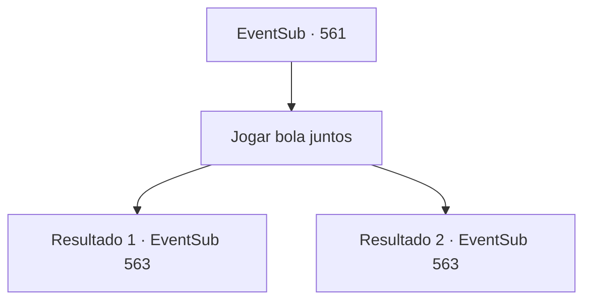

# Eventos secundários · 561

[Índice da tabela](index.md) · [Índice geral](../index.md)

ID: `pt:EventSub:561` · Fonte: `EventSub4` · Versão: 1.2.47.

Mapeamento estático dos arquivos; a disponibilidade e a execução dependem do estado da run.

## Texto do evento

*Sem texto no arquivo.*

## Dados de entrada

```json
{
  "id": 561,
  "grade": 1,
  "subEvent": "",
  "required": ""
}
```

## Mapa das escolhas



## Escolhas e resultados

### Escolha 1

Jogar bola juntos

Requisitos e outros campos da escolha:

```json
{
  "required": ""
}
```

#### Resultado 1.1

Você joga bola com as crianças no beco. As crianças são bastante rápidas, mas não são rivais para você. 

 "Ofegante... Ofegante... Você é incrível...!"

 Você pergunta mais uma vez para as crianças cansadas onde fica a casa de Ushuf. Eles apontam para a mansão azul na margem. Lá você pode ver uma casa decorada com azulejos azuis. Azulejos com padrões coloridos e complexos cobrem todo o prédio, e há uma cúpula dourada no topo. 

 "Lá. É aquela casa azul! Ouvi dizer que é muito, muito rica!"

 Enquanto conversa com as crianças, Tess entra no beco procurando por você. Você diz a Tess onde fica a casa de Ushuf. Ele parece encantado. 

 "Oh! Ok, vamos lá!"

 Tess segue na frente e vocês vão em direção à casa de Ushuf.

Continuação registrada: [Evento 563](0563.md) na mesma tabela.

```json
{
  "required": "",
  "chance": "1|0_6_1",
  "nextEvent": 563,
  "type": 0,
  "reward": "0_3_1"
}
```

#### Resultado 1.2

Você está jogando bola com as crianças no beco. As crianças correm em círculos ao seu redor porque são bem rápidas. 

 "Hahaha! Por que você é tão lento?"

 Enquanto você joga com as crianças, Tess entra no beco, procurando por você. Há sangue em sua luva. 

 "Ugh... Descobri. Ouvi dizer que a mansão azul ali é a casa do Ushuf. Mas o que você está fazendo aqui? Brincando com uma bola?"

 Tess estala a língua e continua. 

 "Tsk, aqui você está brincando enquanto eu discutia com aqueles idiotas. Tudo bem... Apenas se apresse e vamos embora antes que seja tarde demais."

 Tess segue na frente e vocês vão em direção à casa de Ushuf.

Continuação registrada: [Evento 563](0563.md) na mesma tabela.

```json
{
  "required": "",
  "chance": "10",
  "nextEvent": 563,
  "type": 1,
  "reward": "0_3_1"
}
```

## Referências que chegam a este evento

- [Evento 557 · escolha 3 · resultado 2](0557.md#escolha-3)
