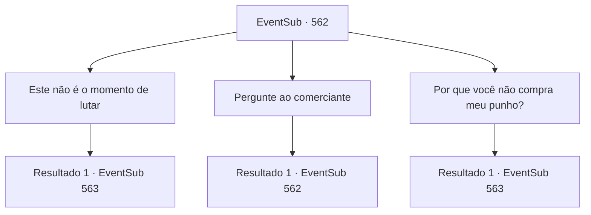

# Eventos secundários · 562

[Índice da tabela](index.md) · [Índice geral](../index.md)

ID: `pt:EventSub:562` · Fonte: `EventSub4` · Versão: 1.2.47.

Mapeamento estático dos arquivos; a disponibilidade e a execução dependem do estado da run.

## Texto do evento

*Sem texto no arquivo.*

## Dados de entrada

```json
{
  "id": 562,
  "grade": 1,
  "subEvent": "",
  "required": ""
}
```

## Mapa das escolhas



## Escolhas e resultados

### Escolha 1

Este não é o momento de lutar

Requisitos e outros campos da escolha:

```json
{
  "required": "1_3_0"
}
```

#### Resultado 1.1

Tranquilize-se, Tess. Enquanto você fala, ele concorda. 

 "...sim, você está certa. Preciso encontrar Sartha. Uma quantia tão pequena de dinheiro não importa. Está tão quente que me empolguei."

 Tess respira fundo e se acalma. 

 "Uau... Ushuf está lá na mansão azul. Vamos."

 Você olha para onde Tess está apontando. Lá você pode ver uma casa decorada com azulejos azuis. Azulejos com padrões coloridos e complexos cobrem todo o prédio, e há uma cúpula dourada no topo. Tess vai na frente e você segue em direção à casa de Ushuf.

Continuação registrada: [Evento 563](0563.md) na mesma tabela.

```json
{
  "required": "",
  "chance": "1",
  "nextEvent": 563,
  "type": 2,
  "reward": ""
}
```

### Escolha 2

Pergunte ao comerciante

Requisitos e outros campos da escolha:

```json
{
  "required": "5_472_0"
}
```

#### Resultado 2.1

Visitas ao comerciante que cobrou a mais de Tess e o questiona. Ele simplesmente dá de ombros. 

 "Eu não te dei a informação que você queria? Eu sei que foi um pouco caro, mas não posso te dar um reembolso."


Continuação registrada: [Evento 562](0562.md) na mesma tabela.

```json
{
  "required": "",
  "chance": "1",
  "nextEvent": 562,
  "type": 2,
  "reward": "5_472_1"
}
```

### Escolha 3

Por que você não compra meu punho?

Requisitos e outros campos da escolha:

```json
{
  "required": "2_3_0|5_472_1"
}
```

#### Resultado 3.1

Você vende seu punho ao comerciante. Ao testar o poder do seu golpe, o comerciante oferece devolver os 50 de ouro. 

 "Alto...! Foi minha culpa."

 Tess está sorrindo. 

 "Ha ha! Você está em chamas! Me sinto aliviada. Obrigada. Você pode ficar com esse ouro. Ushuf mora naquela mansão azul ali. Vamos."

 Você olha na direção em que Tess está apontando. Lá você pode ver uma casa decorada com azulejos azuis. Azulejos com padrões coloridos e complexos cobrem todo o prédio, e há uma cúpula dourada no topo. Tess vai na frente e você segue em direção à casa de Ushuf.

Continuação registrada: [Evento 563](0563.md) na mesma tabela.

```json
{
  "required": "",
  "chance": "1",
  "nextEvent": 563,
  "type": 2,
  "reward": "0_4_50|0_3_-3"
}
```

## Referências que chegam a este evento

- [Evento 557 · escolha 3 · resultado 1](0557.md#escolha-3)
- [Evento 558 · escolha 3 · resultado 3](0558.md#escolha-3)
- [Evento 558 · escolha 3 · resultado 4](0558.md#escolha-3)
- [Evento 559 · escolha 1 · resultado 2](0559.md#escolha-1)
- [Evento 560 · escolha 1 · resultado 2](0560.md#escolha-1)
- [Evento 560 · escolha 2 · resultado 1](0560.md#escolha-2)
- [Evento 562 · escolha 2 · resultado 1](0562.md#escolha-2)
