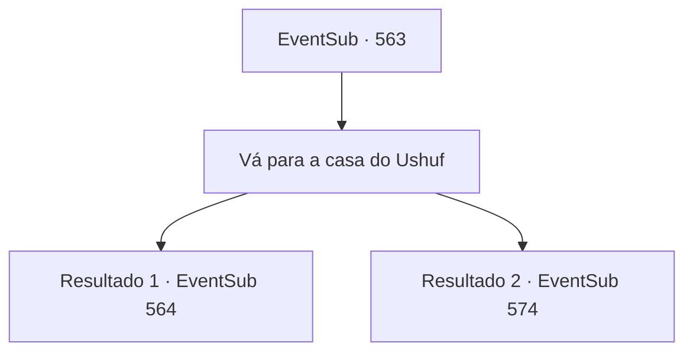

# Eventos secundários · 563

[Índice da tabela](index.md) · [Índice geral](../index.md)

ID: `pt:EventSub:563` · Fonte: `EventSub4` · Versão: 1.2.47.

Mapeamento estático dos arquivos; a disponibilidade e a execução dependem do estado da run.

## Texto do evento

*Sem texto no arquivo.*

## Dados de entrada

```json
{
  "id": 563,
  "grade": 1,
  "subEvent": "",
  "required": ""
}
```

## Mapa das escolhas



## Escolhas e resultados

### Escolha 1

Vá para a casa do Ushuf

Requisitos e outros campos da escolha:

```json
{
  "required": ""
}
```

#### Resultado 1.1

Você está em frente à casa de Ushuf. A espaçosa mansão tem um belo jardim de grama e um lago onde flutuam flores de lótus. E há um elefante bebendo água com sua tromba. 

 "Quem é você? O que te traz aqui?"

 Um dos guardas pergunta educadamente. Tess o olha e responde. 

 "Minha filha Sartha foi vendida aqui. Estou aqui para resgatá-la."

 Diante dessa resposta, o guarda não se afasta e permite que você passe. Em vez disso, ele aponta a ponta de sua lança para você. 

 "Não posso permitir que você conheça Ushuf então. Vá embora!"


Continuação registrada: [Evento 564](0564.md) na mesma tabela.

```json
{
  "required": "5_470_1",
  "chance": "1",
  "nextEvent": 564,
  "type": 2,
  "reward": ""
}
```

#### Resultado 1.2

Você está em frente à casa de Ushuf. A espaçosa mansão tem um belo jardim de grama e um lago onde flutuam flores de lótus. E há um elefante bebendo água com sua tromba. 

 "Oh, você não é Dowd? O que te traz aqui?"

 O porteiro reconhece Dowd e o comerciante o cumprimenta cortesmente. Tenho algo para dizer a Ushuf. Posso responder pelos dois que estão ao meu lado. A pedido de Dowd, o porteiro abre a porta. E te guia até Ushuf. |drawing_Ushuf| Ushuf é um idoso de pele bronzeada e uma longa barba branca. Veste roupas feitas de seda verde e um grande turbante. Bem, é Dowd. E quem te acompanha...? Sente-se. Vamos tomar uma xícara de chá. No entanto, Tess parece não ter intenção de beber chá tranquilamente. Ela se aproxima de Ushuf e começa a gritar. Sou Radan Tess, Conde de Radania. Estou aqui para encontrar minha filha Sartha. O idoso se levanta rapidamente. Dowd se adianta, impedindo Tess. Espera. Deixe isso comigo.

Continuação registrada: [Evento 574](0574.md) na mesma tabela.

```json
{
  "required": "18_470_1",
  "chance": "1",
  "nextEvent": 574,
  "type": 2,
  "reward": ""
}
```

## Referências que chegam a este evento

- [Evento 556 · escolha 1 · resultado 2](0556.md#escolha-1)
- [Evento 557 · escolha 2 · resultado 1](0557.md#escolha-2)
- [Evento 558 · escolha 3 · resultado 1](0558.md#escolha-3)
- [Evento 558 · escolha 3 · resultado 2](0558.md#escolha-3)
- [Evento 559 · escolha 1 · resultado 1](0559.md#escolha-1)
- [Evento 560 · escolha 1 · resultado 1](0560.md#escolha-1)
- [Evento 560 · escolha 2 · resultado 2](0560.md#escolha-2)
- [Evento 561 · escolha 1 · resultado 1](0561.md#escolha-1)
- [Evento 561 · escolha 1 · resultado 2](0561.md#escolha-1)
- [Evento 562 · escolha 1 · resultado 1](0562.md#escolha-1)
- [Evento 562 · escolha 3 · resultado 1](0562.md#escolha-3)
