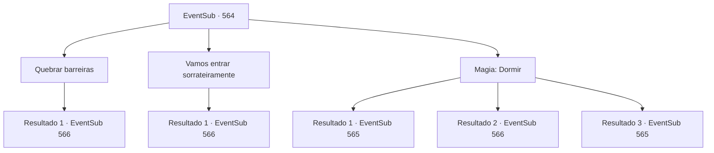

# Eventos secundários · 564

[Índice da tabela](index.md) · [Índice geral](../index.md)

ID: `pt:EventSub:564` · Fonte: `EventSub4` · Versão: 1.2.47.

Mapeamento estático dos arquivos; a disponibilidade e a execução dependem do estado da run.

## Texto do evento

*Sem texto no arquivo.*

## Dados de entrada

```json
{
  "id": 564,
  "grade": 1,
  "subEvent": "",
  "required": ""
}
```

## Mapa das escolhas



## Escolhas e resultados

### Escolha 1

Quebrar barreiras

Requisitos e outros campos da escolha:

```json
{
  "required": ""
}
```

#### Resultado 1.1

Imediatamente você ataca um dos guardiões da porta, e Tess destrói a porta com sua manopla. Com um estrondo, a grade da frente é esmagada e cai de suas dobradiças. O elefante surpreso trombeta e foge. 

 "Argh! Emergência! É um intruso!"

 Diante do grito do guardião, os soldados saem correndo da casa.

Continuação registrada: [Evento 566](0566.md) na mesma tabela.

```json
{
  "required": "",
  "chance": "1",
  "nextEvent": 566,
  "type": 2,
  "reward": "6_3_90",
  "place": 10
}
```

### Escolha 2

Vamos entrar sorrateiramente

Requisitos e outros campos da escolha:

```json
{
  "required": ""
}
```

#### Resultado 2.1

Você afasta Tess para longe do alcance auditivo dos guardiões. Você sugere entrar furtivamente depois do pôr do sol. No entanto, Tess não concorda com você. 

 "Eu não vou ficar aqui por horas. Enquanto esperamos, eles podem mover Sartha para outro lugar."

 Ela se aproxima da porta novamente com uma expressão decidida em seu rosto. E bate na porta com sua luva maciça. Com um estrondo, a grade da frente se esmaga e cai de suas dobradiças. O elefante surpreso trombeta e foge. 

 "Argh! Emergência! É um intruso!"

 Diante do grito do guardião, os soldados saem correndo da casa.

Continuação registrada: [Evento 566](0566.md) na mesma tabela.

```json
{
  "required": "",
  "chance": "1",
  "nextEvent": 566,
  "type": 2,
  "reward": "6_3_90",
  "place": 10
}
```

### Escolha 3

Magia: Dormir

Requisitos e outros campos da escolha:

```json
{
  "required": "20_0_2|1_1_2"
}
```

#### Resultado 3.1

Você lança cuidadosamente o feitiço. Os guardiões não conseguem resistir ao sono repentino e afundam no chão. 

 "Uau... Você sempre foi tão talentoso?"

 Tess procura no bolso do guardião adormecido e tira a chave da porta. Os dois caminham pelo jardim, passando pelo lago e pelo elefante, e chegam à entrada da mansão. Você passa pelo véu feito de seda que pendura sobre a porta. Há muitos corredores diferentes que se afastam do saguão principal. 

 "Hmm... Vai levar um tempo para encontrá-lo. Comece pela direita..."

 Antes que Tess termine de falar, você vê uma mulher descendo pela escada central. Ela está vestida com tecido laranja e segura uma xícara de chá em uma bandeja. Ela olha nervosamente entre você e Tess. Tess se dirige a ela e fala em voz alta. 

 "Ei, eu sou Radan Tess, Conde de Radania. Leve-me imediatamente para Ushuf!"

 Ela assente com a cabeça. 

 "Oh... sim, por favor, sigam-me."

 Ela os guia até um estúdio no segundo andar. Quando ela bate na luxuosa porta de madeira, ela se abre completamente.

Continuação registrada: [Evento 565](0565.md) na mesma tabela.

```json
{
  "required": "21_0_4",
  "chance": "1|0_7_1|0_12_1",
  "nextEvent": 565,
  "type": 0,
  "reward": "0_1_-1"
}
```

#### Resultado 3.2

Você lança cuidadosamente o feitiço. Um dos guardiões adormece, mas o outro não. 

 "O que você está fazendo?!"

 Tess ignora sua pergunta e bate na porta com sua luva massiva. Com um estrondo, a grade da frente se esmaga e cai de suas dobradiças. O elefante surpreso trombeta e foge. 

 "Argh! Emergência! É um intruso!"

 Ao ouvir o grito do guardião, os soldados saem correndo da casa.

Continuação registrada: [Evento 566](0566.md) na mesma tabela.

```json
{
  "required": "21_0_4",
  "chance": "22",
  "nextEvent": 566,
  "type": 1,
  "reward": "6_3_90|0_1_-1",
  "place": 10
}
```

#### Resultado 3.3

Você lança cuidadosamente o feitiço. Os guardiões não conseguem resistir ao sono repentino e afundam no chão. 

 "Uau... Você sempre foi tão talentoso?"

 Tess procura no bolso do guardião adormecido e tira a chave da porta. Os dois caminham pelo jardim, passando pelo lago e pelo elefante, e chegam à entrada da mansão. Você passa pelo véu feito de seda que pendura sobre a porta. Há muitos corredores diferentes que se afastam do saguão principal. 

 "Hmm... Vai levar um tempo para encontrá-lo. Comece pela direita..."

 Antes que Tess termine de falar, você vê uma mulher descendo pela escada central. Ela está vestida com tecido laranja e segura uma xícara de chá em uma bandeja. Ela olha nervosamente entre você e Tess. Tess se dirige a ela e fala em voz alta. 

 "Ei, eu sou Radan Tess, Conde de Radania. Leve-me imediatamente para Ushuf!"

 Ela assente com a cabeça. 

 "Oh... sim, por favor, sigam-me."

 Ela os guia até um estúdio no segundo andar. Quando ela bate na luxuosa porta de madeira, ela se abre completamente.

Continuação registrada: [Evento 565](0565.md) na mesma tabela.

```json
{
  "required": "20_0_4",
  "chance": "1",
  "nextEvent": 565,
  "type": 0,
  "reward": "0_1_-1"
}
```

## Referências que chegam a este evento

- [Evento 563 · escolha 1 · resultado 1](0563.md#escolha-1)
