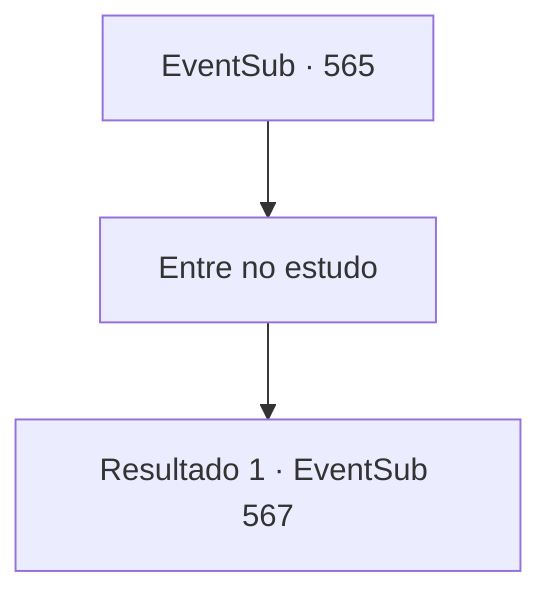

# Eventos secundários · 565

[Índice da tabela](index.md) · [Índice geral](../index.md)

ID: `pt:EventSub:565` · Fonte: `EventSub4` · Versão: 1.2.47.

Mapeamento estático dos arquivos; a disponibilidade e a execução dependem do estado da run.

## Texto do evento

*Sem texto no arquivo.*

## Dados de entrada

```json
{
  "id": 565,
  "grade": 1,
  "subEvent": "",
  "required": ""
}
```

## Mapa das escolhas



## Escolhas e resultados

### Escolha 1

Entre no estudo

Requisitos e outros campos da escolha:

```json
{
  "required": ""
}
```

#### Resultado 1.1

Você entra no estúdio com Tess. As paredes estão revestidas com prateleiras feitas de madeira preta. Um velho está reclinado em um sofá luxuoso feito de pele de ovelha, com um servo ao seu lado como decoração. |drawing_Ushuf| Ushuf é um velho de pele bronzeada e uma longa barba branca. Ele veste roupas feitas de seda verde e um grande turbante. 

 "...quem é você?"

 Tess se sente em casa e se senta em uma cadeira em frente a Ushuf. 

 "Eu sou Radan Tess, Conde de Radania. Estou aqui para encontrar minha filha Sartha."

 O velho se levanta. 

 "Radania... Conde de Radania... Você veio de longe. Mas eu a comprei por um preço justo. Não posso simplesmente entregá-la."

 As veias na testa de Tess se incham. 

 "O quê? Você... não pode me dar minha filha?"


Continuação registrada: [Evento 567](0567.md) na mesma tabela.

```json
{
  "required": "",
  "chance": "1",
  "nextEvent": 567,
  "type": 2,
  "reward": ""
}
```

## Referências que chegam a este evento

- [Evento 564 · escolha 3 · resultado 1](0564.md#escolha-3)
- [Evento 564 · escolha 3 · resultado 3](0564.md#escolha-3)
- [Evento 566 · escolha 1 · resultado 1](0566.md#escolha-1)
