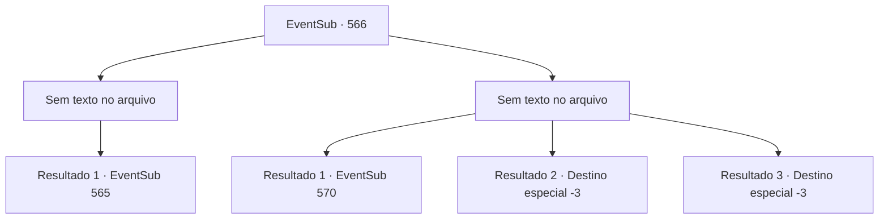

# Eventos secundários · 566

[Índice da tabela](index.md) · [Índice geral](../index.md)

ID: `pt:EventSub:566` · Fonte: `EventSub4` · Versão: 1.2.47.

Mapeamento estático dos arquivos; a disponibilidade e a execução dependem do estado da run.

## Texto do evento

*Sem texto no arquivo.*

## Dados de entrada

```json
{
  "id": 566,
  "grade": 1,
  "subEvent": "",
  "required": ""
}
```

## Mapa das escolhas



## Escolhas e resultados

### Escolha 1

*Sem texto no arquivo; o papel dessa opção depende da interface do jogo.*

Requisitos e outros campos da escolha:

```json
{
  "required": ""
}
```

#### Resultado 1.1

Você e Tess caminham entre os guardas caídos e chegam à entrada principal da mansão. Vocês passam pelo véu feito de seda que pendura sobre a porta. Há muitos corredores diferentes que se afastam do vestíbulo principal. 

 "Hmm... Vai levar um tempo para encontrá-lo. Comece pela direita..."

 Antes que Tess termine de falar, uma das portas se abre e uma mulher vestida com tecido laranja aparece. Ela olha para você e Tess e cai no chão, gritando. Tess olha para sua luva e a esfrega em suas calças para limpar o sangue. 

 "Hmm... Ei. Eu sou Radan Tess, Conde de Radania. Me diga onde está Ushuf. Então não vou te machucar."

 Ela treme e aponta com o dedo para uma porta no segundo andar. 

 "Ele... o mestre está lá... no estúdio..."


Continuação registrada: [Evento 565](0565.md) na mesma tabela.

```json
{
  "required": "",
  "chance": "1",
  "nextEvent": 565,
  "type": 2,
  "reward": ""
}
```

### Escolha 2

*Sem texto no arquivo; o papel dessa opção depende da interface do jogo.*

Requisitos e outros campos da escolha:

```json
{
  "required": ""
}
```

#### Resultado 2.1

Os guardas de Ushuf são superiores a você. Eles te acorrentam a você e a Tess e te lançam através do véu de seda que cobre a entrada da mansão e em direção ao salão central. 

 "Do que se trata toda essa confusão?"

 Um ancião desce pela escadaria central. |drawing_Ushuf| Ushuf é um ancião de pele bronzeada e uma longa barba branca. Ele veste roupas feitas de seda verde e um grande turbante. 

 "...quem são eles?"

 Tess grita em resposta. 

 "Eu sou Radan Tess, Conde de Radania. Estou aqui para recuperar minha filha Sartha!"

 O ancião olha para Tess por um momento e continua. 

 "Radania... Conde de Radania... Você veio de longe. Mas eu a comprei por um preço justo. Não posso simplesmente entregá-la."

 As veias da testa de Tess se incham. 

 "O quê? Você não pode me dar minha filha?"

 Ushuf sorri olhando para ele. 

 "Claro que não. Você não pode simplesmente levá-la."


Continuação registrada: [Evento 570](0570.md) na mesma tabela.

```json
{
  "required": "1_0_2|1_1_2",
  "chance": "1",
  "nextEvent": 570,
  "type": 2,
  "reward": "0_1_-1|0_0_-1"
}
```

#### Resultado 2.2

A lança do guarda se crava em seu pescoço. Você cai no chão imediatamente. 'Uf...' Você até consegue ouvir o som do sangue escapando de você. Então sua visão escurece.

Continuação registrada: [Destino especial `-3`](../destinos-especiais.md).

```json
{
  "required": "2_0_2",
  "chance": "1",
  "nextEvent": -3,
  "type": 2,
  "reward": "0_1_-1|0_0_-1"
}
```

#### Resultado 2.3

A lança do guarda se crava em seu pescoço. Você cai no chão imediatamente. 'Uf...' Você até consegue ouvir o som do sangue escapando de você. Então sua visão escurece.

Continuação registrada: [Destino especial `-3`](../destinos-especiais.md).

```json
{
  "required": "2_1_2",
  "chance": "1",
  "nextEvent": -3,
  "type": 2,
  "reward": "0_1_-1|0_0_-1"
}
```

## Referências que chegam a este evento

- [Evento 564 · escolha 1 · resultado 1](0564.md#escolha-1)
- [Evento 564 · escolha 2 · resultado 1](0564.md#escolha-2)
- [Evento 564 · escolha 3 · resultado 2](0564.md#escolha-3)
