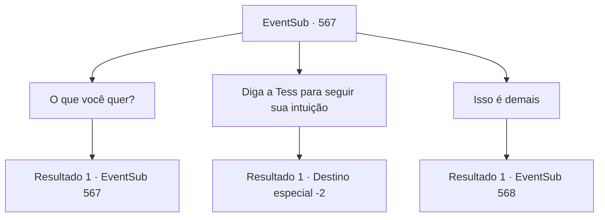

# Eventos secundários · 567

[Índice da tabela](index.md) · [Índice geral](../index.md)

ID: `pt:EventSub:567` · Fonte: `EventSub4` · Versão: 1.2.47.

Mapeamento estático dos arquivos; a disponibilidade e a execução dependem do estado da run.

## Texto do evento

*Sem texto no arquivo.*

## Dados de entrada

```json
{
  "id": 567,
  "grade": 1,
  "subEvent": "",
  "required": ""
}
```

## Mapa das escolhas



## Escolhas e resultados

### Escolha 1

O que você quer?

Requisitos e outros campos da escolha:

```json
{
  "required": "5_509_0"
}
```

#### Resultado 1.1

Você pergunta a Ushuf o que ele quer. 

 "Bem, você entende o que estou dizendo. Primeiro, vamos garantir que ela esteja em boas condições."

 Ushuf ordena ao servo ao seu lado que traga Sartha. Quando Sartha entra na sala, ela parece ainda melhor do que quando você a conheceu pela primeira vez. No entanto, seu rosto está sem expressão, apesar de finalmente ter se reunido com seu pai. Tess percebe imediatamente que algo está errado e se levanta de sua cadeira. 

 "O que você fez com minha filha?"

 Ushuf responde calmamente, como se não fosse nada. 

 "Ela estava tão triste que a ajudei a controlar suas emoções. Apenas me pague tanto quanto investi nela. Seu preço inicial, a comida que ela comeu e o alojamento que lhe dei. Então você pode levá-la."

 Ele entrega a Tess um pergaminho com o preço escrito nele. O rosto de Tess fica vermelho quando ela vê. O pergaminho diz 15.000 de ouro. 

 "A medicação para devolver seus sentimentos normais custará 2.000 de ouro. Aliás, sou o único que pode fazer essa medicação, então solte o punho."

 Ushuf fala habilmente enquanto dá uma olhada na manopla de Tess.

Continuação registrada: [Evento 567](0567.md) na mesma tabela.

```json
{
  "required": "",
  "chance": "1",
  "nextEvent": 567,
  "type": 2,
  "reward": "5_509_1"
}
```

### Escolha 2

Diga a Tess para seguir sua intuição

Requisitos e outros campos da escolha:

```json
{
  "required": "5_509_1"
}
```

#### Resultado 2.1

Você sussurra no ouvido de Tess e o encoraja a fazer o que ele acredita ser correto. Diante desse estímulo, Tess sacode o punho e acerta Ushuf. A luva gigante faz o idoso voar junto com o sofá. O corpo de Ushuf desmorona. Não respinga nem uma gota de sangue. 

 "O que é isso? É... uma boneca."

 Tess olha para ele com uma expressão atônita. O que você pensava ser Ushuf, na verdade, é uma boneca finamente elaborada. 

 "De qualquer forma, vamos nos apressar e sair daqui. Deve haver outras maneiras de consertar Sartha sem depender desse maldito idoso."

 Você e Tess levam Sartha para fora da mansão de Ushuf. 

 "Obrigado pela sua ajuda."

 Tess agradece a você, parecendo angustiado. Em seguida, ele pega Sartha e vai embora.

Continuação registrada: [Destino especial `-2`](../destinos-especiais.md).

```json
{
  "required": "",
  "chance": "1",
  "nextEvent": -2,
  "type": 2,
  "reward": "12_9_-1|14_9_7"
}
```

### Escolha 3

Isso é demais

Requisitos e outros campos da escolha:

```json
{
  "required": "5_509_1"
}
```

#### Resultado 3.1

Quando você aponta o quão absurdo é o preço, Tess concorda. 

 "Claro, é uma quantia incrível de dinheiro!"

 Ushuf responde com um sorriso. 

 "Se é muito para pagar agora, que tal isso?"

 Ele pede a Tess que entregue os direitos de exploração das minas de Radania pelos próximos cinco anos em troca de Sartha. Ushuf escreve os detalhes do contrato em um pergaminho e entrega a Tess.

Continuação registrada: [Evento 568](0568.md) na mesma tabela.

```json
{
  "required": "",
  "chance": "1",
  "nextEvent": 568,
  "type": 2,
  "reward": ""
}
```

## Referências que chegam a este evento

- [Evento 565 · escolha 1 · resultado 1](0565.md#escolha-1)
- [Evento 567 · escolha 1 · resultado 1](0567.md#escolha-1)
