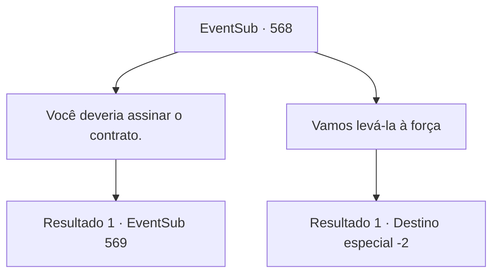

# Eventos secundários · 568

[Índice da tabela](index.md) · [Índice geral](../index.md)

ID: `pt:EventSub:568` · Fonte: `EventSub4` · Versão: 1.2.47.

Mapeamento estático dos arquivos; a disponibilidade e a execução dependem do estado da run.

## Texto do evento

*Sem texto no arquivo.*

## Dados de entrada

```json
{
  "id": 568,
  "grade": 1,
  "subEvent": "",
  "required": ""
}
```

## Mapa das escolhas



## Escolhas e resultados

### Escolha 1

Você deveria assinar o contrato.

Requisitos e outros campos da escolha:

```json
{
  "required": ""
}
```

#### Resultado 1.1

Tess sits in unbearable silence for a long time, but finally nods resignedly. 

 "...Alright, I'll do it."

 When Tess signs the contract, Ushuf turns to his servant with a satisfied smile. 

 "Now, bring me the medicine."

 The servant leaves the room and returns after a short while. He has a black pill in his hand. 

 "If you give her this medicine, her feelings will return. I'll give you a month's worth of medicine for now. And once a month for the next five years, I'll give you more medicine in exchange for the mineral from the mines of Radania."

 Sartha takes the black pill and immediately starts crying. She jumps into Tess's arms. 

 "Daddy...!"

 You and Tess take Sartha out of Ushuf's mansion. Tess wipes her red eyes and looks at you. 

 "Thank you for your help. So, when are you going to marry my daughter?"


Continuação registrada: [Evento 569](0569.md) na mesma tabela.

```json
{
  "required": "",
  "chance": "1",
  "nextEvent": 569,
  "type": 2,
  "reward": "14_9_13|14_9_1"
}
```

### Escolha 2

Vamos levá-la à força

Requisitos e outros campos da escolha:

```json
{
  "required": ""
}
```

#### Resultado 2.1

Você sussurra no ouvido de Tess e a encoraja a pegar Sartha à força. Diante desse estímulo, Tess agita o punho e acerta Ushuf. A luva gigante faz o idoso voar junto com o sofá. O corpo de Ushuf desmorona. Não respinga nem uma gota de sangue. 

 "O que é isso? É... uma boneca."

 Tess olha para ele com expressão atônita. O que você pensava que era Ushuf, na verdade, é uma boneca finamente elaborada. 

 "De qualquer forma, vamos nos apressar e sair daqui. Deve haver mais maneiras de consertar Sartha do que depender desse maldito idoso."

 Você e Tess levam Sartha para fora da mansão de Ushuf. 

 "Obrigado pela sua ajuda."

 Tess agradece a você, parecendo angustiada. Em seguida, ela pega Sartha e vai embora.

Continuação registrada: [Destino especial `-2`](../destinos-especiais.md).

```json
{
  "required": "",
  "chance": "1",
  "nextEvent": -2,
  "type": 2,
  "reward": "12_9_-1|14_9_1|14_9_7"
}
```

## Referências que chegam a este evento

- [Evento 567 · escolha 3 · resultado 1](0567.md#escolha-3)
- [Evento 574 · escolha 2 · resultado 1](0574.md#escolha-2)
