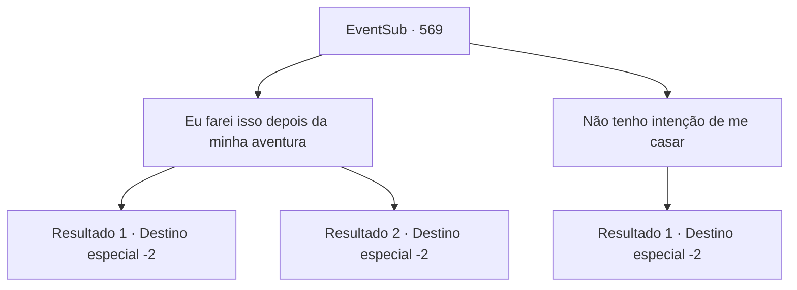

# Eventos secundários · 569

[Índice da tabela](index.md) · [Índice geral](../index.md)

ID: `pt:EventSub:569` · Fonte: `EventSub4` · Versão: 1.2.47.

Mapeamento estático dos arquivos; a disponibilidade e a execução dependem do estado da run.

## Texto do evento

*Sem texto no arquivo.*

## Dados de entrada

```json
{
  "id": 569,
  "grade": 1,
  "subEvent": "",
  "required": ""
}
```

## Mapa das escolhas



## Escolhas e resultados

### Escolha 1

Eu farei isso depois da minha aventura

Requisitos e outros campos da escolha:

```json
{
  "required": "24_1_1"
}
```

#### Resultado 1.1

Você diz que vai terminar sua aventura atual e depois se casar com Sartha. Sartha fica corada e sorri timidamente. Tess tira a manopla e te entrega. 

 "Esta arma é uma extensão de mim mesmo. Meu pai a fez para mim. Se você olhar dentro, há um lugar para colocar seus dedos. Sim, sim, ali."

 Você coloca a manopla na mão e mexe os dedos. A manopla gigante segue seus movimentos. 

 "Volte inteiro. Estaremos preparando o casamento."

 Você se despede de Sartha e Tess e seguem caminhos separados.

Continuação registrada: [Destino especial `-2`](../destinos-especiais.md).

```json
{
  "required": "18_976_1",
  "chance": "1",
  "nextEvent": -2,
  "type": 2,
  "reward": "12_9_-1|3_253_1|14_9_6|5_462_1"
}
```

#### Resultado 1.2

Você diz que vai terminar sua aventura atual e depois se casar com Sartha. Sartha fica corada e sorri timidamente. Tess tira a manopla e te entrega. 

 "Esta arma é uma extensão de mim mesmo. Meu pai a fez para mim. Se você olhar dentro, há um lugar para colocar seus dedos. Sim, sim, ali."

 Você coloca a manopla na mão e mexe os dedos. A manopla gigante segue seus movimentos. 

 "Volte inteiro. Estaremos preparando o casamento."

 Você se despede de Sartha e Tess e seguem caminhos separados.

Continuação registrada: [Destino especial `-2`](../destinos-especiais.md).

```json
{
  "required": "5_976_1",
  "chance": "1",
  "nextEvent": -2,
  "type": 2,
  "reward": "12_9_-1|3_253_1|14_9_17|5_462_1"
}
```

### Escolha 2

Não tenho intenção de me casar

Requisitos e outros campos da escolha:

```json
{
  "required": ""
}
```

#### Resultado 2.1

Sartha parece impactado com a sua resposta. Em seguida, Tess concorda como se tivesse percebido algo. 

 "Entendi. Você... Você deve gostar de homens. Não tinha pensado nisso."

 Tess tira a luva e te entrega. 

 "Essa arma é uma extensão de mim mesma. Meu pai a fez para mim. Se olhar dentro, há um lugar para colocar seus dedos. Sim, sim, ali."

 Você coloca a luva na mão e move os dedos. A luva gigante acompanha seus movimentos. 

 "Por favor, cuide bem dela. Considere como um presente de agradecimento. Adeus!"

 Sartha também te agradece. 

 "Obrigado por me salvar. Espero te ver novamente. Porque... somos amigos."

 Dito isso, Tess e Sartha vão embora.

Continuação registrada: [Destino especial `-2`](../destinos-especiais.md).

```json
{
  "required": "",
  "chance": "1",
  "nextEvent": -2,
  "type": 2,
  "reward": "12_9_-1|14_9_5|3_253_1|0_4_50"
}
```

## Referências que chegam a este evento

- [Evento 568 · escolha 1 · resultado 1](0568.md#escolha-1)
- [Evento 572 · escolha 1 · resultado 1](0572.md#escolha-1)
