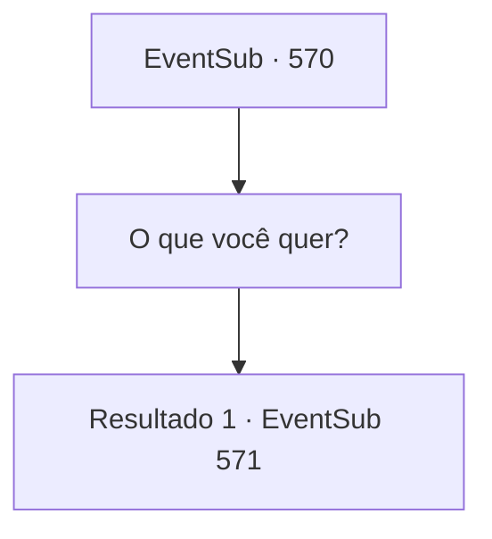

# Eventos secundários · 570

[Índice da tabela](index.md) · [Índice geral](../index.md)

ID: `pt:EventSub:570` · Fonte: `EventSub4` · Versão: 1.2.47.

Mapeamento estático dos arquivos; a disponibilidade e a execução dependem do estado da run.

## Texto do evento

*Sem texto no arquivo.*

## Dados de entrada

```json
{
  "id": 570,
  "grade": 1,
  "subEvent": "",
  "required": ""
}
```

## Mapa das escolhas



## Escolhas e resultados

### Escolha 1

O que você quer?

Requisitos e outros campos da escolha:

```json
{
  "required": "5_509_0"
}
```

#### Resultado 1.1

Você pergunta a Ushuf o que ele quer. 

 "Bem, você entende o que estou dizendo. Primeiro, vamos garantir que ela esteja em boas condições."

 Ushuf ordena ao servo ao seu lado que traga Sartha. Quando Sartha entra na sala, ela parece ainda melhor do que quando você a conheceu pela primeira vez. No entanto, seu rosto está sem expressão, apesar de finalmente ter se reunido com seu pai. Tess percebe imediatamente que algo está errado e se levanta de sua cadeira. 

 "O que você fez com minha filha?"

 Ushuf responde calmamente, como se não fosse nada. 

 "Ela estava tão triste que a ajudei a controlar suas emoções. Apenas me pague tanto quanto investi nela. Seu preço inicial, a comida que ela comeu e o alojamento que lhe dei. Então você pode levá-la."

 Ele entrega a Tess um pergaminho com o preço escrito nele. O rosto de Tess fica vermelho quando ela vê. O pergaminho diz 15.000 de ouro. 

 "A medicação para devolver seus sentimentos normais custará 2.000 de ouro. Aliás, sou o único que pode fazer essa medicação, então solte o punho."

 Ushuf fala habilmente enquanto dá uma olhada na manopla de Tess.

Continuação registrada: [Evento 571](0571.md) na mesma tabela.

```json
{
  "required": "",
  "chance": "1",
  "nextEvent": 571,
  "type": 2,
  "reward": "5_509_1"
}
```

## Referências que chegam a este evento

- [Evento 566 · escolha 2 · resultado 1](0566.md#escolha-2)
