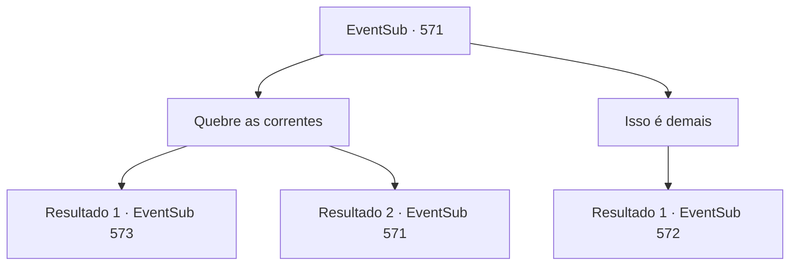

# Eventos secundários · 571

[Índice da tabela](index.md) · [Índice geral](../index.md)

ID: `pt:EventSub:571` · Fonte: `EventSub4` · Versão: 1.2.47.

Mapeamento estático dos arquivos; a disponibilidade e a execução dependem do estado da run.

## Texto do evento

*Sem texto no arquivo.*

## Dados de entrada

```json
{
  "id": 571,
  "grade": 1,
  "subEvent": "",
  "required": ""
}
```

## Mapa das escolhas



## Escolhas e resultados

### Escolha 1

Quebre as correntes

Requisitos e outros campos da escolha:

```json
{
  "required": "5_473_0"
}
```

#### Resultado 1.1

Você quebra as correntes com força. As correntes caem no chão com um baque surdo. Os guardas pegam suas lanças e olham com espanto. 

 "Hmm... Vejo que você não quer fazer um acordo. Dê uma surra neles e depois os expulse."

 Quando Ushuf dá a ordem, os guardas te atacam.

Continuação registrada: [Evento 573](0573.md) na mesma tabela.

```json
{
  "required": "",
  "chance": "1|0_5_1",
  "nextEvent": 573,
  "type": 0,
  "reward": "6_3_90",
  "place": 10
}
```

#### Resultado 1.2

Tentas quebrar as correntes, mas falhas. Ushuf, que tem observado sua luta, fala calmamente. 

 "Haha... Ter muita energia é bom, mas não a desperdice em algo tão insignificante. Se me transformar em seu inimigo, como poderá negociar pela sua filha?"


Continuação registrada: [Evento 571](0571.md) na mesma tabela.

```json
{
  "required": "",
  "chance": "20",
  "nextEvent": 571,
  "type": 1,
  "reward": "5_473_1"
}
```

### Escolha 2

Isso é demais

Requisitos e outros campos da escolha:

```json
{
  "required": ""
}
```

#### Resultado 2.1

Quando você aponta o quão absurdo é o preço, Tess concorda com a cabeça. 

 "É uma quantidade ridícula de dinheiro. Provavelmente poderia comprar outra propriedade!"

 Ushuf responde com um sorriso. 

 "Se é muito para pagar agora, que tal isso?"

 Ele pede a Tess que entregue os direitos de exploração das minas de Radania pelos próximos cinco anos em troca de Sartha. Ushuf escreve os detalhes do contrato em um pergaminho e o entrega a Tess.

Continuação registrada: [Evento 572](0572.md) na mesma tabela.

```json
{
  "required": "",
  "chance": "1",
  "nextEvent": 572,
  "type": 2,
  "reward": ""
}
```

## Referências que chegam a este evento

- [Evento 570 · escolha 1 · resultado 1](0570.md#escolha-1)
- [Evento 571 · escolha 1 · resultado 2](0571.md#escolha-1)
