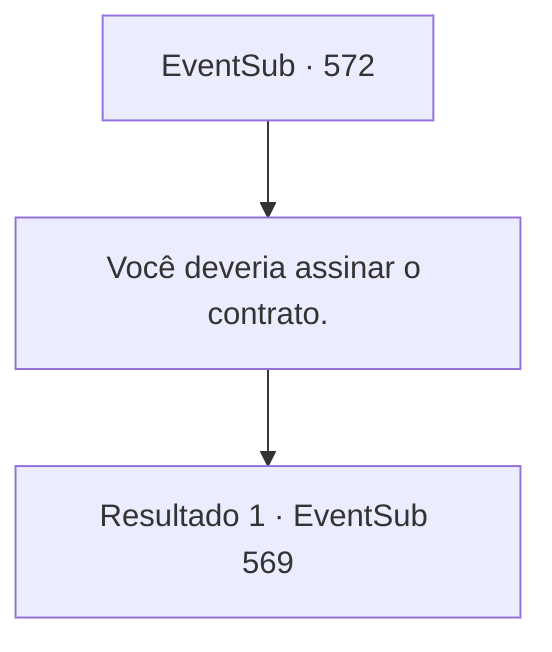

# Eventos secundários · 572

[Índice da tabela](index.md) · [Índice geral](../index.md)

ID: `pt:EventSub:572` · Fonte: `EventSub4` · Versão: 1.2.47.

Mapeamento estático dos arquivos; a disponibilidade e a execução dependem do estado da run.

## Texto do evento

*Sem texto no arquivo.*

## Dados de entrada

```json
{
  "id": 572,
  "grade": 1,
  "subEvent": "",
  "required": ""
}
```

## Mapa das escolhas



## Escolhas e resultados

### Escolha 1

Você deveria assinar o contrato.

Requisitos e outros campos da escolha:

```json
{
  "required": ""
}
```

#### Resultado 1.1

Tess agoniza sobre a decisão por muito tempo, mas finalmente assente resignada. 

 "...Certo, eu farei."

 Quando Tess assina o contrato, Ushuf se dirige ao seu servo com um sorriso satisfeito. 

 "Agora, traga-me o remédio."

 O servo sai do quarto e retorna depois de um curto período. Ele tem um comprimido preto em sua mão. 

 "Se você der esse remédio a ela, seus sentimentos voltarão. Eu lhe darei um mês de remédio por agora. E uma vez por mês pelos próximos cinco anos, eu lhe darei mais remédio em troca do minério das minas de Radania."

 Sartha pega o comprimido preto e começa a chorar imediatamente. Ela pula nos braços de Tess. 

 "Papai...!"

 Você e Tess levam Sartha para fora da mansão de Ushuf. Tess enxuga seus olhos vermelhos e olha para você. 

 "Obrigada por sua ajuda. Então, quando você vai se casar com minha filha?"


Continuação registrada: [Evento 569](0569.md) na mesma tabela.

```json
{
  "required": "",
  "chance": "1",
  "nextEvent": 569,
  "type": 2,
  "reward": ""
}
```

## Referências que chegam a este evento

- [Evento 571 · escolha 2 · resultado 1](0571.md#escolha-2)
