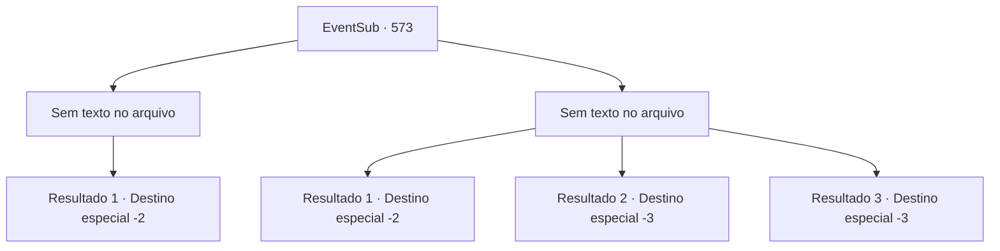

# Eventos secundários · 573

[Índice da tabela](index.md) · [Índice geral](../index.md)

ID: `pt:EventSub:573` · Fonte: `EventSub4` · Versão: 1.2.47.

Mapeamento estático dos arquivos; a disponibilidade e a execução dependem do estado da run.

## Texto do evento

*Sem texto no arquivo.*

## Dados de entrada

```json
{
  "id": 573,
  "grade": 1,
  "subEvent": "",
  "required": ""
}
```

## Mapa das escolhas



## Escolhas e resultados

### Escolha 1

*Sem texto no arquivo; o papel dessa opção depende da interface do jogo.*

Requisitos e outros campos da escolha:

```json
{
  "required": ""
}
```

#### Resultado 1.1

Derrubas os guardas de Ushuf e libertas Tess de suas correntes. Tess gira seu ombro, se aquecendo para um golpe. 

 "Devolve minha filha e talvez eu considere te matar sem dor!"

 Apesar das ameaças de Tess, Ushuf parece surpreendentemente tranquilo. 

 "Eu sou um comerciante. É melhor você me oferecer um acordo se quiser que eu coopere."

 Mas Tess não tem intenção de fazer um acordo com ninguém. Ela golpeia Ushuf com sua manopla. O corpo de Ushuf desmorona. Não respinga nem uma gota de sangue. 

 "O que é isso? É... uma boneca."

 Tess o olha com expressão atônita. O que você pensava que era Ushuf, na verdade, é uma boneca finamente elaborada. 

 "De qualquer forma, vamos nos apressar e sair daqui. Precisamos afastar Sartha daquele maldito velho."

 Você e Tess levam Sartha para fora da mansão de Ushuf. 

 "Obrigado por sua ajuda."

 Tess agradece a você antes de ir embora com sua filha.

Continuação registrada: [Destino especial `-2`](../destinos-especiais.md).

```json
{
  "required": "",
  "chance": "1",
  "nextEvent": -2,
  "type": 2,
  "reward": "12_9_-1|14_9_7|14_9_1"
}
```

### Escolha 2

*Sem texto no arquivo; o papel dessa opção depende da interface do jogo.*

Requisitos e outros campos da escolha:

```json
{
  "required": ""
}
```

#### Resultado 2.1

Uma vez mais, você foi capturado pelos guardas. Eles te golpeiam fortemente na nuca, te deixando inconsciente.  Você não sabe quanto tempo passou. Abre os olhos e se esfrega na parte de trás da cabeça.  Você está nas costas de um camelo.  E o camelo está bebendo água em um oásis em Antitikarr.  Você não sabe o que aconteceu com Tess e sua filha.

Continuação registrada: [Destino especial `-2`](../destinos-especiais.md).

```json
{
  "required": "1_0_2|1_1_2",
  "chance": "1",
  "nextEvent": -2,
  "type": 2,
  "reward": "12_9_-1|14_9_7|0_0_-1|0_1_-1"
}
```

#### Resultado 2.2

A lança do guarda se crava em seu pescoço. Você cai no chão imediatamente. 'Uf...' Você até consegue ouvir o som do sangue escapando de você. Então sua visão escurece.

Continuação registrada: [Destino especial `-3`](../destinos-especiais.md).

```json
{
  "required": "2_0_2",
  "chance": "1",
  "nextEvent": -3,
  "type": 2,
  "reward": "0_1_-1|0_0_-1"
}
```

#### Resultado 2.3

A lança do guarda se crava em seu pescoço. Você cai no chão imediatamente. 'Uf...' Você até consegue ouvir o som do sangue escapando de você. Então sua visão escurece.

Continuação registrada: [Destino especial `-3`](../destinos-especiais.md).

```json
{
  "required": "2_1_2",
  "chance": "1",
  "nextEvent": -3,
  "type": 2,
  "reward": "0_1_-1|0_0_-1"
}
```

## Referências que chegam a este evento

- [Evento 571 · escolha 1 · resultado 1](0571.md#escolha-1)
