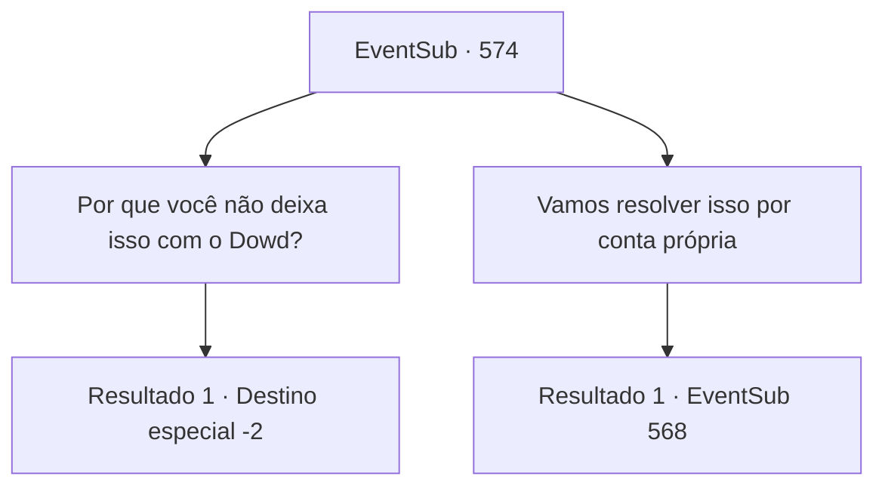

# Eventos secundários · 574

[Índice da tabela](index.md) · [Índice geral](../index.md)

ID: `pt:EventSub:574` · Fonte: `EventSub4` · Versão: 1.2.47.

Mapeamento estático dos arquivos; a disponibilidade e a execução dependem do estado da run.

## Texto do evento

*Sem texto no arquivo.*

## Dados de entrada

```json
{
  "id": 574,
  "grade": 1,
  "subEvent": "",
  "required": ""
}
```

## Mapa das escolhas



## Escolhas e resultados

### Escolha 1

Por que você não deixa isso com o Dowd?

Requisitos e outros campos da escolha:

```json
{
  "required": ""
}
```

#### Resultado 1.1

Tess releases a long sigh and gives in. Dowd goes out to the balcony with Ushuf and they talk for a while. Some time later, he returns. 

 "You just have to wait a little longer. Our negotiation went well and they will soon bring Sartha."

 Just as Dowd promised, Ushuf orders a servant to bring Sartha. As soon as Sartha enters the room, she runs into Tess's arms and cries. 

 "Dad..."

 While the father and daughter have an emotional reunion, Ushuf talks to Dowd. 

 "Here. Take the contract we agreed on."

 You, Tess, and Dowd take Sartha out of the mansion. Tess wipes her red eyes and looks at Dowd. 

 "Thank you. Thank you so much... We're going to Radania. We will proceed with Dowd and Sartha's marriage immediately."

 Dowd seems a little embarrassed. 

 "Oh... I..."

 Tess bursts into laughter and practically drags him away.

Continuação registrada: [Destino especial `-2`](../destinos-especiais.md).

```json
{
  "required": "",
  "chance": "1",
  "nextEvent": -2,
  "type": 2,
  "reward": "12_9_-1|14_9_13|14_9_8"
}
```

### Escolha 2

Vamos resolver isso por conta própria

Requisitos e outros campos da escolha:

```json
{
  "required": ""
}
```

#### Resultado 2.1

Você prende Dowd e deixa Tess fazer o que quiser. Tess grita para Ushuf e exige ver sua filha. 

 "... Você está impaciente. Tudo bem, eu vou te mostrar."

 Ushuf ordena ao servo ao seu lado que traga Sartha. Quando Sartha entra na sala, ela parece ainda melhor do que quando você a conheceu pela primeira vez. No entanto, seu rosto está sem expressão, apesar de finalmente ter se reunido com seu pai. Tess percebe imediatamente que algo está errado e se levanta de sua cadeira. 

 "O que você fez com minha filha?"

 Ushuf responde calmamente, como se não fosse nada. 

 "Ela estava tão triste que eu a ajudei a controlar suas emoções. Apenas me pague tudo o que investi nela. Seu preço inicial, a comida que ela comeu e o alojamento que eu lhe dei. Então você pode levá-la."

 Ele entrega a Tess um pergaminho com o preço escrito. O rosto de Tess fica vermelho quando ela vê. O pergaminho diz 15,000 de ouro. 

 "A medicação para devolver suas emoções normais custará 2.000 de ouro. Aliás, sou o único que pode fazer essa medicação, então solte o punho."

 Ushuf fala habilmente enquanto dá uma olhada na luva de Tess.

Continuação registrada: [Evento 568](0568.md) na mesma tabela.

```json
{
  "required": "",
  "chance": "1",
  "nextEvent": 568,
  "type": 2,
  "reward": ""
}
```

## Referências que chegam a este evento

- [Evento 563 · escolha 1 · resultado 2](0563.md#escolha-1)
