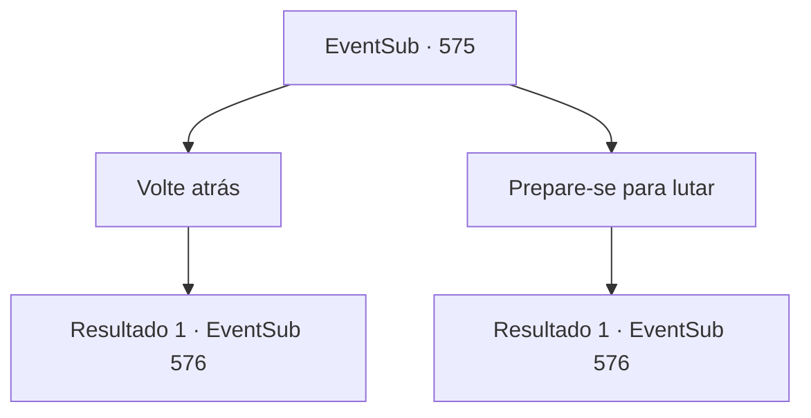

# Eventos secundários · 575

[Índice da tabela](index.md) · [Índice geral](../index.md)

ID: `pt:EventSub:575` · Fonte: `EventSub4` · Versão: 1.2.47.

Mapeamento estático dos arquivos; a disponibilidade e a execução dependem do estado da run.

## Texto do evento

Você está vagando pelas ruas de 'Mavelaine' à noite. Uma cidade localizada nas regiões externas do continente, Mavelaine é uma cidade que parece fria e quieta. Cercas de aço pontiagudas protegem as casas, com tendas rasgadas e esculturas quebradas espalhadas, sem receber nenhum cuidado. Você está fazendo o seu melhor procurando por um lugar para se hospedar, sem sucesso - tudo o que recebe são recusas frias. Mas então, você ouve uma voz desconhecida vindo de trás de você. 

 "Você está... procurando um lugar para descansar?"


## Dados de entrada

```json
{
  "id": 575,
  "grade": 1,
  "subEvent": "",
  "required": "12_10_0"
}
```

## Mapa das escolhas



## Escolhas e resultados

### Escolha 1

Volte atrás

Requisitos e outros campos da escolha:

```json
{
  "required": ""
}
```

#### Resultado 1.1

|drawing_EdenHeart| Você se vira para encarar a fonte da voz. É uma mulher com um par de óculos grossos, usando uma mochila enorme. Você percebe que ela exala um cheiro estranho de ingredientes medicinais. Ela fala em um tom caloroso. 

 "Ahem... se você quiser, eu posso te mostrar um. Meu amigo tem uma mansão."


Continuação registrada: [Evento 576](0576.md) na mesma tabela.

```json
{
  "required": "",
  "chance": "1",
  "nextEvent": 576,
  "type": 2,
  "reward": ""
}
```

### Escolha 2

Prepare-se para lutar

Requisitos e outros campos da escolha:

```json
{
  "required": ""
}
```

#### Resultado 2.1

|drawing_EdenHeart| Você se vira, sem baixar a guarda, para encarar a fonte da voz. É uma mulher com um par de óculos grossos, usando uma mochila enorme. Você percebe que ela exala um cheiro estranho de ingredientes medicinais. 

 "...Oh, eu não quis te machucar! Por favor, eu não sou uma pessoa suspeita de jeito nenhum."

 A mulher limpa a garganta antes de continuar - uma proposta muito inesperada. 

 "Ahem... se você quiser, eu posso te mostrar um. Meu amigo tem uma mansão."


Continuação registrada: [Evento 576](0576.md) na mesma tabela.

```json
{
  "required": "",
  "chance": "1",
  "nextEvent": 576,
  "type": 2,
  "reward": ""
}
```

## Referências que chegam a este evento

Nenhum `nextEvent` positivo da mesma tabela aponta para este nó. Isso não prova que seja inacessível: sorteio e estado de história podem selecioná-lo.

