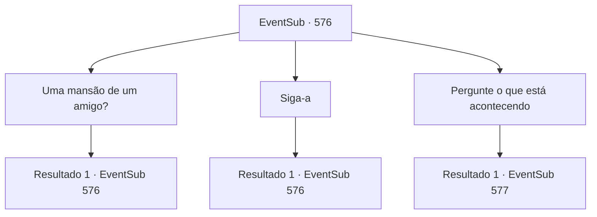

# Eventos secundários · 576

[Índice da tabela](index.md) · [Índice geral](../index.md)

ID: `pt:EventSub:576` · Fonte: `EventSub4` · Versão: 1.2.47.

Mapeamento estático dos arquivos; a disponibilidade e a execução dependem do estado da run.

## Texto do evento

*Sem texto no arquivo.*

## Dados de entrada

```json
{
  "id": 576,
  "grade": 1,
  "subEvent": "",
  "required": ""
}
```

## Mapa das escolhas



## Escolhas e resultados

### Escolha 1

Uma mansão de um amigo?

Requisitos e outros campos da escolha:

```json
{
  "required": "5_586_0"
}
```

#### Resultado 1.1

Ela concorda com a cabeça em resposta, continuando a conversa. 

 "Baron Fheren Hight - é o nome do meu amigo - sempre recebeu aventureiros. Eu não sou a dona da casa, mas... tenho certeza de que ele permitiria felizmente que você ficasse!"

 Ela então se apresenta educadamente, com as mãos no peito. Ela se chama 'Edenheart', uma alquimista.

Continuação registrada: [Evento 576](0576.md) na mesma tabela.

```json
{
  "required": "",
  "chance": "1",
  "nextEvent": 576,
  "type": 2,
  "reward": "5_586_1"
}
```

### Escolha 2

Siga-a

Requisitos e outros campos da escolha:

```json
{
  "required": "5_586_1"
}
```

#### Resultado 2.1

Você se apresenta também e a segue até a mansão de sua amiga. O enorme prédio de telhado cinza está localizado nos arredores da cidade. Edenheart habilmente abre a porta da frente e entra na mansão. 

 "Ah, bem-vinda, Srta. Edenheart. E este é...?"

 Em frente à mansão está uma empregada de meia-idade, aqui para receber os visitantes. Edenheart a apresenta a você e pede que você seja acompanhado até os quartos de hóspedes. Mas então, outra empregada desce correndo das escadas, agarra Edenheart pelas mãos e fala. 

 "Ah, Srta. Edenheart! Um convidado muito bem-vindo! Hora perfeita. A condição do mestre... piorou! Rápido, para o quarto dele!"

 Edenheart e a empregada jovem correm apressadamente para cima, para o segundo andar da mansão. Agora você está sozinho com a empregada de meia-idade. Ela solta um suspiro.

Continuação registrada: [Evento 576](0576.md) na mesma tabela.

```json
{
  "required": "",
  "chance": "1",
  "nextEvent": 576,
  "type": 2,
  "reward": "5_586_2"
}
```

### Escolha 3

Pergunte o que está acontecendo

Requisitos e outros campos da escolha:

```json
{
  "required": "5_586_2"
}
```

#### Resultado 3.1

Você pergunta cuidadosamente à velha empregada o que está acontecendo. Ela hesita um pouco antes de abrir a boca. 

 "Nosso mestre... ele não está com boa saúde, receio."

 De acordo com ela, o mestre sofre de uma doença incurável que enfraqueceu seu corpo desde criança. Apesar de vários esforços médicos, sua condição não mostrou sinais de melhora até agora. 

 "A senhorita Edenheart tem procurado por uma cura... há anos, agora. Parece que não está indo muito bem. Talvez você possa ajudar, aventureiro?"


Continuação registrada: [Evento 577](0577.md) na mesma tabela.

```json
{
  "required": "",
  "chance": "1",
  "nextEvent": 577,
  "type": 2,
  "reward": ""
}
```

## Referências que chegam a este evento

- [Evento 575 · escolha 1 · resultado 1](0575.md#escolha-1)
- [Evento 575 · escolha 2 · resultado 1](0575.md#escolha-2)
- [Evento 576 · escolha 1 · resultado 1](0576.md#escolha-1)
- [Evento 576 · escolha 2 · resultado 1](0576.md#escolha-2)
