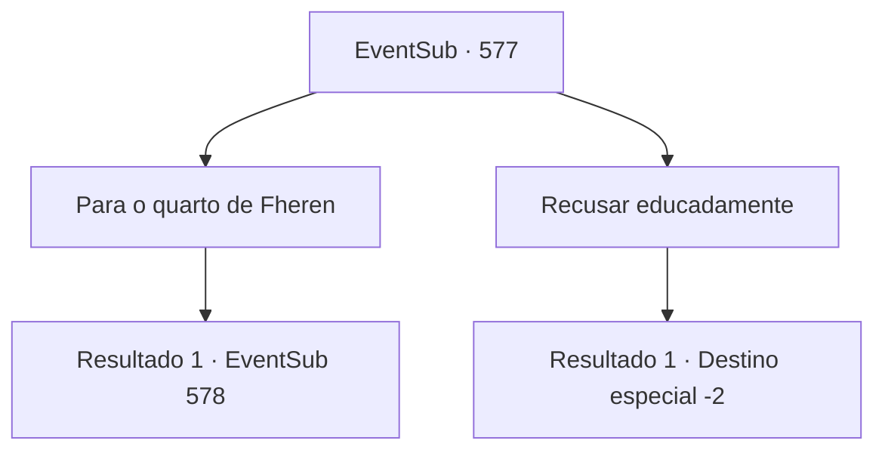

# Eventos secundários · 577

[Índice da tabela](index.md) · [Índice geral](../index.md)

ID: `pt:EventSub:577` · Fonte: `EventSub4` · Versão: 1.2.47.

Mapeamento estático dos arquivos; a disponibilidade e a execução dependem do estado da run.

## Texto do evento

*Sem texto no arquivo.*

## Dados de entrada

```json
{
  "id": 577,
  "grade": 1,
  "subEvent": "",
  "required": ""
}
```

## Mapa das escolhas



## Escolhas e resultados

### Escolha 1

Para o quarto de Fheren

Requisitos e outros campos da escolha:

```json
{
  "required": ""
}
```

#### Resultado 1.1

Você segue a velha empregada até o quarto de Fheren. Localizado no centro da casa, o quarto é adornado com uma grande cama branca. O ocupante da cama é um homem pálido e doente. |drawing_LyingFheren| Isso deve ser Fheren. Ao lado dele está Edenheart, sentada, cuidando de Fheren com uma expressão preocupada no rosto.

Continuação registrada: [Evento 578](0578.md) na mesma tabela.

```json
{
  "required": "",
  "chance": "1",
  "nextEvent": 578,
  "type": 2,
  "reward": ""
}
```

### Escolha 2

Recusar educadamente

Requisitos e outros campos da escolha:

```json
{
  "required": ""
}
```

#### Resultado 2.1

Você educadamente recusa o pedido da velha empregada. 

 "Oh bem. Siga-me. Eu vou te levar para os quartos de hóspedes."

 Você segue a velha empregada até um quarto. É um quarto simples, mas limpo, perfeito para um breve descanso. Você desfaz suas coisas e vai para a cama. Na manhã seguinte, as empregadas, com expressões um tanto tristes, passam pelos quartos de hóspedes, indo para fora da mansão.

Continuação registrada: [Destino especial `-2`](../destinos-especiais.md).

```json
{
  "required": "",
  "chance": "1",
  "nextEvent": -2,
  "type": 2,
  "reward": "0_0_1|0_1_1|12_10_-1"
}
```

## Referências que chegam a este evento

- [Evento 576 · escolha 3 · resultado 1](0576.md#escolha-3)
