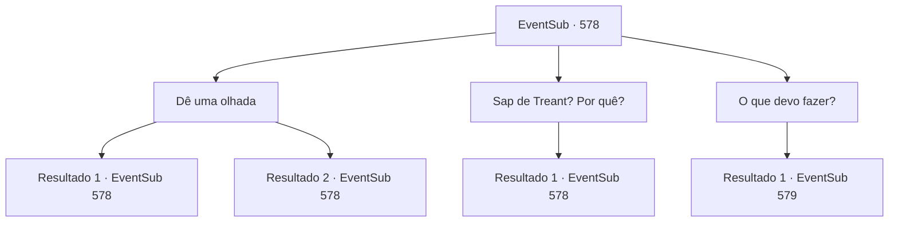

# Eventos secundários · 578

[Índice da tabela](index.md) · [Índice geral](../index.md)

ID: `pt:EventSub:578` · Fonte: `EventSub4` · Versão: 1.2.47.

Mapeamento estático dos arquivos; a disponibilidade e a execução dependem do estado da run.

## Texto do evento

*Sem texto no arquivo.*

## Dados de entrada

```json
{
  "id": 578,
  "grade": 1,
  "subEvent": "",
  "required": ""
}
```

## Mapa das escolhas



## Escolhas e resultados

### Escolha 1

Dê uma olhada

Requisitos e outros campos da escolha:

```json
{
  "required": "5_586_2"
}
```

#### Resultado 1.1

Você se aproxima de Fheren para observar melhor sua condição. Bolsas sob seus olhos, respiração instável, maçãs do rosto quase aparecendo através de sua pele fina - é óbvio que ele não tem muitos dias de vida restantes. Edenheart pergunta cuidadosamente. 

 "Como está, {1}?"

 Você balança lentamente a cabeça em resposta. Edenheart continua, olhando para Fheren com um sentimento de pena em seus olhos. 

 "Posso pedir que você obtenha uma amostra de seiva de treant, {1}...?"


Continuação registrada: [Evento 578](0578.md) na mesma tabela.

```json
{
  "required": "",
  "chance": "1|0_7_1",
  "nextEvent": 578,
  "type": 0,
  "reward": "5_586_3"
}
```

#### Resultado 1.2

Você se aproxima de Fheren para observar melhor sua condição. No entanto, além do fato de que ele parece doente, você não consegue ver muito. Edenheart pergunta cuidadosamente. 

 "Como está, {1}?"

 Você dá de ombros em resposta. Edenheart continua, olhando para Fheren com um olhar de pena nos olhos. 

 "Posso pedir que você obtenha uma amostra de seiva de treant, {1}...?"


Continuação registrada: [Evento 578](0578.md) na mesma tabela.

```json
{
  "required": "",
  "chance": "13",
  "nextEvent": 578,
  "type": 1,
  "reward": "5_586_3"
}
```

### Escolha 2

Sap de Treant? Por quê?

Requisitos e outros campos da escolha:

```json
{
  "required": "5_586_3"
}
```

#### Resultado 2.1

Edenheart explica calmamente. 

 "Não posso curar a doença de Fheren, mas posso prolongar sua vida. Se eu pudesse apenas combinar seiva refinada de treant com raízes secas de ginseng de três patas..."

 De acordo com o alquimista, a seiva de treant irá acalmar Fheren, enquanto o ginseng de três patas irá tratar das erupções, dando-lhe tempo precioso.

Continuação registrada: [Evento 578](0578.md) na mesma tabela.

```json
{
  "required": "",
  "chance": "1",
  "nextEvent": 578,
  "type": 2,
  "reward": "5_586_4"
}
```

### Escolha 3

O que devo fazer?

Requisitos e outros campos da escolha:

```json
{
  "required": "5_586_4"
}
```

#### Resultado 3.1

Você pede a Edenheart por direções. Ela pensa por um momento antes de lhe dar duas opções. Um - comprar a seiva de treant em uma cidade chamada 'Grimdit'. Grimdit é uma cidade localizada a leste de Mavelaine, o primeiro lugar em que um alquimista pensaria ao comprar ingredientes alquímicos como resíduos de monstros ou minerais raros. 

 "Há não muito tempo, a seiva de treant era um item comum lá. Mas algo deve ter acontecido - recentemente, Grimdit cortou todas as exportações de ingredientes medicinais."

 Dois - seguir para 'Monte Hamelrun', localizado perto de Mavelaine. De acordo com ela, tem havido avistamentos de treants vivendo lá. 

 "Caso você escolha ir para o Monte Hamelrun, por favor, certifique-se de obter seiva de treant. Eu peço a você. Provavelmente, os treants vão lhe dar uma garrafa se você pedir educadamente. Embora eu suponha que seria melhor se eu fosse... mas há rumores de bandidos saqueando viajantes nas proximidades..."


Continuação registrada: [Evento 579](0579.md) na mesma tabela.

```json
{
  "required": "",
  "chance": "1",
  "nextEvent": 579,
  "type": 2,
  "reward": ""
}
```

## Referências que chegam a este evento

- [Evento 577 · escolha 1 · resultado 1](0577.md#escolha-1)
- [Evento 578 · escolha 1 · resultado 1](0578.md#escolha-1)
- [Evento 578 · escolha 1 · resultado 2](0578.md#escolha-1)
- [Evento 578 · escolha 2 · resultado 1](0578.md#escolha-2)
