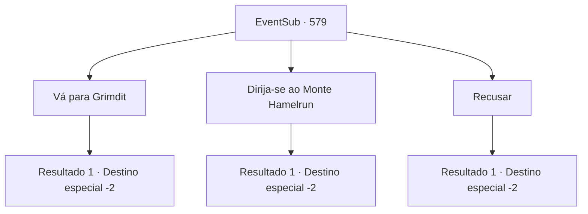

# Eventos secundários · 579

[Índice da tabela](index.md) · [Índice geral](../index.md)

ID: `pt:EventSub:579` · Fonte: `EventSub4` · Versão: 1.2.47.

Mapeamento estático dos arquivos; a disponibilidade e a execução dependem do estado da run.

## Texto do evento

*Sem texto no arquivo.*

## Dados de entrada

```json
{
  "id": 579,
  "grade": 1,
  "subEvent": "",
  "required": ""
}
```

## Mapa das escolhas



## Escolhas e resultados

### Escolha 1

Vá para Grimdit

Requisitos e outros campos da escolha:

```json
{
  "required": "5_587_0"
}
```

#### Resultado 1.1

Você diz a ela que irá para Grimdit em busca da seiva de treant. Edenheart lhe entrega uma pequena quantidade de ouro - obviamente, o preço que você precisaria pagar pela seiva de treant. Você passa a noite na mansão e segue em direção a Grimdit. Edenheart lhe acompanha até fora da mansão, desejando-lhe sorte. 

 "Por favor, tenha cuidado lá fora."

 Você acena com a mão em despedida e se apressa em direção a Grimdit.

Continuação registrada: [Destino especial `-2`](../destinos-especiais.md).

```json
{
  "required": "",
  "chance": "1",
  "nextEvent": -2,
  "type": 2,
  "reward": "0_0_1|0_1_1|0_4_60|5_587_1|12_10_1"
}
```

### Escolha 2

Dirija-se ao Monte Hamelrun

Requisitos e outros campos da escolha:

```json
{
  "required": "5_588_0"
}
```

#### Resultado 2.1

Você diz a ela que irá para o Monte Hamelrun. Edenheart mostra a você as direções para o local. Você passa a noite na mansão e segue em direção ao Monte Hamelrun. Edenheart te acompanha até fora da mansão, dizendo para ter cuidado. 

 "Nesta época do ano, o Monte Hamelrun costuma ser frequentemente atingido por tempestades de chuva. Tenha cuidado."

 Você acena com a mão em despedida e se apressa em direção ao Monte Hamelrun.

Continuação registrada: [Destino especial `-2`](../destinos-especiais.md).

```json
{
  "required": "",
  "chance": "1",
  "nextEvent": -2,
  "type": 2,
  "reward": "0_0_1|0_1_1|5_588_1|12_10_1"
}
```

### Escolha 3

Recusar

Requisitos e outros campos da escolha:

```json
{
  "required": ""
}
```

#### Resultado 3.1

Você recusa o pedido de Edenheart e sai do quarto. Ela parece desanimada, mas não te incomoda mais. Na manhã seguinte, você passa pelas empregadas e deixa a mansão.

Continuação registrada: [Destino especial `-2`](../destinos-especiais.md).

```json
{
  "required": "",
  "chance": "1",
  "nextEvent": -2,
  "type": 2,
  "reward": "0_0_1|0_1_1|12_10_-1"
}
```

## Referências que chegam a este evento

- [Evento 578 · escolha 3 · resultado 1](0578.md#escolha-3)
