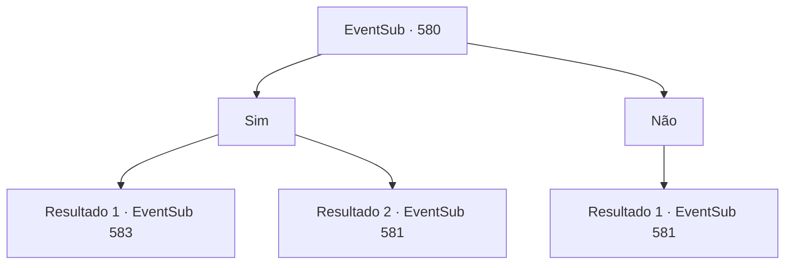

# Eventos secundários · 580

[Índice da tabela](index.md) · [Índice geral](../index.md)

ID: `pt:EventSub:580` · Fonte: `EventSub4` · Versão: 1.2.47.

Mapeamento estático dos arquivos; a disponibilidade e a execução dependem do estado da run.

## Texto do evento

Grimdit, o lugar onde você pode comprar seiva de treant, está localizado em um penhasco íngreme. Finalmente chegando em Grimdit, você se move ao redor da praça central, admirando a vista da cidade. As pessoas lotam todo o lugar, comprando e vendendo coisas, enquanto os guardas da cidade correm de um lado para o outro para manter a ordem. Você entra em uma loja chamada 'A Bolsa do Mágico', localizada bem ao lado da praça. A loja não é tão grande, mas está devidamente equipada com produtos como garras de wyvern, lodo de slime, globos oculares de imp e, o mais importante, seiva de treant. Você pede ao proprietário uma garrafa de seiva de treant. Ao ouvir seu pedido, o proprietário olha para você de cima a baixo e lhe faz uma pergunta. 

 "Você é um dos Veneprada?"


## Dados de entrada

```json
{
  "id": 580,
  "grade": 1,
  "subEvent": "",
  "required": "12_10_1|5_587_1"
}
```

## Mapa das escolhas



## Escolhas e resultados

### Escolha 1

Sim

Requisitos e outros campos da escolha:

```json
{
  "required": "5_589_0"
}
```

#### Resultado 1.1

Você diz sim e pede novamente por seiva de treant. Parece que você conseguiu enganar com sucesso o dono a acreditar em você. Ele coça a parte de trás da cabeça antes de lhe entregar a garrafa de seiva de treant. 

 "Hmph... Eu tenho que ter certeza, apenas por precaução. Você provavelmente sabe também, né? 100 ouro."


Continuação registrada: [Evento 583](0583.md) na mesma tabela.

```json
{
  "required": "",
  "chance": "1|0_12_1",
  "nextEvent": 583,
  "type": 0,
  "reward": "0_2_1"
}
```

#### Resultado 1.2

Você diz sim e pede novamente por seiva de treant. Mas o dono não acredita em sua decepção. 

 "Desculpe, mas não vou vender para você. Veneprada terá algo a dizer se eu fizer isso."

 Ele explica calmamente por que não pode vender a seiva de treant para você. A história é que Veneprada, uma guilda de comerciantes renomada na região, monopolizou o comércio de ingredientes alquímicos em Grimdit. Para comprar ou vender ingredientes alquímicos, a pessoa deve ser um membro da Veneprada. 

 "Um dos executivos, 'Osborn', enviou a mensagem pessoalmente. Se você não é da Veneprada, não posso vender nada para você. Nada que eu possa fazer."

 Você olha ao redor da loja, fingindo ouvir. Pendurada nas paredes está uma bandeira, aparentemente da Veneprada.

Continuação registrada: [Evento 581](0581.md) na mesma tabela.

```json
{
  "required": "",
  "chance": "13",
  "nextEvent": 581,
  "type": 1,
  "reward": "5_589_1"
}
```

### Escolha 2

Não

Requisitos e outros campos da escolha:

```json
{
  "required": "5_589_0"
}
```

#### Resultado 2.1

Você diz não. Então, o dono balança a cabeça, dizendo que não pode te vender o item. 

 "Desculpe, mas não vou vender para você. A Veneprada terá algo a dizer se eu fizer isso."

 Ele explica calmamente por que não pode te vender a seiva de treant. A história é que a Veneprada, uma guilda de comerciantes renomada na região, monopolizou o comércio de ingredientes alquímicos em Grimdit. Para comprar ou vender ingredientes alquímicos, a pessoa deve ser um membro da Veneprada. 

 "Um dos executivos, 'Osborn', enviou a mensagem pessoalmente. Se você não é da Veneprada, não posso te vender nada. Nada que eu possa fazer."

 Você olha ao redor da loja, fingindo ouvir. Pendurada nas paredes está uma bandeira, aparentemente da Veneprada.

Continuação registrada: [Evento 581](0581.md) na mesma tabela.

```json
{
  "required": "",
  "chance": "1",
  "nextEvent": 581,
  "type": 2,
  "reward": "5_589_1"
}
```

## Referências que chegam a este evento

- [Evento 591 · escolha 1 · resultado 1](0591.md#escolha-1)
