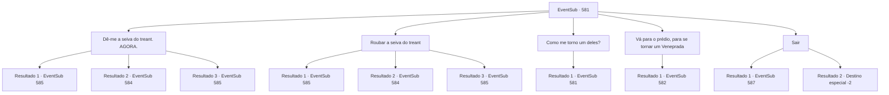

# Eventos secundários · 581

[Índice da tabela](index.md) · [Índice geral](../index.md)

ID: `pt:EventSub:581` · Fonte: `EventSub4` · Versão: 1.2.47.

Mapeamento estático dos arquivos; a disponibilidade e a execução dependem do estado da run.

## Texto do evento

*Sem texto no arquivo.*

## Dados de entrada

```json
{
  "id": 581,
  "grade": 1,
  "subEvent": "",
  "required": ""
}
```

## Mapa das escolhas



## Escolhas e resultados

### Escolha 1

Dê-me a seiva do treant. AGORA.

Requisitos e outros campos da escolha:

```json
{
  "required": ""
}
```

#### Resultado 1.1

Você saca sua arma e ameaça o dono da loja. Assustado, ele lhe entrega a garrafa de seiva de treant com as mãos trêmulas. Aparentemente, os comandos tão importantes da guilda não são tão importantes quanto a vida dele. Você sai da loja com a seiva de treant.

Continuação registrada: [Evento 585](0585.md) na mesma tabela.

```json
{
  "required": "21_1_2",
  "chance": "1|0_12_1",
  "nextEvent": 585,
  "type": 0,
  "reward": "0_2_1|3_295_1"
}
```

#### Resultado 1.2


 "ROUBO! ROUBO!"

 O proprietário corre rapidamente para fora, gritando por ajuda. Que conveniente - parece que um guarda da cidade estava patrulhando nas proximidades. Ele entra na loja, arma em punho, para impedir que você fuja. Ele ordena que você se renda, a ponta de sua lança apontada para você. Você rapidamente alcança sua própria arma para revidar.

Continuação registrada: [Evento 584](0584.md) na mesma tabela.

```json
{
  "required": "21_1_2",
  "chance": "12",
  "nextEvent": 584,
  "type": 1,
  "reward": "6_0_21",
  "place": 4
}
```

#### Resultado 1.3

Você saca sua arma e ameaça o dono da loja. Assustado, ele lhe entrega a garrafa de seiva de treant com as mãos trêmulas. Aparentemente, os comandos tão importantes da guilda não são tão importantes quanto a vida dele. Você sai da loja com a seiva de treant.

Continuação registrada: [Evento 585](0585.md) na mesma tabela.

```json
{
  "required": "20_1_2",
  "chance": "1",
  "nextEvent": 585,
  "type": 2,
  "reward": "0_2_1|3_295_1"
}
```

### Escolha 2

Roubar a seiva do treant

Requisitos e outros campos da escolha:

```json
{
  "required": ""
}
```

#### Resultado 2.1

Você finge olhar ao redor da loja por um tempo antes de pegar a garrafa de seiva de treant com um truque de mão. Felizmente, o dono não percebe seu roubo. Seu olhar está fixo em outro cliente, e você aproveita a oportunidade para sair.

Continuação registrada: [Evento 585](0585.md) na mesma tabela.

```json
{
  "required": "21_5_2",
  "chance": "1|0_6_1",
  "nextEvent": 585,
  "type": 0,
  "reward": "0_2_1|3_295_1"
}
```

#### Resultado 2.2

Você finge olhar ao redor da loja por um tempo antes de tentar pegar a garrafa de seiva de treant com um truque de mãos rápidas. 

 "LADRÃO! LADRÃO!"

 Você é pego pelo dono, que sai correndo da loja pedindo ajuda. Que conveniente - parece que um guarda da cidade estava patrulhando nas proximidades. Ele entra correndo na loja, arma em punho, para evitar que você fuja. Ele ordena que você se renda, com a ponta de sua lança apontada para você. Você rapidamente alcança sua própria arma para lutar de volta.

Continuação registrada: [Evento 584](0584.md) na mesma tabela.

```json
{
  "required": "21_5_2",
  "chance": "12",
  "nextEvent": 584,
  "type": 1,
  "reward": "6_0_21",
  "place": 4
}
```

#### Resultado 2.3

Você finge olhar ao redor da loja por um tempo antes de pegar a garrafa de seiva de treant com um truque de mão. Felizmente, o dono não percebe seu roubo. Seu olhar está fixo em outro cliente, e você aproveita a oportunidade para sair.

Continuação registrada: [Evento 585](0585.md) na mesma tabela.

```json
{
  "required": "20_5_2",
  "chance": "1",
  "nextEvent": 585,
  "type": 2,
  "reward": "0_2_1|3_295_1"
}
```

### Escolha 3

Como me torno um deles?

Requisitos e outros campos da escolha:

```json
{
  "required": "5_590_0"
}
```

#### Resultado 3.1

Você pergunta ao dono como poderia se tornar um Veneprada. O dono te dá um sinal com os dedos. Ouro. 

 "Não está óbvio o suficiente para você? Dinheiro. 'Doe' 100 ouro para a guilda e você deverá entrar."

 Ele diz que há um prédio que pertence à Veneprada não muito longe daqui.

Continuação registrada: [Evento 581](0581.md) na mesma tabela.

```json
{
  "required": "",
  "chance": "1",
  "nextEvent": 581,
  "type": 2,
  "reward": "5_590_1"
}
```

### Escolha 4

Vá para o prédio, para se tornar um Veneprada

Requisitos e outros campos da escolha:

```json
{
  "required": "5_590_1|1_4_100"
}
```

#### Resultado 4.1

Você sai imediatamente da loja e vai para o prédio da Veneprada. A recepcionista te cumprimenta com um sorriso radiante. 

 "Olá. Como posso te ajudar hoje?"

 Você decide se juntar à Veneprada, após fazer sua doação. A recepcionista guarda o ouro nas prateleiras da mesa. Em seguida, ela te entrega um pedaço de papel - um certificado de membro. Ela te diz que seu nome deve ser escrito na lista de membros da Veneprada em pouco tempo.

Continuação registrada: [Evento 582](0582.md) na mesma tabela.

```json
{
  "required": "",
  "chance": "1",
  "nextEvent": 582,
  "type": 2,
  "reward": "5_590_2|0_2_1|0_4_-100|3_300_1"
}
```

### Escolha 5

Sair

Requisitos e outros campos da escolha:

```json
{
  "required": ""
}
```

#### Resultado 5.1

Você sai da loja. Procurar seiva de treant em Grimdit não parece uma boa ideia.

Continuação registrada: [Evento 587](0587.md) na mesma tabela.

```json
{
  "required": "18_588_1",
  "chance": "1",
  "nextEvent": 587,
  "type": 2,
  "reward": ""
}
```

#### Resultado 5.2

Você deixa Grimdit. Sem mais chances de obter seiva de treant, você decide desistir de cumprir o pedido de Edenheart.

Continuação registrada: [Destino especial `-2`](../destinos-especiais.md).

```json
{
  "required": "5_588_1",
  "chance": "1",
  "nextEvent": -2,
  "type": 2,
  "reward": "12_10_-1"
}
```

## Referências que chegam a este evento

- [Evento 580 · escolha 1 · resultado 2](0580.md#escolha-1)
- [Evento 580 · escolha 2 · resultado 1](0580.md#escolha-2)
- [Evento 581 · escolha 3 · resultado 1](0581.md#escolha-3)
