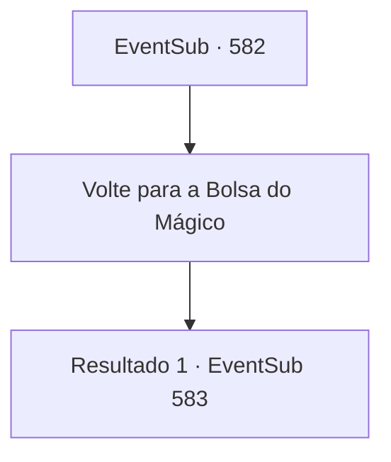

# Eventos secundários · 582

[Índice da tabela](index.md) · [Índice geral](../index.md)

ID: `pt:EventSub:582` · Fonte: `EventSub4` · Versão: 1.2.47.

Mapeamento estático dos arquivos; a disponibilidade e a execução dependem do estado da run.

## Texto do evento

*Sem texto no arquivo.*

## Dados de entrada

```json
{
  "id": 582,
  "grade": 1,
  "subEvent": "",
  "required": ""
}
```

## Mapa das escolhas



## Escolhas e resultados

### Escolha 1

Volte para a Bolsa do Mágico

Requisitos e outros campos da escolha:

```json
{
  "required": ""
}
```

#### Resultado 1.1

Você volta para a Bolsa do Mágico, pedindo mais uma vez por seiva de treant. Ele vê seu certificado de associação, então lhe entrega uma garrafa de seiva de treant. 

 "Aqui está. Serão 100 ouros."


Continuação registrada: [Evento 583](0583.md) na mesma tabela.

```json
{
  "required": "",
  "chance": "1",
  "nextEvent": 583,
  "type": 2,
  "reward": ""
}
```

## Referências que chegam a este evento

- [Evento 581 · escolha 4 · resultado 1](0581.md#escolha-4)
