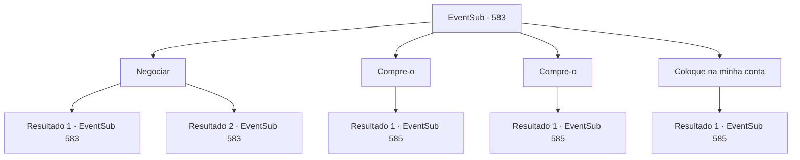

# Eventos secundários · 583

[Índice da tabela](index.md) · [Índice geral](../index.md)

ID: `pt:EventSub:583` · Fonte: `EventSub4` · Versão: 1.2.47.

Mapeamento estático dos arquivos; a disponibilidade e a execução dependem do estado da run.

## Texto do evento

*Sem texto no arquivo.*

## Dados de entrada

```json
{
  "id": 583,
  "grade": 1,
  "subEvent": "",
  "required": ""
}
```

## Mapa das escolhas



## Escolhas e resultados

### Escolha 1

Negociar

Requisitos e outros campos da escolha:

```json
{
  "required": "5_607_0"
}
```

#### Resultado 1.1

Você tenta barganhar. Ele coça a cabeça antes de soltar um suspiro. 

 "Tudo bem. 75."


Continuação registrada: [Evento 583](0583.md) na mesma tabela.

```json
{
  "required": "",
  "chance": "1|0_12_1",
  "nextEvent": 583,
  "type": 0,
  "reward": "5_607_1"
}
```

#### Resultado 1.2

Você tenta barganhar. Ele coça a cabeça antes de soltar um suspiro. 

 "Desculpe, não posso fazer isso. Eu também preciso ganhar a vida, né?"


Continuação registrada: [Evento 583](0583.md) na mesma tabela.

```json
{
  "required": "",
  "chance": "10",
  "nextEvent": 583,
  "type": 1,
  "reward": "5_607_2"
}
```

### Escolha 2

Compre-o

Requisitos e outros campos da escolha:

```json
{
  "required": "1_4_75|5_607_1"
}
```

#### Resultado 2.1

Você compra a garrafa de seiva de treant. O proprietário sorri, satisfeito, e se despede de você. 

 "Volte sempre!"

 Você abre a porta e sai, enquanto o pequeno sino na porta toca.

Continuação registrada: [Evento 585](0585.md) na mesma tabela.

```json
{
  "required": "",
  "chance": "1",
  "nextEvent": 585,
  "type": 2,
  "reward": "0_4_-75|3_295_1"
}
```

### Escolha 3

Compre-o

Requisitos e outros campos da escolha:

```json
{
  "required": "1_4_100|18_607_1"
}
```

#### Resultado 3.1

Você compra a garrafa de seiva de treant. O proprietário sorri, satisfeito, e se despede de você. 

 "Volte sempre!"

 Você abre a porta e sai, enquanto o pequeno sino na porta toca.

Continuação registrada: [Evento 585](0585.md) na mesma tabela.

```json
{
  "required": "",
  "chance": "1",
  "nextEvent": 585,
  "type": 2,
  "reward": "0_4_-100|3_295_1"
}
```

### Escolha 4

Coloque na minha conta

Requisitos e outros campos da escolha:

```json
{
  "required": ""
}
```

#### Resultado 4.1

Você diz a ele para colocar o preço na conta. O dono murmura amargamente. 

 "Eh... tudo bem. No nome de {1}, de Veneprada."

 Com a garrafa de seiva de treant em suas mãos, você abre a porta e sai, enquanto o pequeno sino na porta toca.

Continuação registrada: [Evento 585](0585.md) na mesma tabela.

```json
{
  "required": "",
  "chance": "1",
  "nextEvent": 585,
  "type": 2,
  "reward": "3_295_1"
}
```

## Referências que chegam a este evento

- [Evento 580 · escolha 1 · resultado 1](0580.md#escolha-1)
- [Evento 582 · escolha 1 · resultado 1](0582.md#escolha-1)
- [Evento 583 · escolha 1 · resultado 1](0583.md#escolha-1)
- [Evento 583 · escolha 1 · resultado 2](0583.md#escolha-1)
