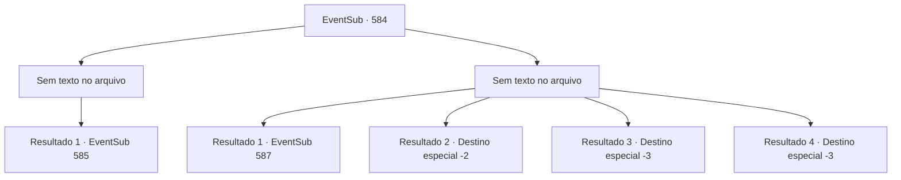

# Eventos secundários · 584

[Índice da tabela](index.md) · [Índice geral](../index.md)

ID: `pt:EventSub:584` · Fonte: `EventSub4` · Versão: 1.2.47.

Mapeamento estático dos arquivos; a disponibilidade e a execução dependem do estado da run.

## Texto do evento

*Sem texto no arquivo.*

## Dados de entrada

```json
{
  "id": 584,
  "grade": 1,
  "subEvent": "",
  "required": ""
}
```

## Mapa das escolhas



## Escolhas e resultados

### Escolha 1

*Sem texto no arquivo; o papel dessa opção depende da interface do jogo.*

Requisitos e outros campos da escolha:

```json
{
  "required": ""
}
```

#### Resultado 1.1

Depois de lidar com a guarda da cidade, você mais uma vez pede por seiva de treant. Assustado, ele lhe entrega a garrafa de seiva de treant com as mãos trêmulas. Aparentemente, os comandos tão importantes da guilda não são tão importantes quanto a vida dele. Você sai da loja com a seiva de treant.

Continuação registrada: [Evento 585](0585.md) na mesma tabela.

```json
{
  "required": "",
  "chance": "1",
  "nextEvent": 585,
  "type": 2,
  "reward": "3_295_1"
}
```

### Escolha 2

*Sem texto no arquivo; o papel dessa opção depende da interface do jogo.*

Requisitos e outros campos da escolha:

```json
{
  "required": ""
}
```

#### Resultado 2.1

Derrotado pelo guarda, você sai, longe de Grimdit. Procurar seiva de treant em Grimdit não parece uma boa ideia.

Continuação registrada: [Evento 587](0587.md) na mesma tabela.

```json
{
  "required": "1_0_2|1_1_2|18_588_1",
  "chance": "1",
  "nextEvent": 587,
  "type": 2,
  "reward": "0_0_-1|0_1_-1"
}
```

#### Resultado 2.2

Derrotado pelo guarda, você sai, longe de Grimdit. Sem mais chances de obter seiva de treant, você decide desistir de cumprir o pedido de Edenheart.

Continuação registrada: [Destino especial `-2`](../destinos-especiais.md).

```json
{
  "required": "1_0_2|1_1_2|5_588_1",
  "chance": "1",
  "nextEvent": -2,
  "type": 2,
  "reward": "0_0_-1|0_1_-1|12_10_-1"
}
```

#### Resultado 2.3

Você bem que poderia ter se rendido. Porque agora, você está prestes a pagar o preço com o seu sangue.

Continuação registrada: [Destino especial `-3`](../destinos-especiais.md).

```json
{
  "required": "2_0_2",
  "chance": "1",
  "nextEvent": -3,
  "type": 2,
  "reward": "0_0_-1|0_1_-1"
}
```

#### Resultado 2.4

Você bem que poderia ter se rendido. Porque agora, você está prestes a pagar o preço com o seu sangue.

Continuação registrada: [Destino especial `-3`](../destinos-especiais.md).

```json
{
  "required": "2_1_2",
  "chance": "1",
  "nextEvent": -3,
  "type": 2,
  "reward": "0_0_-1|0_1_-1"
}
```

## Referências que chegam a este evento

- [Evento 581 · escolha 1 · resultado 2](0581.md#escolha-1)
- [Evento 581 · escolha 2 · resultado 2](0581.md#escolha-2)
