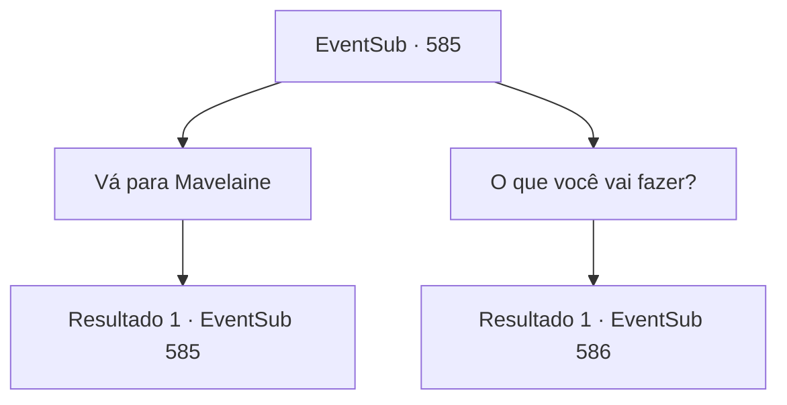

# Eventos secundários · 585

[Índice da tabela](index.md) · [Índice geral](../index.md)

ID: `pt:EventSub:585` · Fonte: `EventSub4` · Versão: 1.2.47.

Mapeamento estático dos arquivos; a disponibilidade e a execução dependem do estado da run.

## Texto do evento

*Sem texto no arquivo.*

## Dados de entrada

```json
{
  "id": 585,
  "grade": 1,
  "subEvent": "",
  "required": ""
}
```

## Mapa das escolhas



## Escolhas e resultados

### Escolha 1

Vá para Mavelaine

Requisitos e outros campos da escolha:

```json
{
  "required": "5_591_0"
}
```

#### Resultado 1.1

Alguns dias depois, você chega em Mavelaine e vai direto para a Mansão de Fheren. Edenheart te cumprimenta pela porta da frente, se aproximando de você primeiro. Você tira a garrafa de seiva de treant dos seus bolsos. Edenheart alegremente pega a garrafa e te agradece. 

 "Eu aprecio muito, {1}. Ah, sim. Eu poderia usar sua ajuda mais uma vez. Estou disposto a pagar, é claro."


Continuação registrada: [Evento 585](0585.md) na mesma tabela.

```json
{
  "required": "",
  "chance": "1",
  "nextEvent": 585,
  "type": 2,
  "reward": "5_591_1|4_295_1"
}
```

### Escolha 2

O que você vai fazer?

Requisitos e outros campos da escolha:

```json
{
  "required": "5_591_1"
}
```

#### Resultado 2.1

Você pergunta a Edenheart qual é o plano dela. Edenheart hesita um pouco antes de responder com uma voz calma. 

 "Estou planejando fazer um Elixir, para libertar Fheren de sua maldita doença."

 O Elixir, segundo ela, é uma poção lendária, dizem que cura qualquer doença que exista. Mas novamente, ninguém sabe se tal poção realmente existe. Ela rapidamente acrescenta, aparentemente esperando sua reação. 

 "Eu sei que pareço louca. Mas... existem registros. Muitos, na verdade. O Elixir deve existir, e se pudermos apenas descobrir como... fazer um nós mesmos deve ser possível."

 Você pergunta a Edenheart o que deve fazer. Ela pede que você procure e obtenha os scripts adicionais, ingredientes e ferramentas necessários para fazer o Elixir.

Continuação registrada: [Evento 586](0586.md) na mesma tabela.

```json
{
  "required": "",
  "chance": "1",
  "nextEvent": 586,
  "type": 2,
  "reward": ""
}
```

## Referências que chegam a este evento

- [Evento 581 · escolha 1 · resultado 1](0581.md#escolha-1)
- [Evento 581 · escolha 1 · resultado 3](0581.md#escolha-1)
- [Evento 581 · escolha 2 · resultado 1](0581.md#escolha-2)
- [Evento 581 · escolha 2 · resultado 3](0581.md#escolha-2)
- [Evento 583 · escolha 2 · resultado 1](0583.md#escolha-2)
- [Evento 583 · escolha 3 · resultado 1](0583.md#escolha-3)
- [Evento 583 · escolha 4 · resultado 1](0583.md#escolha-4)
- [Evento 584 · escolha 1 · resultado 1](0584.md#escolha-1)
- [Evento 585 · escolha 1 · resultado 1](0585.md#escolha-1)
- [Evento 592 · escolha 1 · resultado 1](0592.md#escolha-1)
- [Evento 592 · escolha 1 · resultado 2](0592.md#escolha-1)
- [Evento 592 · escolha 2 · resultado 1](0592.md#escolha-2)
- [Evento 592 · escolha 2 · resultado 2](0592.md#escolha-2)
