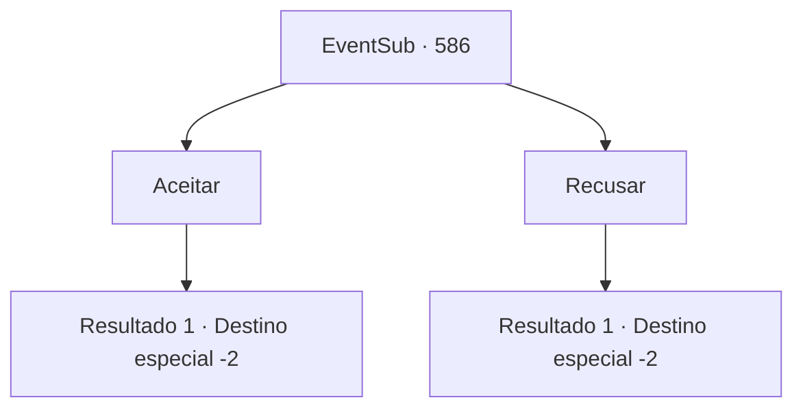

# Eventos secundários · 586

[Índice da tabela](index.md) · [Índice geral](../index.md)

ID: `pt:EventSub:586` · Fonte: `EventSub4` · Versão: 1.2.47.

Mapeamento estático dos arquivos; a disponibilidade e a execução dependem do estado da run.

## Texto do evento

*Sem texto no arquivo.*

## Dados de entrada

```json
{
  "id": 586,
  "grade": 1,
  "subEvent": "",
  "required": ""
}
```

## Mapa das escolhas



## Escolhas e resultados

### Escolha 1

Aceitar

Requisitos e outros campos da escolha:

```json
{
  "required": ""
}
```

#### Resultado 1.1

Assim que você diz sim, Edenheart agarra suas mãos e agradece muitas vezes. Ela diz que vai chamar por você quando sua ajuda for necessária. Você está livre para ir agora. 

 "Ah, e isso é para a seiva do treant."

 Edenheart lhe entrega uma poção de saúde carmesim. Tomando a poção de saúde, você sai da Mansão de Fheren, se despedindo de Edenheart.

Continuação registrada: [Destino especial `-2`](../destinos-especiais.md).

```json
{
  "required": "",
  "chance": "1",
  "nextEvent": -2,
  "type": 2,
  "reward": "3_36_1|12_10_2"
}
```

### Escolha 2

Recusar

Requisitos e outros campos da escolha:

```json
{
  "required": ""
}
```

#### Resultado 2.1

Assim que você diz não, Edenheart franze os lábios antes de soltar um suspiro. 

 "Ufa... ok. Ah, e isso é para a seiva do ent."

 Edenheart entrega a você uma poção de saúde carmesim. Pegando a poção de saúde, você sai da Mansão de Fheren, se despedindo de Edenheart.

Continuação registrada: [Destino especial `-2`](../destinos-especiais.md).

```json
{
  "required": "",
  "chance": "1",
  "nextEvent": -2,
  "type": 2,
  "reward": "3_36_1|12_10_5"
}
```

## Referências que chegam a este evento

- [Evento 585 · escolha 2 · resultado 1](0585.md#escolha-2)
