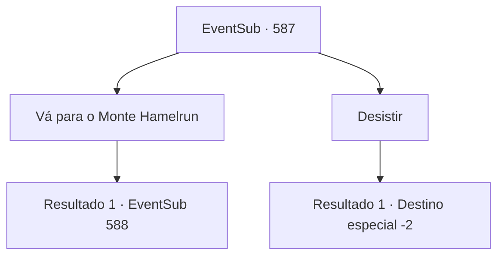

# Eventos secundários · 587

[Índice da tabela](index.md) · [Índice geral](../index.md)

ID: `pt:EventSub:587` · Fonte: `EventSub4` · Versão: 1.2.47.

Mapeamento estático dos arquivos; a disponibilidade e a execução dependem do estado da run.

## Texto do evento

*Sem texto no arquivo.*

## Dados de entrada

```json
{
  "id": 587,
  "grade": 1,
  "subEvent": "",
  "required": ""
}
```

## Mapa das escolhas



## Escolhas e resultados

### Escolha 1

Vá para o Monte Hamelrun

Requisitos e outros campos da escolha:

```json
{
  "required": ""
}
```

#### Resultado 1.1

Você deixa Grimdit, seguindo em direção ao Monte Hamelrun. 

 O Monte Hamelrun, ocupado por treants de acordo com rumores, é um lugar coberto de pedras ásperas e crescimento desenfreado de plantas. Procurar por uma estrada ou um caminho parece impossível. Os avistamentos raros de encostas limpas quase sempre terminam em um penhasco íngreme. Você abre seu próprio caminho, cortando através das florestas e colinas. Depois de se banhar em seu próprio suor, você para diante de um rio fluente. A água está turva e lamacenta. Vórtices aparecem aqui e ali, e pedaços misteriosos que parecem lixo fluem para baixo. Apenas olhar para isso é o suficiente para perceber que atravessar esse rio pode ser perigoso.

Continuação registrada: [Evento 588](0588.md) na mesma tabela.

```json
{
  "required": "",
  "chance": "1",
  "nextEvent": 588,
  "type": 2,
  "reward": ""
}
```

### Escolha 2

Desistir

Requisitos e outros campos da escolha:

```json
{
  "required": ""
}
```

#### Resultado 2.1

Você desiste de investigar o Monte Hamelrun. Você retorna às suas aventuras.

Continuação registrada: [Destino especial `-2`](../destinos-especiais.md).

```json
{
  "required": "",
  "chance": "1",
  "nextEvent": -2,
  "type": 2,
  "reward": "12_10_-1"
}
```

## Referências que chegam a este evento

- [Evento 581 · escolha 5 · resultado 1](0581.md#escolha-5)
- [Evento 584 · escolha 2 · resultado 1](0584.md#escolha-2)
