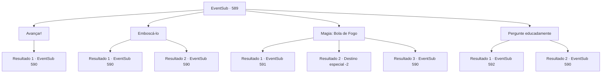

# Eventos secundários · 589

[Índice da tabela](index.md) · [Índice geral](../index.md)

ID: `pt:EventSub:589` · Fonte: `EventSub4` · Versão: 1.2.47.

Mapeamento estático dos arquivos; a disponibilidade e a execução dependem do estado da run.

## Texto do evento

*Sem texto no arquivo.*

## Dados de entrada

```json
{
  "id": 589,
  "grade": 1,
  "subEvent": "",
  "required": ""
}
```

## Mapa das escolhas



## Escolhas e resultados

### Escolha 1

Avançar!

Requisitos e outros campos da escolha:

```json
{
  "required": ""
}
```

#### Resultado 1.1

Você alcança sua arma, avançando diretamente em direção ao treant. Ele responde esticando suas raízes, atacando você.

Continuação registrada: [Evento 590](0590.md) na mesma tabela.

```json
{
  "required": "",
  "chance": "1",
  "nextEvent": 590,
  "type": 2,
  "reward": "6_0_161",
  "place": 1
}
```

### Escolha 2

Emboscá-lo

Requisitos e outros campos da escolha:

```json
{
  "required": ""
}
```

#### Resultado 2.1

Você desfere um ataque sorrateiro ao treant. Emboscado, o treant vacila por um momento, mas logo solta um grito gutural e estica suas raízes em sua direção. Você consegue evitar os galhos ferozes, lutando de volta.

Continuação registrada: [Evento 590](0590.md) na mesma tabela.

```json
{
  "required": "",
  "chance": "1|0_6_1",
  "nextEvent": 590,
  "type": 0,
  "reward": "6_2_161",
  "place": 1
}
```

#### Resultado 2.2

Tenta emboscar o treant, mas é avistado. Ele responde esticando suas raízes, atacando você.

Continuação registrada: [Evento 590](0590.md) na mesma tabela.

```json
{
  "required": "",
  "chance": "13",
  "nextEvent": 590,
  "type": 1,
  "reward": "6_0_161",
  "place": 1
}
```

### Escolha 3

Magia: Bola de Fogo

Requisitos e outros campos da escolha:

```json
{
  "required": "20_0_2|1_1_2"
}
```

#### Resultado 3.1

Você conjura bola de fogo, lançando-a no treant. As chamas envolvem o treant, transformando-o em um grande pedaço de carvão em questão de segundos. Não foi possível obter nem uma única gota de seiva de treant disso.

Continuação registrada: [Evento 591](0591.md) na mesma tabela.

```json
{
  "required": "20_0_4|18_587_1",
  "chance": "1",
  "nextEvent": 591,
  "type": 2,
  "reward": "0_2_1|0_1_-1"
}
```

#### Resultado 3.2

Você conjura bola de fogo, lançando-a no treant. As chamas envolvem o treant, transformando-o em um grande pedaço de carvão em questão de segundos. Não foi possível obter nem uma única gota de seiva de treant. Sem mais chances de obter seiva de treant, você decide desistir de cumprir o pedido de Edenheart.

Continuação registrada: [Destino especial `-2`](../destinos-especiais.md).

```json
{
  "required": "20_0_4|5_587_1",
  "chance": "1",
  "nextEvent": -2,
  "type": 2,
  "reward": "0_2_1|0_1_-1|12_10_-1"
}
```

#### Resultado 3.3

Você conjura bola de fogo, lançando-a no treant. Emboscado, o treant vacila por um momento, mas logo solta um grito gutural e estica suas raízes em sua direção. Você consegue evitar os galhos ferozes, lutando de volta.

Continuação registrada: [Evento 590](0590.md) na mesma tabela.

```json
{
  "required": "21_0_4",
  "chance": "1",
  "nextEvent": 590,
  "type": 2,
  "reward": "6_2_161",
  "place": 1
}
```

### Escolha 4

Pergunte educadamente

Requisitos e outros campos da escolha:

```json
{
  "required": ""
}
```

#### Resultado 4.1

Você se aproxima do treant, pedindo um pouco de sua seiva. No início, o treant levanta suas ramificações com cautela, mas logo conversa com você. 

 "...Ok. Apenas um pouco."

 Então, ele estende lentamente uma de suas ramificações. Você cuidadosamente coleta a seiva do treant em uma garrafa de vidro. Em seguida, agradece ao treant e desce a montanha. 

 Após alguns minutos, você se depara com um herbalista. Ele olha para você e faz uma pergunta. 

 "Você é membro da 'Veneprada'?"


Continuação registrada: [Evento 592](0592.md) na mesma tabela.

```json
{
  "required": "",
  "chance": "1|0_12_1",
  "nextEvent": 592,
  "type": 0,
  "reward": "3_295_1"
}
```

#### Resultado 4.2

Você se aproxima do treant, pedindo um pouco de sua seiva. Mas o treant te percebe como perigo, imediatamente esticando seus galhos para atacar.

Continuação registrada: [Evento 590](0590.md) na mesma tabela.

```json
{
  "required": "",
  "chance": "12",
  "nextEvent": 590,
  "type": 1,
  "reward": "6_0_161",
  "place": 1
}
```

## Referências que chegam a este evento

- [Evento 588 · escolha 1 · resultado 1](0588.md#escolha-1)
- [Evento 588 · escolha 2 · resultado 1](0588.md#escolha-2)
- [Evento 588 · escolha 3 · resultado 1](0588.md#escolha-3)
- [Evento 593 · escolha 1 · resultado 1](0593.md#escolha-1)
- [Evento 593 · escolha 2 · resultado 1](0593.md#escolha-2)
- [Evento 593 · escolha 3 · resultado 1](0593.md#escolha-3)
