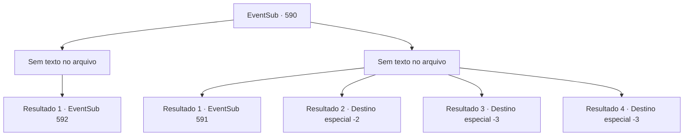

# Eventos secundários · 590

[Índice da tabela](index.md) · [Índice geral](../index.md)

ID: `pt:EventSub:590` · Fonte: `EventSub4` · Versão: 1.2.47.

Mapeamento estático dos arquivos; a disponibilidade e a execução dependem do estado da run.

## Texto do evento

*Sem texto no arquivo.*

## Dados de entrada

```json
{
  "id": 590,
  "grade": 1,
  "subEvent": "",
  "required": ""
}
```

## Mapa das escolhas



## Escolhas e resultados

### Escolha 1

*Sem texto no arquivo; o papel dessa opção depende da interface do jogo.*

Requisitos e outros campos da escolha:

```json
{
  "required": ""
}
```

#### Resultado 1.1

O treant resistiu bravamente, mas logo é derrotado por você. Você se aproxima do treant caído, rasgando uma parte de sua casca. Você enche sua garrafa de vidro com seiva de treant e parte. 

 No caminho de volta, você encontra um herbalista. Ele olha para você e faz uma pergunta. 

 "V-Você é membro da 'Veneprada'?"


Continuação registrada: [Evento 592](0592.md) na mesma tabela.

```json
{
  "required": "",
  "chance": "1",
  "nextEvent": 592,
  "type": 2,
  "reward": "3_295_1"
}
```

### Escolha 2

*Sem texto no arquivo; o papel dessa opção depende da interface do jogo.*

Requisitos e outros campos da escolha:

```json
{
  "required": ""
}
```

#### Resultado 2.1

Derrotado na batalha, você tenta fugir. Seu corpo está coberto de hematomas e arranhões, danificados pelos espinhos e raízes do treant. Ele te ergue triunfantemente, se vangloriando de sua vitória. Em seguida, ele te joga no rio. 

 Alguns momentos depois, você recupera a consciência, água jorrando de sua boca. Olhando ao redor, você acorda em um banco de areia ao redor do rio. Você rapidamente faz uma pequena fogueira para se secar antes de partir. Procurar a seiva do treant no Monte Hamelrun não parece uma boa ideia.

Continuação registrada: [Evento 591](0591.md) na mesma tabela.

```json
{
  "required": "1_0_2|1_1_2|18_587_1",
  "chance": "1",
  "nextEvent": 591,
  "type": 2,
  "reward": "0_0_-1|0_1_-1"
}
```

#### Resultado 2.2

Derrotado na batalha, você tenta fugir. Seu corpo está coberto de hematomas e arranhões, danificado pelos espinhos e raízes do treant. Sem mais chances de obter a seiva do treant, você decide desistir de cumprir o pedido de Edenheart.

Continuação registrada: [Destino especial `-2`](../destinos-especiais.md).

```json
{
  "required": "1_0_2|1_1_2|5_587_1",
  "chance": "1",
  "nextEvent": -2,
  "type": 2,
  "reward": "0_0_-1|0_1_-1|12_10_-1"
}
```

#### Resultado 2.3

Derrotado na batalha, você tenta fugir. Seu corpo está coberto de hematomas e arranhões, danificados pelos espinhos e raízes do treant. Ele te ergue triunfantemente, se vangloriando de sua vitória. Em seguida, ele te joga no rio.

Continuação registrada: [Destino especial `-3`](../destinos-especiais.md).

```json
{
  "required": "2_0_2",
  "chance": "1",
  "nextEvent": -3,
  "type": 2,
  "reward": "0_0_-1|0_1_-1"
}
```

#### Resultado 2.4

Derrotado na batalha, você tenta fugir. Seu corpo está coberto de hematomas e arranhões, danificados pelos espinhos e raízes do treant. Ele te ergue triunfantemente, se vangloriando de sua vitória. Em seguida, ele te joga no rio.

Continuação registrada: [Destino especial `-3`](../destinos-especiais.md).

```json
{
  "required": "2_1_2",
  "chance": "1",
  "nextEvent": -3,
  "type": 2,
  "reward": "0_0_-1|0_1_-1"
}
```

## Referências que chegam a este evento

- [Evento 589 · escolha 1 · resultado 1](0589.md#escolha-1)
- [Evento 589 · escolha 2 · resultado 1](0589.md#escolha-2)
- [Evento 589 · escolha 2 · resultado 2](0589.md#escolha-2)
- [Evento 589 · escolha 3 · resultado 3](0589.md#escolha-3)
- [Evento 589 · escolha 4 · resultado 2](0589.md#escolha-4)
