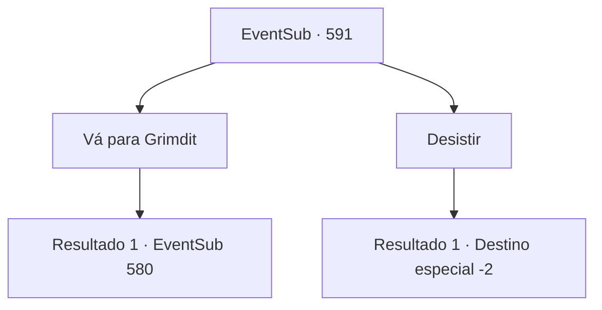

# Eventos secundários · 591

[Índice da tabela](index.md) · [Índice geral](../index.md)

ID: `pt:EventSub:591` · Fonte: `EventSub4` · Versão: 1.2.47.

Mapeamento estático dos arquivos; a disponibilidade e a execução dependem do estado da run.

## Texto do evento

*Sem texto no arquivo.*

## Dados de entrada

```json
{
  "id": 591,
  "grade": 1,
  "subEvent": "",
  "required": ""
}
```

## Mapa das escolhas



## Escolhas e resultados

### Escolha 1

Vá para Grimdit

Requisitos e outros campos da escolha:

```json
{
  "required": ""
}
```

#### Resultado 1.1

Você sai do Monte Hamelrun, indo em direção a Grimdit. 

 Grimdit, o lugar onde você pode comprar seiva de treant, está localizado em um penhasco íngreme. Finalmente chegando em Grimdit, você se move ao redor da praça central, admirando a vista da cidade. As pessoas lotam todo o lugar, comprando e vendendo coisas, enquanto os guardas da cidade correm de um lado para o outro para manter a ordem. Você entra em uma loja chamada 'A Bolsa do Mágico', localizada bem ao lado da praça. A loja não é tão grande, mas está devidamente equipada com produtos como garras de wyvern, lodo de slime, globos oculares de imp e, o mais importante, seiva de treant. Você pede ao proprietário uma garrafa de seiva de treant. Ao ouvir seu pedido, o proprietário olha para você de cima a baixo e lhe faz uma pergunta. 

 "Você é um dos Veneprada?"


Continuação registrada: [Evento 580](0580.md) na mesma tabela.

```json
{
  "required": "",
  "chance": "1",
  "nextEvent": 580,
  "type": 2,
  "reward": "5_592_1"
}
```

### Escolha 2

Desistir

Requisitos e outros campos da escolha:

```json
{
  "required": ""
}
```

#### Resultado 2.1

Você decide retornar às suas aventuras em vez de ir para Grimdit.

Continuação registrada: [Destino especial `-2`](../destinos-especiais.md).

```json
{
  "required": "",
  "chance": "1",
  "nextEvent": -2,
  "type": 2,
  "reward": "0_0_-1|0_1_-1|12_10_-1"
}
```

## Referências que chegam a este evento

- [Evento 588 · escolha 1 · resultado 2](0588.md#escolha-1)
- [Evento 588 · escolha 2 · resultado 2](0588.md#escolha-2)
- [Evento 589 · escolha 3 · resultado 1](0589.md#escolha-3)
- [Evento 590 · escolha 2 · resultado 1](0590.md#escolha-2)
- [Evento 593 · escolha 1 · resultado 2](0593.md#escolha-1)
- [Evento 593 · escolha 2 · resultado 2](0593.md#escolha-2)
