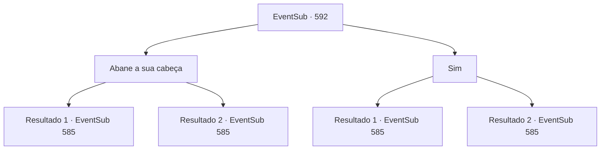

# Eventos secundários · 592

[Índice da tabela](index.md) · [Índice geral](../index.md)

ID: `pt:EventSub:592` · Fonte: `EventSub4` · Versão: 1.2.47.

Mapeamento estático dos arquivos; a disponibilidade e a execução dependem do estado da run.

## Texto do evento

*Sem texto no arquivo.*

## Dados de entrada

```json
{
  "id": 592,
  "grade": 1,
  "subEvent": "",
  "required": ""
}
```

## Mapa das escolhas



## Escolhas e resultados

### Escolha 1

Abane a sua cabeça

Requisitos e outros campos da escolha:

```json
{
  "required": ""
}
```

#### Resultado 1.1

O herbalista estala a língua em resposta. 

 "Tenha cuidado. Esses Venepradans estão apenas esperando a oportunidade de nos prejudicar."

 Você não perguntou nada a ele. Mas parece que ele tem muito a dizer. A história é que Veneprada, uma guilda de comerciantes renomada na região, monopolizou o comércio de ingredientes alquímicos dentro de Grimdit. Essa restrição está afetando até mesmo os herbalistas e aventureiros locais, aparentemente. 

 "Um dos executivos superiores, 'Osborn', enviou a mensagem pessoalmente. Trabalhadores individuais como nós não têm escolha a não ser obedecer. De qualquer forma, tenha cuidado."

 Você se despede do herbalista.

Continuação registrada: [Evento 585](0585.md) na mesma tabela.

```json
{
  "required": "18_589_1",
  "chance": "1",
  "nextEvent": 585,
  "type": 2,
  "reward": "5_589_1"
}
```

#### Resultado 1.2

O herbalista estala a língua em resposta. 

 "Tenha cuidado. Esses Venepradans estão apenas esperando a oportunidade de nos prejudicar."

 Você não perguntou nada a ele. Mas parece que ele tem muito a dizer. Mas você já conhece a história. Você se afasta do herbalista. O herbalista reclama algo sobre os gen-zrs sendo tão mal-educados hoje em dia, mas você decide ignorá-lo.

Continuação registrada: [Evento 585](0585.md) na mesma tabela.

```json
{
  "required": "5_589_1",
  "chance": "1",
  "nextEvent": 585,
  "type": 2,
  "reward": ""
}
```

### Escolha 2

Sim

Requisitos e outros campos da escolha:

```json
{
  "required": ""
}
```

#### Resultado 2.1

Você responde sim. O herbalista responde com um apelo desesperado. 

 "Então você vai contar aos seus chefes sobre como a política deles está MATANDO herbalistas locais como eu!"

 Você não perguntou nada a ele. Mas parece que ele tem muito a dizer. A história é que Veneprada, uma guilda de comerciantes renomada na região, monopolizou o comércio de ingredientes alquímicos dentro de Grimdit. Essa restrição está afetando até mesmo os herbalistas e aventureiros locais, aparentemente. 

 "Aquele... qual é o nome dele, 'Osman'? 'Osborn'? Por favor, peça a ele para pensar em nós também."

 Você se despede do herbalista.

Continuação registrada: [Evento 585](0585.md) na mesma tabela.

```json
{
  "required": "18_589_1",
  "chance": "1",
  "nextEvent": 585,
  "type": 2,
  "reward": "5_589_1"
}
```

#### Resultado 2.2

Você responde sim. O herbalista responde com um apelo desesperado. 

 "Então você vai contar aos seus chefes sobre como a política deles está MATANDO herbalistas locais como eu!"

 Você não perguntou nada a ele. Mas parece que ele tem muito para falar. Mas você já conhece a história. Você se afasta do herbalista. O herbalista reclama algo sobre os gen-zrs sendo tão rudes hoje em dia, mas você decide ignorá-lo.

Continuação registrada: [Evento 585](0585.md) na mesma tabela.

```json
{
  "required": "5_589_1",
  "chance": "1",
  "nextEvent": 585,
  "type": 2,
  "reward": ""
}
```

## Referências que chegam a este evento

- [Evento 589 · escolha 4 · resultado 1](0589.md#escolha-4)
- [Evento 590 · escolha 1 · resultado 1](0590.md#escolha-1)
