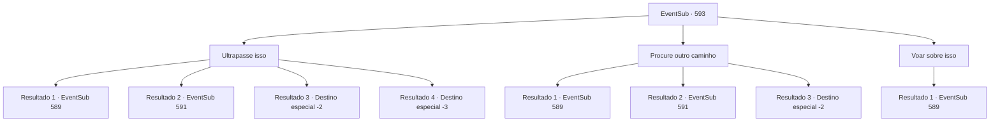

# Eventos secundários · 593

[Índice da tabela](index.md) · [Índice geral](../index.md)

ID: `pt:EventSub:593` · Fonte: `EventSub4` · Versão: 1.2.47.

Mapeamento estático dos arquivos; a disponibilidade e a execução dependem do estado da run.

## Texto do evento

O Monte Hamelrun, ocupado por treants de acordo com rumores, é um lugar coberto por pedras ásperas e crescimento desenfreado de plantas. Procurar por uma estrada ou um caminho parece impossível. Os avistamentos raros de encostas limpas quase sempre terminam em um penhasco íngreme. Você abre seu próprio caminho, cortando através das florestas e colinas. Depois de se banhar em seu próprio suor, você para diante de um rio fluente. A água está turva e lamacenta. Vórtices aparecem aqui e ali, e misteriosos pedaços que parecem lixo fluem para baixo. Apenas olhar para isso é o suficiente para perceber que atravessar esse rio pode ser perigoso.

## Dados de entrada

```json
{
  "id": 593,
  "grade": 1,
  "subEvent": "",
  "required": "12_10_1|5_588_1"
}
```

## Mapa das escolhas



## Escolhas e resultados

### Escolha 1

Ultrapasse isso

Requisitos e outros campos da escolha:

```json
{
  "required": ""
}
```

#### Resultado 1.1

Você recua, dá alguns passos em sprint e dá um salto poderoso, saltando sobre a água. Mesmo as correntezas mais fortes não podem te prejudicar se você apenas pular por cima dela. Você rapidamente bate a sujeira das suas roupas e continua em frente. 

 Após cerca de trinta minutos de caminhada, você avista uma árvore em movimento além dos arbustos. O treant não está ciente da sua presença, passeando entre as árvores.

Continuação registrada: [Evento 589](0589.md) na mesma tabela.

```json
{
  "required": "",
  "chance": "1|0_5_1",
  "nextEvent": 589,
  "type": 0,
  "reward": ""
}
```

#### Resultado 1.2

Você recua, dá alguns passos em sprint e dá um salto poderoso. Mas a distância percorrida não foi suficiente - você é arrastado pela água. 

 Alguns momentos depois, você recupera a consciência, água jorrando da sua boca. Olhando ao redor, você acorda em um banco de areia ao redor do rio. Você rapidamente faz uma pequena fogueira para se secar antes de partir. Procurar a seiva do treant em Mt. Hamelrun não parece uma boa ideia.

Continuação registrada: [Evento 591](0591.md) na mesma tabela.

```json
{
  "required": "1_0_2|18_587_1",
  "chance": "13",
  "nextEvent": 591,
  "type": 1,
  "reward": "0_0_-1"
}
```

#### Resultado 1.3

Você recua, dá alguns passos em sprint e dá um salto poderoso. Mas a distância percorrida não foi suficiente - você é arrastado pela água. 

 Alguns momentos depois, você recobra a consciência, água jorrando da sua boca. Olhando ao redor, você acorda em um banco de areia ao redor do rio. Você rapidamente faz uma pequena fogueira para se secar antes de partir. Você decide desistir de cumprir o pedido de Edenheart.

Continuação registrada: [Destino especial `-2`](../destinos-especiais.md).

```json
{
  "required": "1_0_2|5_587_1",
  "chance": "13",
  "nextEvent": -2,
  "type": 1,
  "reward": "0_0_-1|12_10_-1"
}
```

#### Resultado 1.4

Você recua, dá alguns passos em sprint e dá um salto poderoso. Mas a distância percorrida não foi suficiente - você é arrastado pela água. Ai, você encontra um destino prematuro.

Continuação registrada: [Destino especial `-3`](../destinos-especiais.md).

```json
{
  "required": "2_0_2",
  "chance": "13",
  "nextEvent": -3,
  "type": 2,
  "reward": "0_0_-1"
}
```

### Escolha 2

Procure outro caminho

Requisitos e outros campos da escolha:

```json
{
  "required": ""
}
```

#### Resultado 2.1

Você se afasta do rio. Parece que você tem sorte - logo encontra um caminho alternativo. 

 Após cerca de trinta minutos de caminhada, você avista uma árvore em movimento além dos arbustos. O treant não está ciente de sua presença, passeando entre as árvores.

Continuação registrada: [Evento 589](0589.md) na mesma tabela.

```json
{
  "required": "",
  "chance": "1|0_14_1",
  "nextEvent": 589,
  "type": 0,
  "reward": ""
}
```

#### Resultado 2.2

Você se afasta do rio. Mas você simplesmente não consegue encontrar o treant. Você desce do Monte Hamelrun no momento do pôr do sol. Procurar a seiva do treant no Monte Hamelrun não parece uma boa ideia.

Continuação registrada: [Evento 591](0591.md) na mesma tabela.

```json
{
  "required": "18_587_1",
  "chance": "13",
  "nextEvent": 591,
  "type": 1,
  "reward": ""
}
```

#### Resultado 2.3

Você se afasta do rio. Mas você simplesmente não consegue encontrar o treant. Você desce do Monte Hamelrun no momento do pôr do sol. Sem mais chances de obter seiva de treant, você decide desistir de cumprir o pedido de Edenheart.

Continuação registrada: [Destino especial `-2`](../destinos-especiais.md).

```json
{
  "required": "5_587_1",
  "chance": "13",
  "nextEvent": -2,
  "type": 1,
  "reward": "12_10_-1"
}
```

### Escolha 3

Voar sobre isso

Requisitos e outros campos da escolha:

```json
{
  "required": "-1|20_0_2|20_10_1"
}
```

#### Resultado 3.1

Até as correntes mais fortes não podem te prejudicar se você simplesmente voar sobre elas. Você rapidamente bate a sujeira das suas roupas e continua em frente. 

 Após cerca de trinta minutos de caminhada, você avista uma árvore em movimento além dos arbustos. O treant não está ciente da sua presença, passeando entre as árvores.

Continuação registrada: [Evento 589](0589.md) na mesma tabela.

```json
{
  "required": "",
  "chance": "1",
  "nextEvent": 589,
  "type": 2,
  "reward": ""
}
```

## Referências que chegam a este evento

Nenhum `nextEvent` positivo da mesma tabela aponta para este nó. Isso não prova que seja inacessível: sorteio e estado de história podem selecioná-lo.

