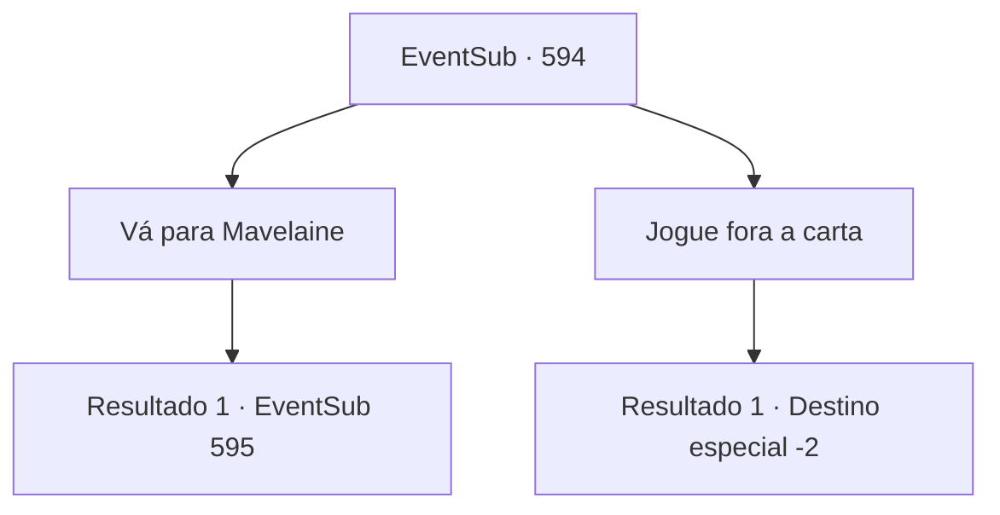

# Eventos secundários · 594

[Índice da tabela](index.md) · [Índice geral](../index.md)

ID: `pt:EventSub:594` · Fonte: `EventSub4` · Versão: 1.2.47.

Mapeamento estático dos arquivos; a disponibilidade e a execução dependem do estado da run.

## Texto do evento

Enquanto está aventureiro, recebe uma carta de Edenheart. Ao abrir o envelope, vê o conteúdo da carta, escrito com letra cuidada. 

 'A sua ajuda é necessária, {1}. Por favor, venha para Mavelaine o mais rápido possível.'

## Dados de entrada

```json
{
  "id": 594,
  "grade": 1,
  "subEvent": "",
  "required": "12_10_2"
}
```

## Mapa das escolhas



## Escolhas e resultados

### Escolha 1

Vá para Mavelaine

Requisitos e outros campos da escolha:

```json
{
  "required": ""
}
```

#### Resultado 1.1

Após ler a carta, você imediatamente vai para Mavelaine. 

 Alguns dias depois, você avista Edenheart em frente à Mansão de Fheren. Ela está usando aquela mochila enorme que você viu da última vez, terminando seus preparativos, colocando suas coisas em uma carruagem. Você se aproxima de Edenheart e pergunta para onde ela está indo. Edenheart fica surpresa, pega de surpresa. Ela recebe sua presença de braços abertos. 

 "Você chegou na hora certa, {1}! Eu estava prestes a ir em direção à Biblioteca Real de Zaipent!"

 Ela menciona que o roteiro necessário para completar o elixir está guardado na Biblioteca Real. Após terminar sua explicação, ela pede que você dirija a carruagem.

Continuação registrada: [Evento 595](0595.md) na mesma tabela.

```json
{
  "required": "",
  "chance": "1",
  "nextEvent": 595,
  "type": 2,
  "reward": ""
}
```

### Escolha 2

Jogue fora a carta

Requisitos e outros campos da escolha:

```json
{
  "required": ""
}
```

#### Resultado 2.1

Você joga a carta fora e vai para outro lugar.

Continuação registrada: [Destino especial `-2`](../destinos-especiais.md).

```json
{
  "required": "",
  "chance": "1",
  "nextEvent": -2,
  "type": 2,
  "reward": "12_10_-1"
}
```

## Referências que chegam a este evento

Nenhum `nextEvent` positivo da mesma tabela aponta para este nó. Isso não prova que seja inacessível: sorteio e estado de história podem selecioná-lo.

