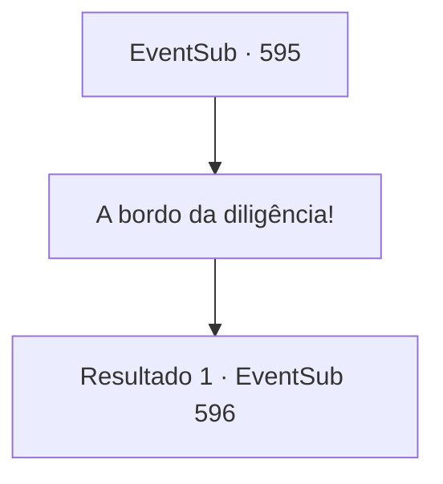

# Eventos secundários · 595

[Índice da tabela](index.md) · [Índice geral](../index.md)

ID: `pt:EventSub:595` · Fonte: `EventSub4` · Versão: 1.2.47.

Mapeamento estático dos arquivos; a disponibilidade e a execução dependem do estado da run.

## Texto do evento

*Sem texto no arquivo.*

## Dados de entrada

```json
{
  "id": 595,
  "grade": 1,
  "subEvent": "",
  "required": ""
}
```

## Mapa das escolhas



## Escolhas e resultados

### Escolha 1

A bordo da diligência!

Requisitos e outros campos da escolha:

```json
{
  "required": ""
}
```

#### Resultado 1.1

Você sobe na diligência e começa sua jornada para 'Zapen', a cidade capital do Império Zaipent. Alguns dias depois, a diligência é bloqueada repentinamente por um bando de goblins. Um bugbear, aparentemente o chefe desse grupo, faz o possível para falar, segurando desajeitadamente sua palma. 

 "Ouro. Dar. Deixar passar. Sem ouro? Matar."

 Eles parecem ser uma gangue de goblionoides, se entregando à banditismo. Os olhos assustados de Edenheart encontram os seus.

Continuação registrada: [Evento 596](0596.md) na mesma tabela.

```json
{
  "required": "",
  "chance": "1",
  "nextEvent": 596,
  "type": 2,
  "reward": ""
}
```

## Referências que chegam a este evento

- [Evento 594 · escolha 1 · resultado 1](0594.md#escolha-1)
