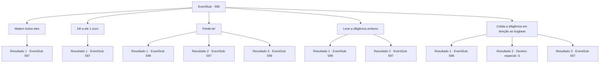

# Eventos secundários · 596

[Índice da tabela](index.md) · [Índice geral](../index.md)

ID: `pt:EventSub:596` · Fonte: `EventSub4` · Versão: 1.2.47.

Mapeamento estático dos arquivos; a disponibilidade e a execução dependem do estado da run.

## Texto do evento

*Sem texto no arquivo.*

## Dados de entrada

```json
{
  "id": 596,
  "grade": 1,
  "subEvent": "",
  "required": ""
}
```

## Mapa das escolhas



## Escolhas e resultados

### Escolha 1

Matem todos eles

Requisitos e outros campos da escolha:

```json
{
  "required": ""
}
```

#### Resultado 1.1

Você decide matar todos eles - o caminho direto e simples. Assim que você desce da diligência, os goblins começam seu ataque, tendo sentido suas intenções. O bugbear é o primeiro a correr em sua direção.

Continuação registrada: [Evento 597](0597.md) na mesma tabela.

```json
{
  "required": "",
  "chance": "1",
  "nextEvent": 597,
  "type": 2,
  "reward": "6_0_144",
  "place": 0
}
```

### Escolha 2

Dê a ele 1 ouro

Requisitos e outros campos da escolha:

```json
{
  "required": "1_4_1"
}
```

#### Resultado 2.1

Você joga uma moeda de ouro para o bugbear. O bugbear pega a moeda de ouro, levanta seu clube no ar e grita. 

 "OURO! PEGAMOS! MATAMOS! MAIS OURO!"

 Incentivados pelo comando do bugbear, os goblins avançam em sua direção com alegria. O bugbear é o primeiro a avançar em sua direção. Você imediatamente pula para fora da carruagem, se preparando para lutar.

Continuação registrada: [Evento 597](0597.md) na mesma tabela.

```json
{
  "required": "",
  "chance": "1",
  "nextEvent": 597,
  "type": 2,
  "reward": "6_0_144|0_4_-1",
  "place": 0
}
```

### Escolha 3

Perde-te!

Requisitos e outros campos da escolha:

```json
{
  "required": ""
}
```

#### Resultado 3.1

Você grita para o bugbear se perder. Assustado com sua intimidação, o bugbear foge. Com seu líder fora, os outros goblins fazem o mesmo, largando suas armas e fugindo. Você retorna para a carruagem. 

 Alguns dias depois, chegando em Zapen, você deixa Edenheart para o trabalho dela. Edenheart imediatamente vai para a Biblioteca Real, enquanto você anda pelas ruas de Zapen, apreciando as vistas da capital real. |drawing_Zapen| Mas então, nem mesmo uma hora se passou e Edenheart está de volta. Parece que ela estava procurando por você. 

 "Eu deveria ter sabido. Para entrar na Biblioteca Real, você precisa de uma permissão real. Eu fiz o meu melhor para convencer os guardas a me deixarem entrar, mas sem sucesso."

 Edenheart pergunta o que fazer, triste.

Continuação registrada: [Evento 598](0598.md) na mesma tabela.

```json
{
  "required": "21_1_2",
  "chance": "1|0_12_1",
  "nextEvent": 598,
  "type": 0,
  "reward": "0_2_1"
}
```

#### Resultado 3.2

Você grita para o bugbear se perder. Mas parece que sua estratégia deu errado. O bugbear levanta seu clube alto no ar e grita. 

 "OURO! NÓS PEGAMOS! MATAR! MAIS OURO!"

 Incentivados pelo comando do bugbear, os goblins avançam em sua direção com alegria. O bugbear é o primeiro a avançar em sua direção. Você prepara sua arma, mirando na cabeça do bugbear.

Continuação registrada: [Evento 597](0597.md) na mesma tabela.

```json
{
  "required": "21_1_2",
  "chance": "13",
  "nextEvent": 597,
  "type": 1,
  "reward": "6_0_144",
  "place": 0
}
```

#### Resultado 3.3

Você grita para o bugbear se perder. Assustado com sua intimidação, o bugbear foge. Com seu líder fora, os outros goblins fazem o mesmo, largando suas armas e fugindo. Você retorna para a carruagem. 

 Alguns dias depois, chegando em Zapen, você deixa Edenheart para o trabalho dela. Edenheart imediatamente vai para a Biblioteca Real, enquanto você anda pelas ruas de Zapen, apreciando as vistas da capital real. |drawing_Zapen| Mas então, nem mesmo uma hora se passou e Edenheart está de volta. Parece que ela estava procurando por você. 

 "Eu deveria ter sabido. Para entrar na Biblioteca Real, você precisa de uma permissão real. Eu fiz o meu melhor para convencer os guardas a me deixarem entrar, mas sem sucesso."

 Edenheart pergunta o que fazer, triste.

Continuação registrada: [Evento 598](0598.md) na mesma tabela.

```json
{
  "required": "20_1_2",
  "chance": "1",
  "nextEvent": 598,
  "type": 2,
  "reward": "0_2_1"
}
```

### Escolha 4

Leve a diligência embora

Requisitos e outros campos da escolha:

```json
{
  "required": ""
}
```

#### Resultado 4.1

Você passa rapidamente pela banda de goblins. Eles tentam perseguir a diligência, mas logo percebem que é impossível alcançar um veículo. Você continua dirigindo. 

 Alguns dias depois, ao chegar em Zapen, você deixa Edenheart para fazer seu trabalho. Edenheart vai imediatamente para a Biblioteca Real, enquanto você passeia pelas ruas de Zapen, apreciando as vistas da capital real. |drawing_Zapen| Mas então, nem mesmo uma hora se passou e Edenheart está de volta. Parece que ela estava te procurando. 

 "Eu deveria ter sabido. Para entrar na Biblioteca Real, você precisa de uma permissão real. Eu fiz o meu melhor para convencer os guardas a me deixarem entrar, mas sem sucesso."

 Edenheart pergunta o que fazer, triste.

Continuação registrada: [Evento 598](0598.md) na mesma tabela.

```json
{
  "required": "",
  "chance": "1|0_6_1",
  "nextEvent": 598,
  "type": 0,
  "reward": "0_2_1"
}
```

#### Resultado 4.2

Você tenta passar pela banda de goblins, mas o bugbear percebe sua intenção e impede sua fuga. Agora, sua carruagem está cercada. 

 "OURO! PEGAMOS! MATAMOS! MAIS OURO!"

 Incentivados pelo comando do bugbear, os goblins avançam em sua direção com alegria. O bugbear é o primeiro a avançar em sua direção. Você imediatamente pula da carruagem, se preparando para lutar.

Continuação registrada: [Evento 597](0597.md) na mesma tabela.

```json
{
  "required": "",
  "chance": "15",
  "nextEvent": 597,
  "type": 1,
  "reward": "6_0_144",
  "place": 0
}
```

### Escolha 5

Colida a diligência em direção ao bugbear

Requisitos e outros campos da escolha:

```json
{
  "required": ""
}
```

#### Resultado 5.1

Você golpeia o bugbear com sua diligência, acertando-o em cheio no rosto. O bugbear é nocauteado, enquanto os outros goblins se dispersam com seu líder desaparecido. Você desce da diligência, pegando as moedas de ouro que os goblins deixaram para trás. 

 "Ugh... uck..."

 Você volta para a diligência e encontra Edenheart vomitando. Ela parece chocada. Você dá tapinhas nas costas dela e continua dirigindo a diligência. 

 Alguns dias depois, ao chegar em Zapen, você deixa Edenheart trabalhando. Edenheart vai imediatamente para a Biblioteca Real, enquanto você passeia pelas ruas de Zapen, apreciando as vistas da capital real. |drawing_Zapen| Mas então, nem mesmo uma hora se passou e Edenheart está de volta. Parece que ela estava procurando por você. 

 "Eu deveria ter sabido. Para entrar na Biblioteca Real, você precisa de uma permissão real. Eu fiz o meu melhor para convencer os guardas a me deixarem entrar, mas sem sucesso."

 Edenheart pergunta o que fazer, triste.

Continuação registrada: [Evento 598](0598.md) na mesma tabela.

```json
{
  "required": "",
  "chance": "1|0_6_1",
  "nextEvent": 598,
  "type": 0,
  "reward": "0_2_1|0_4_50"
}
```

#### Resultado 5.2

Tentas atingir o bugbear com a tua diligência. Mas devido à tua falta de habilidades de condução, a diligência choca-se contra uma árvore próxima. Impulsionados pelo momentum, tu e Edenheart são lançados para fora da diligência. Infelizmente, encontram um destino prematuro.

Continuação registrada: [Destino especial `-3`](../destinos-especiais.md).

```json
{
  "required": "2_0_2",
  "chance": "12",
  "nextEvent": -3,
  "type": 1,
  "reward": "0_0_-1"
}
```

#### Resultado 5.3

Tentas atingir o bugbear com a tua diligência. Mas devido à tua falta de habilidades de condução, a diligência choca-se contra uma árvore próxima. Impulsionados pelo momento, tu e Edenheart são lançados para fora da diligência. Os goblins e o bugbear riem-se de ti e depois atacam.

Continuação registrada: [Evento 597](0597.md) na mesma tabela.

```json
{
  "required": "1_0_2",
  "chance": "12",
  "nextEvent": 597,
  "type": 1,
  "reward": "0_0_-1|6_0_144",
  "place": 0
}
```

## Referências que chegam a este evento

- [Evento 595 · escolha 1 · resultado 1](0595.md#escolha-1)
