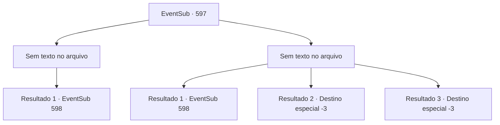

# Eventos secundários · 597

[Índice da tabela](index.md) · [Índice geral](../index.md)

ID: `pt:EventSub:597` · Fonte: `EventSub4` · Versão: 1.2.47.

Mapeamento estático dos arquivos; a disponibilidade e a execução dependem do estado da run.

## Texto do evento

*Sem texto no arquivo.*

## Dados de entrada

```json
{
  "id": 597,
  "grade": 1,
  "subEvent": "",
  "required": ""
}
```

## Mapa das escolhas



## Escolhas e resultados

### Escolha 1

*Sem texto no arquivo; o papel dessa opção depende da interface do jogo.*

Requisitos e outros campos da escolha:

```json
{
  "required": ""
}
```

#### Resultado 1.1

Você limpa o sangue da sua arma e olha ao redor. Os goblins já fugiram, com a cabeça de seu líder decepada. Você retorna à carruagem. 

 Alguns dias depois, chegando em Zapen, você deixa Edenheart para o seu trabalho. Edenheart imediatamente foi para a Biblioteca Real, enquanto você está caminhando pelas ruas de Zapen, apreciando as vistas da capital real. |drawing_Zapen| Mas então, nem mesmo uma hora se passou e Edenheart está de volta. Parece que ela estava procurando por você. 

 "Eu deveria ter sabido. Para entrar na Biblioteca Real, você precisa de uma permissão real. Eu fiz o meu melhor para convencer os guardas a me deixarem entrar, mas sem sucesso."

 Edenheart pergunta o que fazer, triste.

Continuação registrada: [Evento 598](0598.md) na mesma tabela.

```json
{
  "required": "",
  "chance": "1",
  "nextEvent": 598,
  "type": 2,
  "reward": ""
}
```

### Escolha 2

*Sem texto no arquivo; o papel dessa opção depende da interface do jogo.*

Requisitos e outros campos da escolha:

```json
{
  "required": ""
}
```

#### Resultado 2.1

Apesar de sua habilidade inadequada de fala, o bugbear e os goblins parecem habilidosos em uma coisa: banditismo. Vendo que a diligência está em perigo, Edenheart revira sua mochila e joga algo. Uma garrafa de vidro se quebra e uma forte faísca de luz é disparada dela. 

 "GIIIEEEK!!! ACK!"

 Os goblins tentam cobrir os olhos, cambaleando com a faísca ou já caídos inconscientes no chão. Você também fica cego pelo choque, mas logo Edenheart te agarra pelo braço e te ajuda a se levantar. Vocês dois conseguem escapar dos goblins. 

 "...Bem, acho que vamos ter que andar a partir de agora."

 Alguns dias depois, chegando em Zapen, você deixa Edenheart para o trabalho dela. Edenheart vai imediatamente para a Biblioteca Real, enquanto você passeia pelas ruas de Zapen, apreciando as vistas da capital real. |drawing_Zapen| Mas então, nem mesmo uma hora se passou e Edenheart está de volta. Parece que ela estava te procurando. 

 "Eu deveria ter sabido. Para entrar na Biblioteca Real, você precisa de uma permissão real. Eu fiz o meu melhor para convencer os guardas a me deixarem entrar, mas sem sucesso."

 Edenheart te pergunta o que fazer, triste.

Continuação registrada: [Evento 598](0598.md) na mesma tabela.

```json
{
  "required": "1_0_2|1_1_2",
  "chance": "1",
  "nextEvent": 598,
  "type": 2,
  "reward": "0_0_-1|0_1_-1"
}
```

#### Resultado 2.2

Apesar de sua habilidade inadequada de fala, o bugbear e os goblins parecem habilidosos em uma coisa: banditismo. Você é rapidamente morto, deixado em uma bagunça ensanguentada.

Continuação registrada: [Destino especial `-3`](../destinos-especiais.md).

```json
{
  "required": "2_0_2",
  "chance": "1",
  "nextEvent": -3,
  "type": 2,
  "reward": "0_0_-1|0_1_-1"
}
```

#### Resultado 2.3

Apesar de sua habilidade inadequada de fala, o bugbear e os goblins parecem habilidosos em uma coisa: banditismo. Você é rapidamente morto, deixado em uma bagunça ensanguentada.

Continuação registrada: [Destino especial `-3`](../destinos-especiais.md).

```json
{
  "required": "2_1_2",
  "chance": "1",
  "nextEvent": -3,
  "type": 2,
  "reward": "0_0_-1|0_1_-1"
}
```

## Referências que chegam a este evento

- [Evento 596 · escolha 1 · resultado 1](0596.md#escolha-1)
- [Evento 596 · escolha 2 · resultado 1](0596.md#escolha-2)
- [Evento 596 · escolha 3 · resultado 2](0596.md#escolha-3)
- [Evento 596 · escolha 4 · resultado 2](0596.md#escolha-4)
- [Evento 596 · escolha 5 · resultado 3](0596.md#escolha-5)
