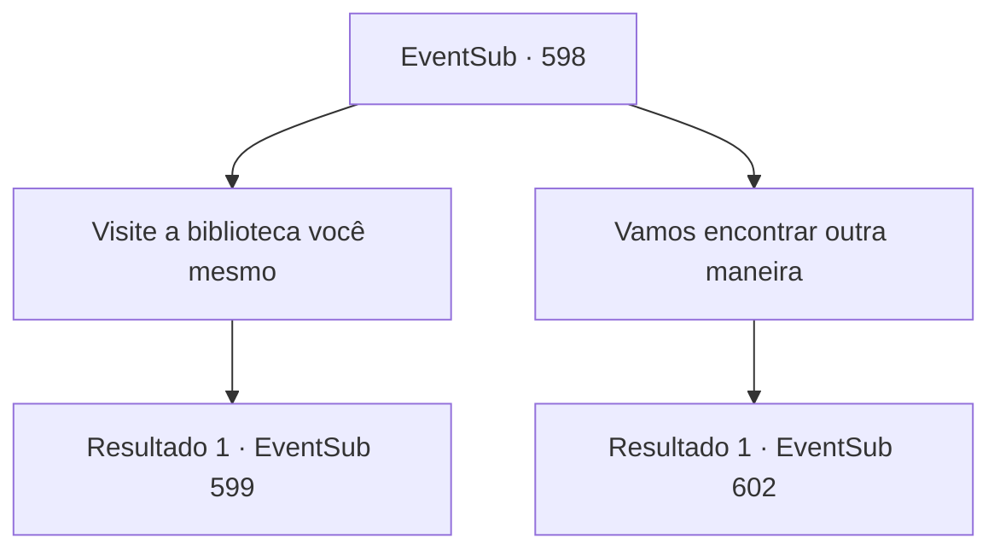

# Eventos secundários · 598

[Índice da tabela](index.md) · [Índice geral](../index.md)

ID: `pt:EventSub:598` · Fonte: `EventSub4` · Versão: 1.2.47.

Mapeamento estático dos arquivos; a disponibilidade e a execução dependem do estado da run.

## Texto do evento

*Sem texto no arquivo.*

## Dados de entrada

```json
{
  "id": 598,
  "grade": 1,
  "subEvent": "",
  "required": ""
}
```

## Mapa das escolhas



## Escolhas e resultados

### Escolha 1

Visite a biblioteca você mesmo

Requisitos e outros campos da escolha:

```json
{
  "required": ""
}
```

#### Resultado 1.1

Você visita a Biblioteca Real de Zaipent com Edenheart. A biblioteca está à altura de seu título - mantida pelos próprios cortesãos do imperador, ela possui uma enorme coleção de livros e tomos de todo o mundo, decorados com vitrais coloridos. 

 "Argh, você de novo? Desculpe, mas não posso deixar você entrar sem uma permissão real."

 O guarda da biblioteca impede vocês dois de entrarem na biblioteca. Ele reconhece Edenheart e insta vocês dois a voltarem.

Continuação registrada: [Evento 599](0599.md) na mesma tabela.

```json
{
  "required": "",
  "chance": "1",
  "nextEvent": 599,
  "type": 2,
  "reward": ""
}
```

### Escolha 2

Vamos encontrar outra maneira

Requisitos e outros campos da escolha:

```json
{
  "required": ""
}
```

#### Resultado 2.1

Você decide se separar, procurando uma maneira de entrar na Biblioteca Real. Após ouvir sua sugestão, Edenheart vai para a praça principal, enquanto você procura as vielas dos fundos. Logo você percebe que, mesmo a esplêndida capital do brilhante império tem suas sombras. As vielas dos fundos estão cheias de mendigos e crianças de rua - e figuras suspeitas também, sobrevivendo com moedas não tão legitimamente ganhas. Você conversa com eles, procurando uma maneira de entrar na biblioteca. Cerca de uma hora depois, um homem chamado 'o Falsificador' se aproxima de você. 

 "Ouvi dizer que você está procurando uma maneira de entrar na Biblioteca Real. Posso fazer um documento falso para você, se quiser, hein?"

 É claro que ele não vai trabalhar de graça. Rindo, ele pede 100 moedas de ouro pelo serviço.

Continuação registrada: [Evento 602](0602.md) na mesma tabela.

```json
{
  "required": "",
  "chance": "1",
  "nextEvent": 602,
  "type": 2,
  "reward": ""
}
```

## Referências que chegam a este evento

- [Evento 596 · escolha 3 · resultado 1](0596.md#escolha-3)
- [Evento 596 · escolha 3 · resultado 3](0596.md#escolha-3)
- [Evento 596 · escolha 4 · resultado 1](0596.md#escolha-4)
- [Evento 596 · escolha 5 · resultado 1](0596.md#escolha-5)
- [Evento 597 · escolha 1 · resultado 1](0597.md#escolha-1)
- [Evento 597 · escolha 2 · resultado 1](0597.md#escolha-2)
