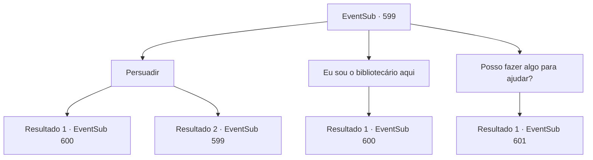

# Eventos secundários · 599

[Índice da tabela](index.md) · [Índice geral](../index.md)

ID: `pt:EventSub:599` · Fonte: `EventSub4` · Versão: 1.2.47.

Mapeamento estático dos arquivos; a disponibilidade e a execução dependem do estado da run.

## Texto do evento

*Sem texto no arquivo.*

## Dados de entrada

```json
{
  "id": 599,
  "grade": 1,
  "subEvent": "",
  "required": ""
}
```

## Mapa das escolhas



## Escolhas e resultados

### Escolha 1

Persuadir

Requisitos e outros campos da escolha:

```json
{
  "required": "5_593_0"
}
```

#### Resultado 1.1

Você persuade o guarda da biblioteca com sua habilidade de persuasão. Finalmente, o guarda cede. 

 "Tudo bem, tudo bem. Apenas desta vez. Mas, se eu ver qualquer um de vocês causando problemas na biblioteca, EU responsabilizarei ambos."

 O guarda permite que Edenheart passe um dia na biblioteca. Como se estivesse tentando aproveitar cada segundo, Edenheart devora vários volumes e tomos, examinando cada página relacionada ao lendário Elixir. Enquanto isso, você passa a noite dormindo em uma cadeira. Você e Edenheart deixam a Biblioteca Real na manhã seguinte. Você pode perceber apenas olhando para o rosto dela que Edenheart não dormiu nem um minuto na noite passada, mas seu rosto está cheio de um sorriso brilhante.

Continuação registrada: [Evento 600](0600.md) na mesma tabela.

```json
{
  "required": "",
  "chance": "1|0_12_1",
  "nextEvent": 600,
  "type": 0,
  "reward": ""
}
```

#### Resultado 1.2

Tentas persuadir o guarda da biblioteca com a tua habilidade de oratória. No entanto, o guarda não cede.

Continuação registrada: [Evento 599](0599.md) na mesma tabela.

```json
{
  "required": "",
  "chance": "16",
  "nextEvent": 599,
  "type": 1,
  "reward": "5_593_9"
}
```

### Escolha 2

Eu sou o bibliotecário aqui

Requisitos e outros campos da escolha:

```json
{
  "required": "5_153_1"
}
```

#### Resultado 2.1

Você repete seu pedido, mas desta vez adiciona que você é um ex-Bibliotecário Real que costumava trabalhar aqui. Finalmente, o guarda teimoso reconhece seu rosto e fala. 

 "Ah... Eu sabia que já tinha visto seu rosto em algum lugar. Faz muito tempo, não é? O que você tem feito?"

 Você conversa com o guarda e finalmente recebe permissão para entrar na biblioteca. 

 "Certifique-se de agradecer seu amigo, senhorita."

 O guarda permite que Edenheart passe um dia na biblioteca. Como se estivesse tentando aproveitar cada segundo, Edenheart devora vários volumes e tomos, examinando cada página relacionada ao lendário Elixir. Enquanto isso, você passa a noite dormindo em uma cadeira. Você e Edenheart deixam a Biblioteca Real na manhã seguinte. Você pode dizer apenas olhando para o rosto dela que Edenheart não dormiu nem um minuto na noite passada, mas seu rosto está cheio de um sorriso brilhante.

Continuação registrada: [Evento 600](0600.md) na mesma tabela.

```json
{
  "required": "",
  "chance": "1",
  "nextEvent": 600,
  "type": 2,
  "reward": ""
}
```

### Escolha 3

Posso fazer algo para ajudar?

Requisitos e outros campos da escolha:

```json
{
  "required": ""
}
```

#### Resultado 3.1

Você pergunta ao guarda se pode ajudá-lo com algo. Claro, isso é uma forma alternativa de dizer, 'não posso fazer algo em troca da sua permissão'. O guarda te encara por um segundo e então faz um gesto para que você o siga. Ele os leva até uma cabana decadente, localizada um pouco longe da biblioteca. 

 "Eu preciso que você copie o conteúdo deste livro em três dias. Aqui está tudo que você precisa para o trabalho."

 O guarda coloca um livro na mesa e retorna para a biblioteca. Edenheart dá uma olhada no livro e solta um suspiro profundo. -E-esse é uma biografia do famoso cavaleiro 'Sir Valernon'! Não há como transcrevermos isso em três dias! Como faremos...

Continuação registrada: [Evento 601](0601.md) na mesma tabela.

```json
{
  "required": "",
  "chance": "1",
  "nextEvent": 601,
  "type": 2,
  "reward": ""
}
```

## Referências que chegam a este evento

- [Evento 598 · escolha 1 · resultado 1](0598.md#escolha-1)
- [Evento 599 · escolha 1 · resultado 2](0599.md#escolha-1)
- [Evento 602 · escolha 3 · resultado 1](0602.md#escolha-3)
