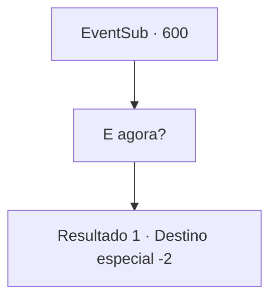

# Eventos secundários · 600

[Índice da tabela](index.md) · [Índice geral](../index.md)

ID: `pt:EventSub:600` · Fonte: `EventSub4` · Versão: 1.2.47.

Mapeamento estático dos arquivos; a disponibilidade e a execução dependem do estado da run.

## Texto do evento

*Sem texto no arquivo.*

## Dados de entrada

```json
{
  "id": 600,
  "grade": 1,
  "subEvent": "",
  "required": ""
}
```

## Mapa das escolhas



## Escolhas e resultados

### Escolha 1

E agora?

Requisitos e outros campos da escolha:

```json
{
  "required": ""
}
```

#### Resultado 1.1

Você pergunta a Edenheart o que ela vai fazer. Ela responde que quer visitar as 'Ruínas de Plasphere'. De acordo com os scripts da biblioteca, é lá que o lendário Elixir foi preparado. 

 "Talvez possamos... verificar os ingredientes ou instrumentos que precisamos para preparar o Elixir. Eu te aviso onde fica, por que você não vai lá primeiro? Eu preciso passar em Mavelaine antes. E isso... é para me ajudar."

 Edenheart te entrega uma Poção da Beleza e então sai da cidade.

Continuação registrada: [Destino especial `-2`](../destinos-especiais.md).

```json
{
  "required": "",
  "chance": "1",
  "nextEvent": -2,
  "type": 2,
  "reward": "3_52_1|12_10_3"
}
```

## Referências que chegam a este evento

- [Evento 599 · escolha 1 · resultado 1](0599.md#escolha-1)
- [Evento 599 · escolha 2 · resultado 1](0599.md#escolha-2)
- [Evento 601 · escolha 1 · resultado 1](0601.md#escolha-1)
- [Evento 601 · escolha 2 · resultado 1](0601.md#escolha-2)
- [Evento 601 · escolha 3 · resultado 1](0601.md#escolha-3)
- [Evento 603 · escolha 1 · resultado 1](0603.md#escolha-1)
