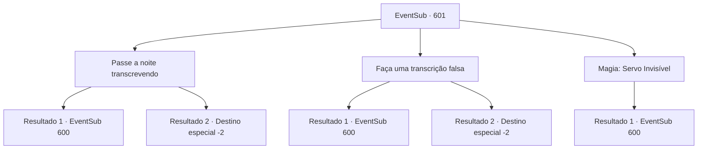

# Eventos secundários · 601

[Índice da tabela](index.md) · [Índice geral](../index.md)

ID: `pt:EventSub:601` · Fonte: `EventSub4` · Versão: 1.2.47.

Mapeamento estático dos arquivos; a disponibilidade e a execução dependem do estado da run.

## Texto do evento

*Sem texto no arquivo.*

## Dados de entrada

```json
{
  "id": 601,
  "grade": 1,
  "subEvent": "",
  "required": ""
}
```

## Mapa das escolhas



## Escolhas e resultados

### Escolha 1

Passe a noite transcrevendo

Requisitos e outros campos da escolha:

```json
{
  "required": ""
}
```

#### Resultado 1.1

Você e Edenheart passam a noite inteira transcrevendo. A biografia do Sir Valernon normalmente levaria pelo menos uma semana para ser transcrita completamente, mas vocês dois conseguem fazer isso em três dias, trabalhando incansavelmente. 

 Três dias depois, você se aproxima do guarda da biblioteca para entregar a transcrição. Ele dá uma olhada na transcrição, fica boquiaberto e lhe dá permissão. 

 "Huh. Vocês realmente conseguiram. Em três dias! Uma promessa é uma promessa. Mas, se eu ver algum de vocês causando problemas na biblioteca, EU responsabilizarei ambos."

 O guarda permite que Edenheart passe um dia na biblioteca. Como se estivesse tentando aproveitar cada segundo, Edenheart devora vários volumes e tomos, examinando cada página relacionada ao lendário Elixir. Enquanto isso, você passa a noite dormindo em uma cadeira. 

 Você e Edenheart deixam a Biblioteca Real na manhã seguinte. Você pode perceber apenas olhando para o rosto dela que Edenheart não dormiu nem um minuto na noite passada, mas seu rosto está cheio de um sorriso radiante.

Continuação registrada: [Evento 600](0600.md) na mesma tabela.

```json
{
  "required": "",
  "chance": "1|0_6_1|0_13_1",
  "nextEvent": 600,
  "type": 0,
  "reward": ""
}
```

#### Resultado 1.2

Você e Edenheart passam a noite inteira transcrevendo. Infelizmente, vocês não conseguem cumprir o prazo e o guarda não lhes dá permissão. Entrada rejeitada, Edenheart decide voltar para Mavelaine. Ela lhe diz que continuará conduzindo pesquisas lá individualmente. 

 "As coisas não deram tão certo, mas... Eu não teria chegado tão longe sem você. Por favor, aceite isso. E, se eu precisar da sua ajuda novamente, lhe enviarei outra carta. Agora, se me der licença."

 Edenheart pega uma carruagem e deixa a capital do império.

Continuação registrada: [Destino especial `-2`](../destinos-especiais.md).

```json
{
  "required": "",
  "chance": "20",
  "nextEvent": -2,
  "type": 1,
  "reward": "0_4_60|12_10_6"
}
```

### Escolha 2

Faça uma transcrição falsa

Requisitos e outros campos da escolha:

```json
{
  "required": ""
}
```

#### Resultado 2.1

A biografia do Sir Valernon normalmente levaria pelo menos uma semana para ser transcrita completamente. Uma tarefa impossível em mãos, você decide enganar o guarda da biblioteca - apenas transcrevendo as primeiras e últimas páginas, e preenchendo a lacuna com poemas aleatórios retirados de outros livros. A consciência de Edenheart parece estar perturbada, mas por fim ela decide relutantemente ajudar você. 

 Três dias depois, você entrega confiantemente a transcrição falsa ao guarda. Completamente enganado pela sua atuação, ele permite sua entrada sem nem mesmo olhar o conteúdo da transcrição. 

 "Huh. Você realmente conseguiu. Em três dias! Uma promessa é uma promessa. Mas, se eu ver qualquer um de vocês causando problemas na biblioteca, EU responsabilizarei ambos."

 O guarda permite que Edenheart passe um dia na biblioteca. Como se estivesse tentando aproveitar cada segundo, Edenheart devora vários volumes e tomos, percorrendo cada página relacionada ao lendário Elixir. Enquanto isso, você passa a noite dormindo em uma cadeira. 

 Você e Edenheart deixam a Biblioteca Real na manhã seguinte. Você pode perceber apenas olhando para o rosto dela que Edenheart não dormiu nem um minuto na noite passada, mas seu rosto está cheio de um sorriso brilhante.

Continuação registrada: [Evento 600](0600.md) na mesma tabela.

```json
{
  "required": "",
  "chance": "1|0_12_1",
  "nextEvent": 600,
  "type": 0,
  "reward": ""
}
```

#### Resultado 2.2

A biografia do Sir Valernon normalmente levaria pelo menos uma semana para ser transcrita completamente. Uma tarefa impossível em mãos, você decide enganar o guarda da biblioteca - apenas transcrevendo as primeiras e últimas páginas, e preenchendo a lacuna com poemas aleatórios retirados de outros livros. A consciência de Edenheart parece estar perturbada, mas por fim ela decide relutantemente ajudar você. 

 Três dias depois, você entrega confiantemente a transcrição falsa ao guarda. Mas talvez sua atuação não tenha sido suficiente. O guarda olha suspeitosamente para você por um segundo antes de apontar as partes erradas da transcrição e então começa a gritar com vocês dois. Entrada rejeitada, Edenheart decide voltar para Mavelaine. Ela diz que continuará conduzindo pesquisas lá individualmente. 

 "As coisas não deram tão certo, mas... Eu não teria chegado tão longe sem você. Por favor, aceite isso. E, se eu precisar de sua ajuda novamente, enviarei outra carta para você. Agora, se me der licença."

 Edenheart pega uma carruagem e deixa a capital do império.

Continuação registrada: [Destino especial `-2`](../destinos-especiais.md).

```json
{
  "required": "",
  "chance": "14",
  "nextEvent": -2,
  "type": 1,
  "reward": "0_4_60|12_10_6"
}
```

### Escolha 3

Magia: Servo Invisível

Requisitos e outros campos da escolha:

```json
{
  "required": "20_0_1"
}
```

#### Resultado 3.1

Você conjura o Servo Invisível, fazendo com que ele faça o trabalho manual em seu lugar. A biografia do Sir Valernon normalmente levaria pelo menos uma semana para ser transcrita completamente. Mas o Servo Invisível trabalha incansavelmente, completando a transcrição. 

 Três dias depois, você se aproxima do guarda da biblioteca para entregar a transcrição a ele. Ele dá uma olhada na transcrição, fica boquiaberto e lhe dá permissão. 

 "Huh. Você realmente fez isso. Em três dias! Uma promessa é uma promessa. Mas, se eu ver qualquer um de vocês causando problemas na biblioteca, EU responsabilizarei ambos."

 O guarda permite que Edenheart passe um dia na biblioteca. Como se estivesse tentando aproveitar cada segundo, Edenheart devora vários volumes e tomos, examinando cada página relacionada ao lendário Elixir. Enquanto isso, você passa a noite dormindo em uma cadeira. 

 Você e Edenheart deixam a Biblioteca Real na manhã seguinte. Você pode perceber apenas olhando para o rosto dela que Edenheart não dormiu nem um minuto na noite passada, mas seu rosto está cheio de um sorriso brilhante.

Continuação registrada: [Evento 600](0600.md) na mesma tabela.

```json
{
  "required": "",
  "chance": "1",
  "nextEvent": 600,
  "type": 2,
  "reward": ""
}
```

## Referências que chegam a este evento

- [Evento 599 · escolha 3 · resultado 1](0599.md#escolha-3)
