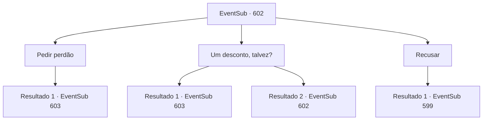

# Eventos secundários · 602

[Índice da tabela](index.md) · [Índice geral](../index.md)

ID: `pt:EventSub:602` · Fonte: `EventSub4` · Versão: 1.2.47.

Mapeamento estático dos arquivos; a disponibilidade e a execução dependem do estado da run.

## Texto do evento

*Sem texto no arquivo.*

## Dados de entrada

```json
{
  "id": 602,
  "grade": 1,
  "subEvent": "",
  "required": ""
}
```

## Mapa das escolhas



## Escolhas e resultados

### Escolha 1

Pedir perdão

Requisitos e outros campos da escolha:

```json
{
  "required": "1_4_100"
}
```

#### Resultado 1.1

Você compra o documento de entrada falsificado do Falsificador e retorna a Edenheart. A consciência de Edenheart parece perturbada, mas finalmente ela decide relutantemente seguir você. Alguns minutos depois, você visita a Biblioteca Real de Zaipent com Edenheart. A biblioteca está à altura de seu título - mantida pelos cortesãos do imperador, ela possui uma enorme coleção de livros e tomos de todo o mundo, decorados com vitrais coloridos. 

 "Argh, você de novo? Desculpe, mas não posso deixar você entrar sem uma permissão real."

 O guarda da biblioteca impede que vocês dois entrem na biblioteca. Ele reconhece Edenheart e instiga vocês dois a voltarem.

Continuação registrada: [Evento 603](0603.md) na mesma tabela.

```json
{
  "required": "",
  "chance": "1",
  "nextEvent": 603,
  "type": 2,
  "reward": "0_4_-100"
}
```

### Escolha 2

Um desconto, talvez?

Requisitos e outros campos da escolha:

```json
{
  "required": "1_4_80|5_594_0"
}
```

#### Resultado 2.1

Depois de uma negociação acirrada, você consegue obter um documento de entrada falsificado por 80 ouros. Você retorna a Edenheart. A consciência de Edenheart parece perturbada, mas finalmente ela decide relutantemente seguir você. Alguns minutos depois, você visita a Biblioteca Real de Zaipent com Edenheart. A biblioteca está à altura de seu título - mantida pelos cortesãos do imperador, ela possui uma enorme coleção de livros e tomos de todo o mundo, decorados com vitrais coloridos. 

 "Argh, você de novo? Desculpe, mas não posso deixar você entrar sem um documento real."

 O guarda da biblioteca impede que vocês entrem na biblioteca. Ele reconhece Edenheart e instiga vocês dois a voltarem.

Continuação registrada: [Evento 603](0603.md) na mesma tabela.

```json
{
  "required": "",
  "chance": "1|0_12_1",
  "nextEvent": 603,
  "type": 0,
  "reward": "0_4_-80"
}
```

#### Resultado 2.2

Você pede um desconto, mas o Forget zomba e recusa. 

 "Vá procurar outra pessoa, então."


Continuação registrada: [Evento 602](0602.md) na mesma tabela.

```json
{
  "required": "",
  "chance": "12",
  "nextEvent": 602,
  "type": 1,
  "reward": "5_594_9"
}
```

### Escolha 3

Recusar

Requisitos e outros campos da escolha:

```json
{
  "required": ""
}
```

#### Resultado 3.1

Você recusa a sugestão do Falsário e deixa as vielas escuras. Logo, você se encontra novamente com Edenheart, mas ela também chegou a um beco sem saída. Você e Edenheart retornam mais uma vez ao guarda da biblioteca. Ele ainda está bloqueando a porta da biblioteca.

Continuação registrada: [Evento 599](0599.md) na mesma tabela.

```json
{
  "required": "",
  "chance": "1",
  "nextEvent": 599,
  "type": 2,
  "reward": ""
}
```

## Referências que chegam a este evento

- [Evento 598 · escolha 2 · resultado 1](0598.md#escolha-2)
- [Evento 602 · escolha 2 · resultado 2](0602.md#escolha-2)
