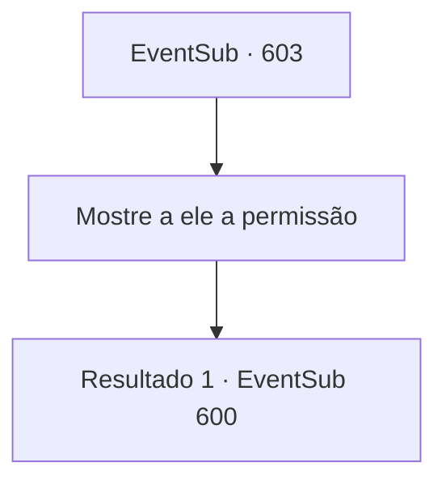

# Eventos secundários · 603

[Índice da tabela](index.md) · [Índice geral](../index.md)

ID: `pt:EventSub:603` · Fonte: `EventSub4` · Versão: 1.2.47.

Mapeamento estático dos arquivos; a disponibilidade e a execução dependem do estado da run.

## Texto do evento

*Sem texto no arquivo.*

## Dados de entrada

```json
{
  "id": 603,
  "grade": 1,
  "subEvent": "",
  "required": ""
}
```

## Mapa das escolhas



## Escolhas e resultados

### Escolha 1

Mostre a ele a permissão

Requisitos e outros campos da escolha:

```json
{
  "required": ""
}
```

#### Resultado 1.1

Você mostra ao guarda o seu documento de entrada falsificado. Depois de olhar para cima e para baixo, ele faz algumas perguntas sobre o documento. Você improvisa e o guarda acena com a cabeça, permitindo que você entre. 

 "Hmph. Você pode entrar."

 O guarda permite que Edenheart passe um dia na biblioteca. Como se estivesse tentando aproveitar cada segundo, Edenheart devora vários volumes e tomos, percorrendo cada página relacionada ao lendário Elixir. Enquanto isso, você passa a noite dormindo em uma cadeira. 

 Você e Edenheart deixam a Biblioteca Real na manhã seguinte. Você pode perceber apenas olhando para o rosto dela que Edenheart não dormiu nem um minuto na noite passada, mas seu rosto está cheio de um sorriso brilhante.

Continuação registrada: [Evento 600](0600.md) na mesma tabela.

```json
{
  "required": "",
  "chance": "1",
  "nextEvent": 600,
  "type": 2,
  "reward": ""
}
```

## Referências que chegam a este evento

- [Evento 602 · escolha 1 · resultado 1](0602.md#escolha-1)
- [Evento 602 · escolha 2 · resultado 1](0602.md#escolha-2)
