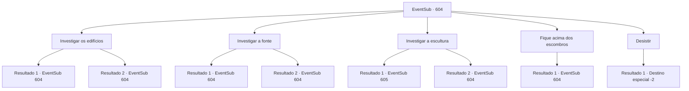

# Eventos secundários · 604

[Índice da tabela](index.md) · [Índice geral](../index.md)

ID: `pt:EventSub:604` · Fonte: `EventSub4` · Versão: 1.2.47.

Mapeamento estático dos arquivos; a disponibilidade e a execução dependem do estado da run.

## Texto do evento

|drawing_Plasphere| No meio da tempestade de areia, as ruínas capturam uma paisagem antiga. Edifícios antiquados construídos com tijolos de pedra esculpidos estão espalhados aqui e ali, uma fonte seca e os destroços de esculturas e cercas quebradas espalhados pelo chão. Isso é, ou era, 'Plasphere', construído aproximadamente mil anos atrás. O que resta são chamadas de 'Ruínas de Plasphere'. 

 "{1}! Aqui! Aqui!"

 Você encontra Edenheart nas ruínas. Ela lhe conta que Plasphere costumava ser um lugar de alquimia e herbalismo, e também o local de nascimento do lendário Elixir. 

 "Deve haver um laboratório em algum lugar, onde eles criaram o primeiro Elixir. Mal posso esperar para encontrá-lo."

 Você e Edenheart exploram as ruínas, procurando pelo laboratório.

## Dados de entrada

```json
{
  "id": 604,
  "grade": 1,
  "subEvent": "",
  "required": "12_10_3"
}
```

## Mapa das escolhas



## Escolhas e resultados

### Escolha 1

Investigar os edifícios

Requisitos e outros campos da escolha:

```json
{
  "required": "5_595_0"
}
```

#### Resultado 1.1

Os prédios ainda permanecem em certa medida intactos, mesmo depois de terem resistido ao teste do tempo. Mas todos estão vazios, presumivelmente saqueados por caçadores de tesouros ou escavadores. Eles estão cheios de móveis quebrados, lixo empoeirado e uma infestação de insetos. Depois de olhar ao redor dos prédios, você retorna a Edenheart e vai embora.

Continuação registrada: [Evento 604](0604.md) na mesma tabela.

```json
{
  "required": "",
  "chance": "1|0_14_1",
  "nextEvent": 604,
  "type": 0,
  "reward": "5_595_1"
}
```

#### Resultado 1.2

Os prédios ainda permanecem em certa medida intactos, mesmo depois de terem resistido ao teste do tempo. Mas todos estão vazios, presumivelmente saqueados por caçadores de tesouros ou escavadores. Incapaz de encontrar algo fora do comum, você retorna a Edenheart e segue em frente.

Continuação registrada: [Evento 604](0604.md) na mesma tabela.

```json
{
  "required": "",
  "chance": "16",
  "nextEvent": 604,
  "type": 1,
  "reward": "5_595_1"
}
```

### Escolha 2

Investigar a fonte

Requisitos e outros campos da escolha:

```json
{
  "required": "5_596_0"
}
```

#### Resultado 2.1

Você se aproxima da fonte no centro das ruínas. A fonte parece ter sido decorada com belos fragmentos há muito tempo, mas agora sua estrutura não pode ser discernida. A água já se foi - a base da fonte está seca e rachada. 

 "Devemos procurar em outro lugar."

 Você concorda com Edenheart, se afastando.

Continuação registrada: [Evento 604](0604.md) na mesma tabela.

```json
{
  "required": "",
  "chance": "1|0_14_1",
  "nextEvent": 604,
  "type": 0,
  "reward": "5_596_1"
}
```

#### Resultado 2.2

Você se aproxima da fonte no centro das ruínas. Além de parecer muito, muito antiga, você não vê nada fora do comum. 

 "Devemos procurar em outro lugar."

 Você concorda com Edenheart, se afastando.

Continuação registrada: [Evento 604](0604.md) na mesma tabela.

```json
{
  "required": "",
  "chance": "16",
  "nextEvent": 604,
  "type": 1,
  "reward": "5_596_1"
}
```

### Escolha 3

Investigar a escultura

Requisitos e outros campos da escolha:

```json
{
  "required": "5_597_0"
}
```

#### Resultado 3.1

Você dá uma olhada na escultura, colocada no canto das ruínas. Além do fato de parecer o rosto de um humano, você não consegue distinguir muito da escultura. Mas então, você instintivamente sente que algo está errado com essa escultura. Você empurra a escultura para longe e encontra algo que não deveria estar ali. É uma porta de pedra redonda e escondida. 

 "{1}! Isso é...!"

 Edenheart solta um suspiro de surpresa. Você cuidadosamente alcança a maçaneta da porta.

Continuação registrada: [Evento 605](0605.md) na mesma tabela.

```json
{
  "required": "",
  "chance": "1|0_14_1",
  "nextEvent": 605,
  "type": 0,
  "reward": ""
}
```

#### Resultado 3.2

Você dá uma olhada na escultura, colocada no canto das ruínas. Além do fato de parecer o rosto de um humano, você não consegue distinguir muito da escultura. 

 "Talvez a classe dominante de uma cidade? Ou talvez, alguém mais...?"

 Você deixa Edenheart em seus pensamentos sombrios e se afasta. Depois de passar alguns segundos em frente à escultura, Edenheart te segue.

Continuação registrada: [Evento 604](0604.md) na mesma tabela.

```json
{
  "required": "",
  "chance": "16",
  "nextEvent": 604,
  "type": 1,
  "reward": "5_597_1"
}
```

### Escolha 4

Fique acima dos escombros

Requisitos e outros campos da escolha:

```json
{
  "required": "5_598_0"
}
```

#### Resultado 4.1


 "Vê alguma coisa?"

 Você se aproxima do monte de destroços, mas não vê nada de interessante. Você balança a cabeça e desce. Você vai embora de mãos vazias.

Continuação registrada: [Evento 604](0604.md) na mesma tabela.

```json
{
  "required": "",
  "chance": "1",
  "nextEvent": 604,
  "type": 2,
  "reward": "5_598_1"
}
```

### Escolha 5

Desistir

Requisitos e outros campos da escolha:

```json
{
  "required": "-1|5_595_1|5_596_1|5_597_1|5_598_1"
}
```

#### Resultado 5.1

Você procurou pelos destroços por muito tempo agora, mas não há nenhum indício do laboratório. Infelizmente, você e Edenheart decidem parar a exploração dos destroços. 

 "*suspiro*... Bem, lá se vai o laboratório..."

 Edenheart faz o possível para esconder a decepção de seu rosto, então diz que irá retornar a Mavelaine. Parece que ela continuará sua pesquisa individualmente lá. Vocês se separam de Edenheart e deixam as Ruínas de Plasphere.

Continuação registrada: [Destino especial `-2`](../destinos-especiais.md).

```json
{
  "required": "",
  "chance": "1",
  "nextEvent": -2,
  "type": 2,
  "reward": "12_10_10"
}
```

## Referências que chegam a este evento

- [Evento 604 · escolha 1 · resultado 1](0604.md#escolha-1)
- [Evento 604 · escolha 1 · resultado 2](0604.md#escolha-1)
- [Evento 604 · escolha 2 · resultado 1](0604.md#escolha-2)
- [Evento 604 · escolha 2 · resultado 2](0604.md#escolha-2)
- [Evento 604 · escolha 3 · resultado 2](0604.md#escolha-3)
- [Evento 604 · escolha 4 · resultado 1](0604.md#escolha-4)
