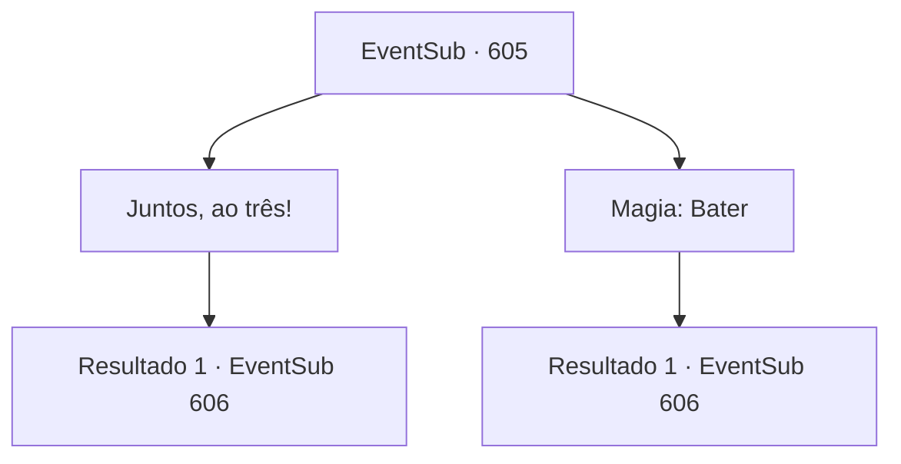

# Eventos secundários · 605

[Índice da tabela](index.md) · [Índice geral](../index.md)

ID: `pt:EventSub:605` · Fonte: `EventSub4` · Versão: 1.2.47.

Mapeamento estático dos arquivos; a disponibilidade e a execução dependem do estado da run.

## Texto do evento

*Sem texto no arquivo.*

## Dados de entrada

```json
{
  "id": 605,
  "grade": 1,
  "subEvent": "",
  "required": ""
}
```

## Mapa das escolhas



## Escolhas e resultados

### Escolha 1

Juntos, ao três!

Requisitos e outros campos da escolha:

```json
{
  "required": ""
}
```

#### Resultado 1.1

Você e Edenheart cooperam, puxando a porta aberta. A porta de pedra se abriu, revelando uma escada que leva a um porão. Você desce cuidadosamente as escadas. Ao chegar ao final da escada, você encontra um corredor escuro e úmido. Está coberto de pedras vermelhas, com sinais e desenhos esotéricos preenchendo as paredes. Escritas no chão estão letras misteriosas que você não consegue entender, emitindo uma luz fraca, como se fossem um grupo de vaga-lumes.

Continuação registrada: [Evento 606](0606.md) na mesma tabela.

```json
{
  "required": "",
  "chance": "1",
  "nextEvent": 606,
  "type": 2,
  "reward": ""
}
```

### Escolha 2

Magia: Bater

Requisitos e outros campos da escolha:

```json
{
  "required": "20_0_1"
}
```

#### Resultado 2.1

Você lança um feitiço para abrir magicamente a porta de pedra. A porta de pedra finalmente se abre, revelando uma escada que leva a um porão. Você desce cuidadosamente as escadas. Ao chegar ao final da escada, você encontra um corredor escuro e úmido. Está coberto de pedras vermelhas, com sinais e desenhos esotéricos preenchendo as paredes. Escritas no chão estão letras misteriosas que você não consegue entender, emitindo uma luz fraca, como se fossem um grupo de vaga-lumes.

Continuação registrada: [Evento 606](0606.md) na mesma tabela.

```json
{
  "required": "",
  "chance": "1",
  "nextEvent": 606,
  "type": 2,
  "reward": ""
}
```

## Referências que chegam a este evento

- [Evento 604 · escolha 3 · resultado 1](0604.md#escolha-3)
