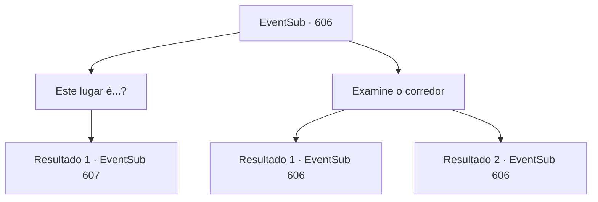

# Eventos secundários · 606

[Índice da tabela](index.md) · [Índice geral](../index.md)

ID: `pt:EventSub:606` · Fonte: `EventSub4` · Versão: 1.2.47.

Mapeamento estático dos arquivos; a disponibilidade e a execução dependem do estado da run.

## Texto do evento

*Sem texto no arquivo.*

## Dados de entrada

```json
{
  "id": 606,
  "grade": 1,
  "subEvent": "",
  "required": ""
}
```

## Mapa das escolhas



## Escolhas e resultados

### Escolha 1

Este lugar é...?

Requisitos e outros campos da escolha:

```json
{
  "required": ""
}
```

#### Resultado 1.1

Com a luz vinda da carta no chão, uma fonte de luz adicional não era necessária. 

 "Essas marcações e desenhos... E as letras no chão... Isso deve ser o que vi nos roteiros!"

 Edenheart acrescenta que mesmo nos tempos antigos, a receita de um Elixir era mantida confidencial. Sua voz está mais alta do que o normal, provavelmente animada. 

 "Vamos, agora!"


Continuação registrada: [Evento 607](0607.md) na mesma tabela.

```json
{
  "required": "",
  "chance": "1",
  "nextEvent": 607,
  "type": 2,
  "reward": ""
}
```

### Escolha 2

Examine o corredor

Requisitos e outros campos da escolha:

```json
{
  "required": "5_599_0"
}
```

#### Resultado 2.1

Você examina cuidadosamente o corredor, procurando por qualquer coisa relacionada a letras antigas em suas memórias. Você se lembra que na maioria dos laboratórios antigos, algo como o princípio fundador ou a razão da fundação está escrito em seus corredores. Portanto, se os sinais, desenhos e as letras estão relacionados ao Elixir, este deve ser um laboratório de Elixir. Então, você encontra uma palavra antiga que diz 'Cuidado com as armadilhas'.

Continuação registrada: [Evento 606](0606.md) na mesma tabela.

```json
{
  "required": "",
  "chance": "1|0_7_1",
  "nextEvent": 606,
  "type": 0,
  "reward": "5_599_1"
}
```

#### Resultado 2.2

Você examina cuidadosamente o corredor, procurando por qualquer coisa relacionada a letras antigas em suas memórias. Mas tudo o que você consegue descobrir é que este corredor tem um cheiro úmido, vindo da quantidade de poeira.

Continuação registrada: [Evento 606](0606.md) na mesma tabela.

```json
{
  "required": "",
  "chance": "15",
  "nextEvent": 606,
  "type": 1,
  "reward": "5_599_2"
}
```

## Referências que chegam a este evento

- [Evento 605 · escolha 1 · resultado 1](0605.md#escolha-1)
- [Evento 605 · escolha 2 · resultado 1](0605.md#escolha-2)
- [Evento 606 · escolha 2 · resultado 1](0606.md#escolha-2)
- [Evento 606 · escolha 2 · resultado 2](0606.md#escolha-2)
