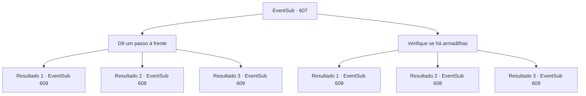

# Eventos secundários · 607

[Índice da tabela](index.md) · [Índice geral](../index.md)

ID: `pt:EventSub:607` · Fonte: `EventSub4` · Versão: 1.2.47.

Mapeamento estático dos arquivos; a disponibilidade e a execução dependem do estado da run.

## Texto do evento

*Sem texto no arquivo.*

## Dados de entrada

```json
{
  "id": 607,
  "grade": 1,
  "subEvent": "",
  "required": ""
}
```

## Mapa das escolhas



## Escolhas e resultados

### Escolha 1

Dê um passo à frente

Requisitos e outros campos da escolha:

```json
{
  "required": "18_599_1"
}
```

#### Resultado 1.1

Você entra no corredor escuro. O corredor é de sentido único - um caminho direto. Após cerca de dez minutos de caminhada, você sente algo estranho sob seus pés. Você avista um único azulejo, ligeiramente diferente dos outros ao redor. Você assume que deve ser uma armadilha. Você evita o azulejo estranho e continua em frente. Após cerca de trinta minutos de caminhada, você chega a um amplo salão. No centro do salão há um golem de pedra, parado ali como uma decoração, e no teto você vê uma luz estranha, parecida com um lustre. 

 "Intruso detectado. Visitante não autorizado. Iniciar ataque."

 Assim que você pisa no salão, o golem de pedra levanta os punhos para atacar.

Continuação registrada: [Evento 609](0609.md) na mesma tabela.

```json
{
  "required": "21_25_2",
  "chance": "1|0_14_1",
  "nextEvent": 609,
  "type": 0,
  "reward": "6_0_15",
  "place": 7
}
```

#### Resultado 1.2

Você entra no corredor escuro. O corredor é de sentido único - um caminho direto. Após cerca de dez minutos de caminhada, você sente algo estranho sob seus pés. Então, uma enorme pedra cai do teto, rolando em sua direção e em direção a Edenheart em uma velocidade cegante. 

 "AHHH! Uma armadilha!"

 Edenheart grita de medo ao ver a pedra.

Continuação registrada: [Evento 608](0608.md) na mesma tabela.

```json
{
  "required": "21_25_2",
  "chance": "16",
  "nextEvent": 608,
  "type": 1,
  "reward": ""
}
```

#### Resultado 1.3

Você entra no corredor escuro. O corredor é de sentido único - um caminho direto. Após cerca de dez minutos de caminhada, você sente algo estranho sob seus pés. Você avista um único azulejo, ligeiramente diferente dos outros ao redor. Você assume que deve ser uma armadilha. Você evita o azulejo estranho e continua em frente. Após cerca de trinta minutos de caminhada, você chega a um amplo salão. No centro do salão há um golem de pedra, parado ali como uma decoração, e no teto você vê uma luz estranha, parecida com um lustre. 

 "Intruso detectado. Visitante não autorizado. Iniciar ataque."

 Assim que você pisa no salão, o golem de pedra levanta os punhos para atacar.

Continuação registrada: [Evento 609](0609.md) na mesma tabela.

```json
{
  "required": "20_25_2",
  "chance": "1",
  "nextEvent": 609,
  "type": 2,
  "reward": "6_0_15",
  "place": 7
}
```

### Escolha 2

Verifique se há armadilhas

Requisitos e outros campos da escolha:

```json
{
  "required": "5_599_1"
}
```

#### Resultado 2.1

Você caminha cuidadosamente pelo corredor, verificando armadilhas. Você avista um único azulejo, elevado em uma altura ligeiramente diferente. Você assume que deve ser uma armadilha. Evitando o azulejo estranho, você consegue chegar ao final do corredor em segurança. Você e Edenheart chegam a um salão amplo. No centro do salão há um golem de pedra, lá parado como uma decoração, e no teto você vê uma luz estranha, parecida com um lustre. 

 "Intruso detectado. Visitante não autorizado. Iniciar ataque."

 Assim que você pisa no salão, o golem de pedra levanta os punhos para atacar.

Continuação registrada: [Evento 609](0609.md) na mesma tabela.

```json
{
  "required": "21_25_2",
  "chance": "1|0_14_1",
  "nextEvent": 609,
  "type": 0,
  "reward": "6_0_15",
  "place": 7
}
```

#### Resultado 2.2

Você caminha cuidadosamente pelo corredor, verificando armadilhas. O corredor é de sentido único - um caminho direto. Após cerca de dez minutos de caminhada, você sente algo estranho sob seus pés. Então, uma enorme pedra cai do teto, rolando em sua direção e em direção a Edenheart em uma velocidade cegante. 

 "AHHH! Uma armadilha!"

 Edenheart grita de medo ao ver a pedra.

Continuação registrada: [Evento 608](0608.md) na mesma tabela.

```json
{
  "required": "21_25_2",
  "chance": "8",
  "nextEvent": 608,
  "type": 1,
  "reward": ""
}
```

#### Resultado 2.3

Você caminha cuidadosamente pelo corredor, verificando armadilhas. Você avista um único azulejo, elevado em uma altura ligeiramente diferente. Você assume que deve ser uma armadilha. Evitando o azulejo estranho, você consegue chegar ao final do corredor em segurança. Você e Edenheart chegam a um salão amplo. No centro do salão há um golem de pedra, lá parado como uma decoração, e no teto você vê uma luz estranha, parecida com um lustre. 

 "Intruso detectado. Visitante não autorizado. Iniciar ataque."

 Assim que você pisa no salão, o golem de pedra levanta os punhos para atacar.

Continuação registrada: [Evento 609](0609.md) na mesma tabela.

```json
{
  "required": "20_25_2",
  "chance": "1",
  "nextEvent": 609,
  "type": 2,
  "reward": "6_0_15",
  "place": 7
}
```

## Referências que chegam a este evento

- [Evento 606 · escolha 1 · resultado 1](0606.md#escolha-1)
