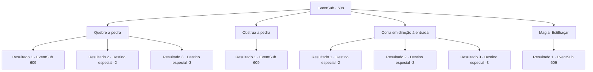

# Eventos secundários · 608

[Índice da tabela](index.md) · [Índice geral](../index.md)

ID: `pt:EventSub:608` · Fonte: `EventSub4` · Versão: 1.2.47.

Mapeamento estático dos arquivos; a disponibilidade e a execução dependem do estado da run.

## Texto do evento

*Sem texto no arquivo.*

## Dados de entrada

```json
{
  "id": 608,
  "grade": 1,
  "subEvent": "",
  "required": ""
}
```

## Mapa das escolhas



## Escolhas e resultados

### Escolha 1

Quebre a pedra

Requisitos e outros campos da escolha:

```json
{
  "required": ""
}
```

#### Resultado 1.1

Você atinge a pedra rolante, destruindo-a. A pedra - ou os pedaços restantes dela - está no chão imóvel. 

 "Huh... Incrível. Você realmente destruiu uma pedra rolante..."

 Você pega Edenheart, ainda chocado com o que conseguiu fazer, e continua pelo corredor. Você e Edenheart chegam a um salão amplo. No centro do salão há um golem de pedra, parado ali como uma decoração, e no teto você vê uma luz estranha, parecida com um lustre. 

 "Intruso detectado. Visitante não autorizado. Iniciar ataque."

 Assim que você pisa no salão, o golem de pedra levanta os punhos para atacar.

Continuação registrada: [Evento 609](0609.md) na mesma tabela.

```json
{
  "required": "",
  "chance": "1|0_5_1",
  "nextEvent": 609,
  "type": 0,
  "reward": "6_0_15",
  "place": 7
}
```

#### Resultado 1.2

Tentas atingir a pedra rolante, destruindo-a. Mas a tua força inadequada não consegue fazê-lo. Os dois são perseguidos pelo corredor pela pedra rolante. A pedra finalmente para de se mover quando bate numa coluna dentro do laboratório. 

 <link=shake>'BBBBRRRGH! RRRRG!' </link> 

 Incapaz de resistir ao choque, o laboratório inteiro desmorona. A falta de manutenção deve ter deixado a estrutura frágil. Escapando por pouco do enterro, Edenheart olha para o laboratório destruído e solta um longo suspiro. 

 "*suspiro*... Bem, lá se vai o laboratório..."

 Edenheart faz o seu melhor para esconder a decepção do seu rosto, e depois diz que vai voltar para Mavelaine. Parece que ela vai continuar a sua pesquisa individualmente lá. Separas-te de Edenheart e deixas as Ruínas de Plasphere.

Continuação registrada: [Destino especial `-2`](../destinos-especiais.md).

```json
{
  "required": "1_0_2",
  "chance": "14",
  "nextEvent": -2,
  "type": 1,
  "reward": "0_0_-1|12_10_10"
}
```

#### Resultado 1.3

Tentas atingir a pedra rolante, destruindo-a. Mas a tua força inadequada não consegue fazê-lo. És esmagado pela pedra - encontras a tua morte.

Continuação registrada: [Destino especial `-3`](../destinos-especiais.md).

```json
{
  "required": "2_0_2",
  "chance": "14",
  "nextEvent": -3,
  "type": 1,
  "reward": "0_0_-1"
}
```

### Escolha 2

Obstrua a pedra

Requisitos e outros campos da escolha:

```json
{
  "required": "20_9_2"
}
```

#### Resultado 2.1

Você bloqueia a pedra rolante. Perdendo seu momentum, a pedra fica parada no meio do corredor. 

 "Huh... Incrível. Você realmente parou uma pedra rolante..."

 Você e Edenheart passam pela estreita abertura entre a pedra e as paredes, continuando pelo corredor. Você e Edenheart chegam a um salão amplo. No centro do salão há um golem de pedra, parado ali como uma decoração, e no teto você vê uma luz estranha, parecida com um lustre. 

 "Intruso detectado. Visitante não autorizado. Iniciar ataque."

 Assim que você pisa no salão, o golem de pedra levanta os punhos para atacar.

Continuação registrada: [Evento 609](0609.md) na mesma tabela.

```json
{
  "required": "",
  "chance": "1",
  "nextEvent": 609,
  "type": 2,
  "reward": "6_0_15",
  "place": 7
}
```

### Escolha 3

Corra em direção à entrada

Requisitos e outros campos da escolha:

```json
{
  "required": ""
}
```

#### Resultado 3.1

Você foge para fora, correndo para longe da pedra rolante. Edenheart, também, rapidamente segue você para fora, fazendo esforços para não ficar para trás. A pedra finalmente para de se mover quando bate em uma coluna dentro do laboratório. 

 <link=shake>'BBBBRRRGH! RRRRG!' </link> 

 Incapaz de resistir ao choque, o laboratório inteiro desmorona. A falta de manutenção deve ter deixado a estrutura frágil. Escapando por pouco do enterro, Edenheart olha para o laboratório destruído e solta um longo suspiro. 

 "*suspiro*... Bem, lá se vai o laboratório..."

 Edenheart faz o possível para esconder a decepção de seu rosto, então diz que vai voltar para Mavelaine. Parece que ela continuará sua pesquisa individualmente lá. Você se despede de Edenheart e deixa as Ruínas de Plasphere.

Continuação registrada: [Destino especial `-2`](../destinos-especiais.md).

```json
{
  "required": "",
  "chance": "1|0_6_1",
  "nextEvent": -2,
  "type": 0,
  "reward": "12_10_10"
}
```

#### Resultado 3.2

Você foge para fora, correndo para longe da pedra rolante. Você torce o tornozelo no processo, mas consegue cobrir uma distância suficiente. Edenheart, também, rapidamente segue você para fora, fazendo esforços para não ficar para trás. A pedra finalmente para de se mover quando bate em uma coluna dentro do laboratório. 

 <link=shake>'BBBBRRRGH! RRRRG!' </link> 

 Incapaz de resistir ao choque, o laboratório inteiro desmorona. A falta de manutenção deve ter deixado a estrutura frágil. Escapando por pouco do enterro, Edenheart olha para o laboratório destruído e solta um longo suspiro. 

 "*suspiro*... Bem, lá se vai o laboratório..."

 Edenheart faz o possível para esconder a decepção de seu rosto, então diz que vai voltar para Mavelaine. Parece que ela continuará sua pesquisa individualmente lá. Você se despede de Edenheart e deixa as Ruínas de Plasphere.

Continuação registrada: [Destino especial `-2`](../destinos-especiais.md).

```json
{
  "required": "1_0_2",
  "chance": "14",
  "nextEvent": -2,
  "type": 1,
  "reward": "0_0_-1|12_10_10"
}
```

#### Resultado 3.3

Tentas fugir para fora, correndo para longe da pedra rolante. Mas a pedra é mais rápida do que tu, e és esmagado(a) completamente.

Continuação registrada: [Destino especial `-3`](../destinos-especiais.md).

```json
{
  "required": "2_0_2",
  "chance": "14",
  "nextEvent": -3,
  "type": 1,
  "reward": "0_0_-1"
}
```

### Escolha 4

Magia: Estilhaçar

Requisitos e outros campos da escolha:

```json
{
  "required": "20_0_2|1_1_2"
}
```

#### Resultado 4.1

Você conjura Shatter, destruindo a pedra. A pedra - ou as peças restantes dela - está no chão imóvel. 

 "Huh... Incrível. Você realmente destruiu uma pedra rolando..."

 Você pega Edenheart, ainda chocado com o que conseguiu fazer, e continua pelo corredor. Você e Edenheart chegam a um salão amplo. No centro do salão há um golem de pedra, parado ali como uma decoração, e no teto você vê uma luz estranha, parecida com um lustre. 

 "Intruso detectado. Visitante não autorizado. Iniciar ataque."

 Assim que você pisa no salão, o golem de pedra levanta os punhos para atacar.

Continuação registrada: [Evento 609](0609.md) na mesma tabela.

```json
{
  "required": "",
  "chance": "1",
  "nextEvent": 609,
  "type": 2,
  "reward": "6_0_15",
  "place": 7
}
```

## Referências que chegam a este evento

- [Evento 607 · escolha 1 · resultado 2](0607.md#escolha-1)
- [Evento 607 · escolha 2 · resultado 2](0607.md#escolha-2)
