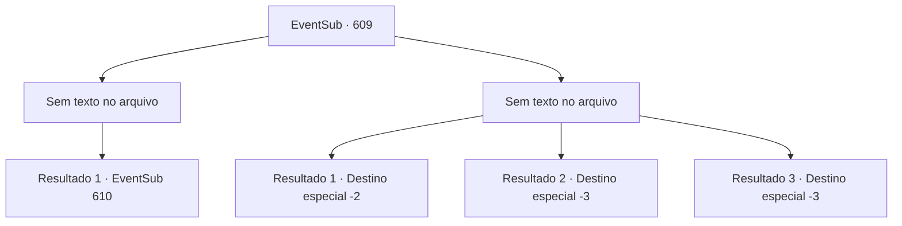

# Eventos secundários · 609

[Índice da tabela](index.md) · [Índice geral](../index.md)

ID: `pt:EventSub:609` · Fonte: `EventSub4` · Versão: 1.2.47.

Mapeamento estático dos arquivos; a disponibilidade e a execução dependem do estado da run.

## Texto do evento

*Sem texto no arquivo.*

## Dados de entrada

```json
{
  "id": 609,
  "grade": 1,
  "subEvent": "",
  "required": ""
}
```

## Mapa das escolhas



## Escolhas e resultados

### Escolha 1

*Sem texto no arquivo; o papel dessa opção depende da interface do jogo.*

Requisitos e outros campos da escolha:

```json
{
  "required": ""
}
```

#### Resultado 1.1

Você passa pelo golem de pedra desmoronado e entra no laboratório mais interno. É um lugar distintivo, dividido em duas partes. Um lado tem uma estante cheia de vários roteiros, enquanto o outro é adornado com uma mesa de pedra e instrumentos usados na alquimia. Você e Edenheart investigam o local. Edenheart fala animadamente, vasculhando o laboratório, como se tivesse descoberto um tesouro perdido há muito tempo. 

 "Ah...! Estes são exatamente os que eu li nos roteiros! Graças aos deuses, eles ainda estão aqui."

 Mas então, um grupo de homens aparece do corredor. A maioria deles parece aventureiros, cada um usando um conjunto combinando de capas com símbolos familiares. Um homem de meia-idade com um impressionante bigode e um corpo curto e gordo dá um passo à frente. |drawing_Osborne| 

 "Eu mesmo estava procurando o Elixir, e pensar que estou atrasado para a festa... Eu, Osborne, o vice-presidente da guilda de comerciantes Veneprada, agradeço. Agora, vamos cuidar das coisas daqui, então por que vocês não saem quietos?"

 Edenheart tenta retrucar, mas tudo o que Osborne faz é zombar. Os aventureiros ao redor de Osborne alcançam suas armas, como se estivessem tentando intimidá-los.

Continuação registrada: [Evento 610](0610.md) na mesma tabela.

```json
{
  "required": "",
  "chance": "1",
  "nextEvent": 610,
  "type": 2,
  "reward": ""
}
```

### Escolha 2

*Sem texto no arquivo; o papel dessa opção depende da interface do jogo.*

Requisitos e outros campos da escolha:

```json
{
  "required": ""
}
```

#### Resultado 2.1

Você não tem escolha a não ser fugir do laboratório, derrotado pelo golem de pedra. Felizmente, o golem de pedra não te persegue mais. Alguns segundos depois, Edenheart solta um longo suspiro, olhando para a entrada do laboratório. Edenheart faz o possível para esconder a decepção do seu rosto, então diz que vai voltar para Mavelaine. Parece que ela vai continuar sua pesquisa individualmente lá. Vocês se separam de Edenheart e deixam as Ruínas de Plasphere.

Continuação registrada: [Destino especial `-2`](../destinos-especiais.md).

```json
{
  "required": "1_0_2|1_1_2",
  "chance": "1",
  "nextEvent": -2,
  "type": 2,
  "reward": "0_0_-1|0_1_-1|12_10_10"
}
```

#### Resultado 2.2

O golem de pedra te golpeia com seus punhos de pedra pesados. Seu corpo se despedaça em pedaços.

Continuação registrada: [Destino especial `-3`](../destinos-especiais.md).

```json
{
  "required": "2_0_2",
  "chance": "1",
  "nextEvent": -3,
  "type": 2,
  "reward": "0_0_-1|0_1_-1"
}
```

#### Resultado 2.3

O golem de pedra te golpeia com seus punhos de pedra pesados. Seu corpo se despedaça em pedaços.

Continuação registrada: [Destino especial `-3`](../destinos-especiais.md).

```json
{
  "required": "2_1_2",
  "chance": "1",
  "nextEvent": -3,
  "type": 2,
  "reward": "0_0_-1|0_1_-1"
}
```

## Referências que chegam a este evento

- [Evento 607 · escolha 1 · resultado 1](0607.md#escolha-1)
- [Evento 607 · escolha 1 · resultado 3](0607.md#escolha-1)
- [Evento 607 · escolha 2 · resultado 1](0607.md#escolha-2)
- [Evento 607 · escolha 2 · resultado 3](0607.md#escolha-2)
- [Evento 608 · escolha 1 · resultado 1](0608.md#escolha-1)
- [Evento 608 · escolha 2 · resultado 1](0608.md#escolha-2)
- [Evento 608 · escolha 4 · resultado 1](0608.md#escolha-4)
