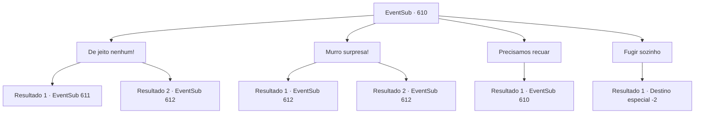

# Eventos secundários · 610

[Índice da tabela](index.md) · [Índice geral](../index.md)

ID: `pt:EventSub:610` · Fonte: `EventSub4` · Versão: 1.2.47.

Mapeamento estático dos arquivos; a disponibilidade e a execução dependem do estado da run.

## Texto do evento

*Sem texto no arquivo.*

## Dados de entrada

```json
{
  "id": 610,
  "grade": 1,
  "subEvent": "",
  "required": ""
}
```

## Mapa das escolhas



## Escolhas e resultados

### Escolha 1

De jeito nenhum!

Requisitos e outros campos da escolha:

```json
{
  "required": ""
}
```

#### Resultado 1.1

Os aventureiros franzem a testa em resposta, aproximando-se. Mas então, Osborne levanta a mão para detê-los e faz uma sugestão. 

 "Ouvi dizer que você é um aventureiro famoso, não é? Na verdade, estou disposto a lhe dar 300 ouros se você apenas se afastar. O que acha?"

 Ao ouvir essa sugestão, Edenheart olha para você preocupado. 

 "Eu... Eu não posso desistir do Elixir. Não aqui. Por favor... Eu preciso da sua ajuda."


Continuação registrada: [Evento 611](0611.md) na mesma tabela.

```json
{
  "required": "1_2_50",
  "chance": "1",
  "nextEvent": 611,
  "type": 2,
  "reward": ""
}
```

#### Resultado 1.2

Os aventureiros franzem a testa em resposta, se aproximando.  Eles rapidamente te cercam, cada um levantando suas armas.

Continuação registrada: [Evento 612](0612.md) na mesma tabela.

```json
{
  "required": "2_2_50",
  "chance": "1",
  "nextEvent": 612,
  "type": 2,
  "reward": "6_0_62",
  "place": 7
}
```

### Escolha 2

Murro surpresa!

Requisitos e outros campos da escolha:

```json
{
  "required": ""
}
```

#### Resultado 2.1

Você ataca rapidamente Osborne. Surpresos com a agressão repentina, os aventureiros vêm ajudar Osborne. Você aproveita a oportunidade e continua o ataque.

Continuação registrada: [Evento 612](0612.md) na mesma tabela.

```json
{
  "required": "",
  "chance": "1|0_6_1",
  "nextEvent": 612,
  "type": 0,
  "reward": "6_0_62",
  "place": 7
}
```

#### Resultado 2.2

Você ataca rapidamente Osborne. Mas os aventureiros respondem rapidamente, bloqueando seu ataque e cercando os dois. 

 "Hmph. Como você desejar, então. Mate-os!"

 Com a ordem de Osborne, os aventureiros formam uma formação e começam seu ataque.

Continuação registrada: [Evento 612](0612.md) na mesma tabela.

```json
{
  "required": "",
  "chance": "14",
  "nextEvent": 612,
  "type": 1,
  "reward": "6_3_62",
  "place": 7
}
```

### Escolha 3

Precisamos recuar

Requisitos e outros campos da escolha:

```json
{
  "required": "5_608_0"
}
```

#### Resultado 3.1

Edenheart recusa firmemente. 

 "Você sabe tão bem quanto eu, {1}! A vida de Fheren está em jogo! Ainda assim, você deseja recuar? Vá sozinho, então."


Continuação registrada: [Evento 610](0610.md) na mesma tabela.

```json
{
  "required": "",
  "chance": "1",
  "nextEvent": 610,
  "type": 2,
  "reward": "5_608_1"
}
```

### Escolha 4

Fugir sozinho

Requisitos e outros campos da escolha:

```json
{
  "required": "5_608_1"
}
```

#### Resultado 4.1

Você sai de Edenheart, saindo do laboratório. Osborne mais uma vez propõe que Edenheart saia quietamente, mas ela se recusa, oferecendo a resistência que pode. Osborne suspira baixinho e fala. 

 "Tudo bem, então. Como você desejar."

 Com um leve levantar de queixo de Osborne, os aventureiros cercam Edenheart e balançam suas armas. A resistência de Edenheart é interrompida em questão de minutos. 

 "Agora, peguem tudo."

 Os aventureiros começam a vasculhar o laboratório, e você sai das ruínas para sempre.

Continuação registrada: [Destino especial `-2`](../destinos-especiais.md).

```json
{
  "required": "",
  "chance": "1",
  "nextEvent": -2,
  "type": 2,
  "reward": "12_10_7"
}
```

## Referências que chegam a este evento

- [Evento 609 · escolha 1 · resultado 1](0609.md#escolha-1)
- [Evento 610 · escolha 3 · resultado 1](0610.md#escolha-3)
