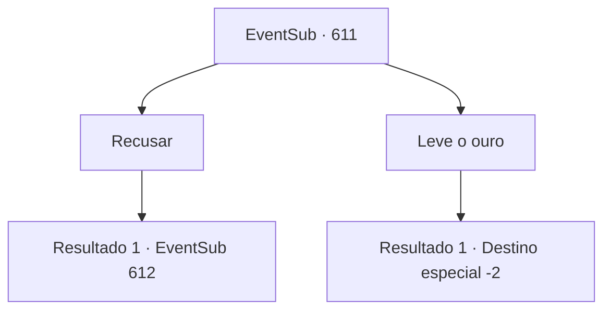

# Eventos secundários · 611

[Índice da tabela](index.md) · [Índice geral](../index.md)

ID: `pt:EventSub:611` · Fonte: `EventSub4` · Versão: 1.2.47.

Mapeamento estático dos arquivos; a disponibilidade e a execução dependem do estado da run.

## Texto do evento

*Sem texto no arquivo.*

## Dados de entrada

```json
{
  "id": 611,
  "grade": 1,
  "subEvent": "",
  "required": ""
}
```

## Mapa das escolhas



## Escolhas e resultados

### Escolha 1

Recusar

Requisitos e outros campos da escolha:

```json
{
  "required": ""
}
```

#### Resultado 1.1

Você recusa a oferta de Osborne. Osborne franze a testa, em seguida, faz um gesto para os aventureiros atacarem. 

 "Hmph. Como desejar, então. Mate-os!"

 Os aventureiros cercam você e Edenheart em um instante, e então começam a atacar.

Continuação registrada: [Evento 612](0612.md) na mesma tabela.

```json
{
  "required": "",
  "chance": "1",
  "nextEvent": 612,
  "type": 2,
  "reward": "6_3_62",
  "place": 7
}
```

### Escolha 2

Leve o ouro

Requisitos e outros campos da escolha:

```json
{
  "required": ""
}
```

#### Resultado 2.1

Você pega o ouro e sai do laboratório. Osborne mais uma vez propõe que Edenheart saia quietamente, mas ela se recusa, oferecendo a resistência que pode. Osborne suspira baixinho e fala. 

 "Tudo bem, então. Como você desejar."

 Com um leve levantar de queixo de Osborne, os aventureiros cercam Edenheart e balançam suas armas. A resistência de Edenheart é interrompida em minutos. 

 "Agora, peguem tudo."

 Os aventureiros começam a vasculhar o laboratório, e vocês deixam as ruínas para sempre.

Continuação registrada: [Destino especial `-2`](../destinos-especiais.md).

```json
{
  "required": "",
  "chance": "1",
  "nextEvent": -2,
  "type": 2,
  "reward": "0_4_300|12_10_7"
}
```

## Referências que chegam a este evento

- [Evento 610 · escolha 1 · resultado 1](0610.md#escolha-1)
